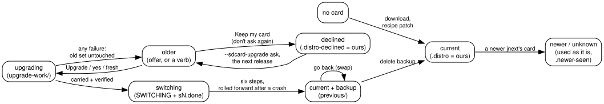

# 3.8.1 The SD card set

The default SD card is not one file but a set kept beside it under `~/.jnext/sdcard/` (or
`$JNEXT_CONFIG_DIR/sdcard/`). This page describes the set, how a card is compared with the card it
was made from, how an upgrade carries the user's files over, the rescue commands, the image lock, the
start-up error box and the browser's counterpart. The sources are `src/core/sdcard_provisioner.cpp`
(policy, download), `sdcard_upgrade.cpp` (carry-over and switch), `sdcard_backup.cpp` (the backup),
`sdcard_carry.cpp` (the comparison engine and the rescue verbs), `image_lock.cpp` and
`src/platform/startup_report.cpp`.

## On-disk layout

| File | Content | Written by |
|---|---|---|
| `cspect-next-1gb-fixed.img` | the user's card | the provisioner, then the guest |
| `cspect-next-1gb.img` | the original distribution image the card was made from | the provisioner |
| `<card>.distro`, `<raw>.distro` | the distribution (zip name) of each; none means 24.11 | the provisioner |
| `<card>.recipe` | the recipe number that made the card; none means 1 | the provisioner |
| `<raw>.sha256` | the original's SHA-256 | the provisioner |
| `<card>.distro-declined` | the release whose offer was turned down for good | the offer, `--sdcard-upgrade never` |
| `<card>.newer-seen` | the newer distribution a notice was shown for | the provisioner |
| `overlays.list` | absolute paths of the `--sdcard-writes` files used with the default card | `bind_card_writes` |
| `previous/` | the backup: the old card, raw, sidecars; `overlays/` with a `LIST` of tag and path; `upgrade-report.txt` | the upgrade, go back |
| `upgrade-work/` | scratch: the new raw and card, `old-as-made.img`, `new-as-made.img`, `report.txt`, `SWITCHING` and the `sN.done` marks | the upgrade |
| `go-back-work/` | the swap's scratch, `SWAPPING` and the `gN.done` marks | go back |
| `<state dir>/locks/<hash>.lock` | the image lock files | `image_lock.cpp` |
| `test-suite/` | the harness's own card; owned by the test suites, never by a user | the harness |

## Identifying a version

A distribution is the file name of its zip. `distribution_of_url` takes it from the address,
`backup::compare_distributions` orders two (the numbers of `sn-emulator-<N>(.<N>)*<letter>?.zip`
component by component, then the letter; a name it cannot parse is unknown), and the recipe number
orders cards made by different recipes. A card of a newer distribution, an unknown one or a newer
recipe is used as it is: no offer, a warning in the log and one notice for each distribution
(`<card>.newer-seen`). A card with no sidecars is a 24.11 card at recipe 1.

## The comparison

`carry::pristine_base_ok` says whether a card can be compared with the card as it was made: the
original exists and matches its `.sha256`, both `.distro` agree, the recipe is known and, for recipe 3,
the volume serial is the one the original's hash gives. `rebuild_as_made` copies the original (sparse)
and runs the recipe (`patch_image_for_recipe`) to rebuild the card as it was made, exactly, FatFs's own
metadata included. Cards are read through ChaN FatFs on two volumes at once (`FF_VOLUMES` 2: drive 0
and drive 1; a read-only attach never writes), or, for an under-clustered distribution image FatFs
refuses, through the hand-rolled reader (`open_tree_lenient`, always on drive 1).

"Changed" means a different type, size, content or R/H/S attribute; not the archive bit, a date, the 8.3
name, a case-only rename or the volume label. There are two layers: the direct one (the card against the
rebuilt original) and, for each writes file, the overlay one (the card seen through the file against the
card). Two properties of FAT shape the walk: a name that ends in a space or a dot cannot be addressed
through FatFs (`Entry::unaddressable`: listed, never compared, carried or exported), and an 8.3 name
that a long name's generated short name would collide with must be written first (`write_order`).

## The carry-over

`decide` takes the user's changes and what the distribution changed at the same paths (the new card as
made against the rebuilt original) and decides per path: a deletion is never carried (it is listed when
the new card has the path); a path the distribution also changed, or holds with the other type, or whose
parent is a file there, is the distribution's (listed as replaced); the rest is carried. `apply_carry`
is the low-level writer (not `add_to_image`: it keeps attributes and dates, and writes names exactly):
space is checked before writing, parents are made as needed, a failure removes what it created.
`verify_carry` then checks that the carried paths equal their sources and that nothing else differs
from the new card as made (the parents the carry made count as carried).

Overlays are rebuilt as `FILE.new`, bound to the new card's final size and modification time (the new
card is not written after that), by writing the overlay layer through a journal over the new card; the
esxDOS stand-in's kept-file record is copied. Writes files are read for the list (`overlays.list`,
`usable_overlays`) from their headers only: binding a file registers it as the card's write target and
compacts it, which a start that merely makes an offer must not do.

## The switch, atomicity and the backup

Everything is made inside `upgrade-work/`; the old card, raw and overlays are only read until the
switch. `SWITCHING` (written under another name and renamed) holds the plan, and six idempotent steps
follow, each marked by `sN.done`: the old set and a copy of the overlays into `previous.new/`; the new
raw with its sidecars (a card is never in place without the raw it was made from); the new card with
its sidecars; each `FILE.new` over its `FILE` (a fresh start removes the file instead); the old
`previous/` removed and `previous.new/` renamed to it; the report copied and `upgrade-work/` removed.
`upgrade::recover` runs at the start of every provisioning, under the lock: with `SWITCHING` it rolls
forward, without it it deletes the scratch. Before the first step any failure removes the scratch and
the run goes on with the old card. `backup::go_back` is the same shape (four steps in `go-back-work/`) and
swaps the two sets; `delete_backup` removes `previous/` only. Before step 1 every writes file the backup
holds is checked against the path it is to be restored to: a missing folder is made, and a path nothing can
be written to refuses the go back with the set exactly as it was (exit 3 and the box are then true).
After step 1 the swap must always be able to finish: a restore target that became unwritable only keeps
the file's copy in the new `previous/overlays/` under an `unrestored-` name and logs where it is. The
last upgrade's `upgrade-report.txt` stays with the set it describes. In the Qt window the actions eject
slot 0 through the live card change, do their work outside the frame tick, re-bind the session's
writes file over the new card, insert the card again and hard-reset the machine (requested in the tick that
services the insert, so no frame runs on the new card first; the session's writes file is detached from the
card while the work runs, and only the session's own file is bound again, and only when it belongs to the card
that is mounted). A failed or no-op action puts the original card back with its writes file and says why. The machine is not
paused: the change is serviced on the frame tick, and a paused session does not tick. The flow is
driven by `sdcard_menu_test` (SDMENU-09 to 11).

## The rescue commands and `CHANGES.txt`

`--sdcard-writes-flatten OUT` lays the journal over a copy of the card sector by sector.
`--sdcard-export-changes DIR` compares the card as the machine sees it with a base, in this order:
the card as made (the default card with a pristine base), `--sdcard-export-base`, the card itself
when there is a journal; with none it refuses. Files go to `DIR` under escaped host names
(`%XX`: bytes outside printable ASCII, `%`, characters a host refuses, a trailing dot or space, a
device name, and a root file named like the list itself). `--sdcard-import-changes DIR` goes through
the file-add path with two extensions (restoring R/H/S, replacing a read-only file): everything is
validated before the image is opened, and a failure rolls back. Import is user-wins, the upgrade is
distribution-wins.

`--sdcard-file-extract PATH` is the read-only counterpart that is not limited to the first FAT32-LBA
partition: it mounts the volume the firmware would (any FAT12/16/32 card, partitioned or not) read-only
through FatFs, with the writes file laid over it, and copies one file or directory into the current
directory (see "Taking files off the card" in [3.8](08-media-and-loaders.md)). It shares `escape_name`
with the export.

`CHANGES.txt` is `jnext-changes 1` on the first line, then `# card:`, `# writes:`, `# base:` and
`# made: YYYY-MM-DD HH:MM:SS` comments (ignored on import), then one line per entry of five
TAB-separated fields: the kind (`A` added file, `C` changed file, `D` added directory, `R` removed),
the attributes (`-` or letters from `R`, `H`, `S` in that order), the size, the card path and the
host path relative to `DIR` (`-` for `D` and `R`). Names are `%XX`-escaped, lines are sorted by
card path, CR is accepted. `format_changes` and `parse_changes` are the one writer and reader; the
parser refuses a wrong magic or version, a field count other than five, an unknown kind, a size that
is not a number, a relative card path, and a host path with `..` or a leading `/`.

## The image lock

Two jnexts on one card or writes file would each cache what the other writes. `ImageLock` takes a
lock on a file in `<state dir>/locks/` named by a hash of the canonical path (not an inode, so a
replaced card keeps its lock): `flock` on POSIX, `LockFileEx` on Windows, a no-op in the browser.
`sd_locks` keeps one holder per slot, disabled until `main` enables it (the unit suites build many
emulators in one process). The default location's card and the command line's writes file are locked
from the first moment of a start, before recovery, the offer and the upgrade, and the listed overlays
an upgrade would move are locked too; a held set gets only the lock message. Live card changes take the
new card's lock before unmounting the old one. Hard links count as separate cards (the harness uses
one for each parallel row).

## The suites' own card

The suites never read or write `~/.jnext/sdcard`'s user files: `sd_test_state_dir` names the
harness's own master under `test-suite/`, `test_sd_image.h` finds it for the unit suites, and
`lint-user-card` fails any test or tool that names the user's card. Real SD images are never
committed or posted.

## Start-up errors in a window

`startup_report::report` writes the exact bytes `fprintf(stderr, ...)` would and keeps the text; a
logger tap keeps warnings and errors. `main` wraps `run_main`: when a windowed, attended run (no
`--headless`, no `--delayed-automatic-exit`, not a terminal command, not a browser) fails before its
loop started, and no dialog of its own was shown, the text goes into a Qt or SDL box (on the offscreen
and dummy platforms into one debug line). Test rows run with no `DISPLAY` or `WAYLAND_DISPLAY`. `startup_report_test` reads `src/main.cpp` and fails when `run_main` holds a bare `fprintf(stderr` or `std::cerr` that is not marked as a terminal verb, so a new fatal refusal cannot bypass `report()`.

## The browser

`jnext-card-writes` is at version 2: `journals` holds the saves, `journal-meta` tags each record with
`{page, cardSha256, distribution, defaultCard}`. On a mount with `keepWrites` on the default card,
records of the same page whose tag says another card, `defaultCard: true` and another distribution are
deleted from both stores before the machine starts, and `onNotice('card-writes-reset', message)` is
called. Records without a tag, a page-supplied card's records and other pages' records stay.
(`WBW-18` to `WBW-22`.)

## Test rows

`sdcard_carry_test` (SDCMP, SDCARRY, SDFLAT, SDEXP, SDIMP), `sdcard_file_extract_test` and `sdcard_file_extract_posix_test` (SDFX), `sdcard_upgrade_test` (SDUPG), `sdcard_backup_test`
(SDBAK, SDMENU-01..06), `sdcard_menu_test` (SDMENU-07..11), `sdcard_provisioner_test` (PROV-DIST, SDNEW),
`image_lock_*_test` (SDLOCK), `startup_report_test` (STARTERR), the regression rows
`sdcard-upgrade-carry-func`, `sdcard-upgrade-real-func`, `sdcard-backup-func`, `sdcard-rescue-func`,
`sdcard-file-extract-func`, `sdcard-lock-func`, `sdcard-no-default-card-func` and `startup-error-dialog-func`, and the browser rows
`WBW-18` to `WBW-22`.
