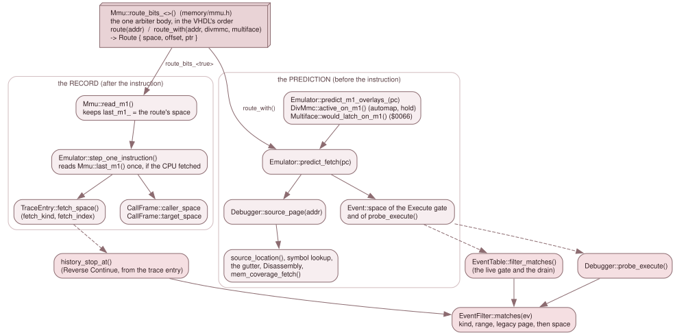

# 7.1 Which memory supplied the instruction

A source map says "the bytes at `$8C95` came from `main.c:17`". On a Next that
sentence is incomplete, because `$8C95` is a logical address and the logical
address space is a window onto many memories: the MMU maps RAM pages into eight
slots, and over them a ROM, the DivMMC's ROM or RAM, the Multiface, the
alternate ROM or Layer 2 can be mapped. A program built for RAM page 20 and a
ROM routine at the same logical address are different code with different
source. So every range, label and line breakpoint carries the memory it belongs
to, and every lookup supplies the memory that is mapped *now*.

That memory is a `MemSpace` (`src/debug/mem_space.h`, std headers only). When
it names what supplied a read or an opcode fetch it is called a `FetchSource`,
an alias of the same type (`using FetchSource = MemSpace;`) so that a grep finds
the role.

*One arbiter body answers every question. The record is taken after an
instruction and goes into the trace and the call frames; the prediction is
asked before one and feeds every lookup. The Execute filter has one predicate,
used in three places.*

## The kinds

A `MemSpace` is a `Kind` and a 16-bit `index`. Equality is by **decode path**,
not by physical store: `Layer2{p}` and `Page{p}` share external SRAM for every
`p` outside {`0x0A`, `0x0B`, `0x0E`}, and `DivMmcRam{b}`, `Config{b}`, the
Multiface and the alternate-ROM windows all alias SRAM pages some `Page{}` also
reaches. They stay distinct because the VHDL arbiter reaches them by different
routes, and a debugger that shows which one answered must not collapse them.
`Cpu` compares equal whatever its index (`operator==` in `mem_space.h`).

| Kind | `index` | Store | The VHDL (`zxnext.vhd` unless named) |
|---|---|---|---|
| `Cpu` | unused | The live CPU mapping, overlays included. Never an arbiter result: it is the peek side's "whatever the CPU would see" | |
| `Page` | NR `0x50`-`0x57` page number, 0..223 | An 8 KB page. On the Next it is SRAM page `n + 0x20`, except `n` = `0x0A`/`0x0B` (the bank-5 BRAM) and `0x0E` (the bank-7 BRAM) | `mem_active_page` `:2952`; slots 0/1 `:3037-3043`, slots 2-7 `:3059-3065`; `:2961-2964` |
| `Rom` | 0..3 | A 16 KB ROM image; the half is `cpu_a(13)` | `sram_rom`, `:3052-3057` |
| `BootRom` | 0 | The 8 KB boot ROM (`bootrom_en`), mirrored through 0..`0x3FFF`; it sits above the whole SRAM arbiter | `:1856-1857`, `:3199-3204` |
| `MultifaceRom` | 0 | 0..`0x1FFF` while `mf_mem_en`: SRAM page `0x0A` | `:2923`, `:3030-3035` |
| `MultifaceRam` | 0 | `0x2000`..`0x3FFF` while `mf_mem_en`: SRAM page `0x0B` | `:3030-3035` |
| `DivMmcRom` | 0 | The 8 KB DivMMC ROM: SRAM page `0x08` | `:2921`, `:3084-3090`; `divmmc.vhd:94,98` |
| `DivMmcRam` | bank 0..15 | A DivMMC RAM bank: SRAM page `0x10 + bank` | `:2926`, `:3092-3098`; `divmmc.vhd:95-96,99` |
| `AltRom` | `sram_alt_128_n` (0 = Alt ROM0 128k, 1 = Alt ROM1 48k) | The alternate-ROM read override, a 16 KB store: SRAM pages `0x0C + 2*index + cpu_a(13)` | `:2924-2925`, `:3116-3122`, selector `:2981-3008` |
| `Layer2` | `layer2_active_page` | The Layer 2 CPU read mapping: SRAM page `index + 0x20`, never the BRAMs | `:2966-2969`, `:2971`, `:3100-3107` |
| `Config` | NR `0x04` | The config-mode window, a 16 KB store: SRAM pages `2*index + cpu_a(13)` | `:3044-3050` |
| `Floating` | 0 | Nothing answers; the read returns the floating bus (`0xFF` in JNEXT) | `:3060-3061`, `:3101-3102` |

Three facts the table does not show:

- **The packing is bounded.** Every value the arbiter produces fits 12 bits:
  `kind <= 15` and `index <= 0xFF`. A `static_assert` in
  `debug_types_check.cpp` pins `kind <= 15`, and row `FSRC-09` (`mmu_integration_test`)
  pins `index <= 0xFF`. `MemCoverage` relies on both (below).
- **Store size depends on the kind.** `space_size()` is `0x4000` for `Rom`,
  `AltRom` and `Config` and `0x2000` for every other kind, and `space_offset(s,
  logical)` is `logical & (size - 1)`. Every route the arbiter produces has
  exactly this offset.
- **Only some kinds are accessible to a verb.** `Debugger::peek()` and `poke()`
  take `Cpu`, `Page` and `Rom`. `DivMmcRam{b}` can be *read* (GH #351: the dot
  commands run from DivMMC bank 2, so their bytes must be checkable): bank `b`
  is `DivMmc::ram_page(b)` (SRAM page `0x10 + b`, `zxnext.vhd:3092-3098`), a bank
  past `DivMmc::kRamPages` is `InvalidPage` (`debugger_inspect.cpp:310-317`), and
  `poke` of it stays `Unsupported`. Every other kind is *identity-only*: the arbiter
  names it, and `peek` and `poke` refuse it with `Result::Unsupported`
  (`identity_only()`, `debugger_inspect.cpp:98`, one total `switch` with no
  `default`, so a new kind is a compile error there). `Rom` is read-only
  (`RefusedReadOnly`). Coverage is the exception: `mem_coverage()` accepts the
  identity-only kinds.

## One arbiter

`Mmu::route(addr)` and `Mmu::route_with(addr, divmmc_active, mf_active)`
(`src/memory/mmu.h`) are the single body that decides which memory answers a
read, and they return a `Route { space, offset, ptr }`. The read, the opcode
fetch, the debugger's prediction and the instruction-fetch record all come from
it, in the VHDL's order, so they cannot disagree. [3.2](../03-subsystems/02-memory.md)
owns that body and its priority order; this page does not restate it. What this
chapter needs from it is the `space` field.

`route()` uses the overlays as they are now. `route_with()` is the same body
with the two overlays that an M1 fetch itself can switch, DivMMC's automap and
the Multiface's `$0066` latch, given as they will be *for that fetch*.

## The prediction and the record

A lookup happens *before* the instruction runs (the Source tab follows a PC
that has not yet executed it, and a line breakpoint must match the fetch about
to happen), but a fetch can change which memory supplies it. The system
therefore has two views of one function.

**The prediction.** `Emulator::predict_fetch(pc)` (`core/emulator.cpp`) asks the
overlay predictors, then the arbiter:

1. `predict_m1_overlays_(pc)` mirrors the `on_m1_prefetch` hook in `init()`, but
   asks const predictors instead of the state machines. The DivMMC decision
   comes first (`DivMmc::automap_m1_may_react()` gates it; `m1_automap_gates_()`
   supplies the arbiter inputs; `DivMmc::active_on_m1()` is the answer and
   `hold_after_m1()` the hold for the next fetch), then the Multiface's
   (`Multiface::would_latch_on_m1()`, the `$0066` fetch). `m1_automap_gates_()`
   is called by both the real hook and the predictor, so there is one copy of
   the inputs.
2. `Mmu::route_with(pc, o.divmmc, o.mf).space` is the result.

`Debugger::source_page(addr)` (`debugger_source.cpp`) is `predict_fetch(addr)`,
and it is what every lookup passes: `source_location(addr)`, the symbol lookup,
the gutter, `mem_coverage_fetch()`. A DivMMC entry shows the idea: a *delayed*
entry at `RST $08` (NR `0xBA` bit 1 clear) maps at the next M1, so the fetch at
`$0008` is still the RAM page and the one at `$0009` comes from the DivMMC ROM,
and the prediction at `$0008` has to say RAM (row `SRCDBG-ID-09`).

**The record.** `Mmu::read_m1()` keeps `last_m1_ = route.space` for the first
opcode byte of every instruction fetch; `Mmu::last_m1()` returns it, and
`MemSpace::cpu()` ("none recorded") after construction, `reset()` and
`load_state()` until the next fetch.
`Emulator::step_one_instruction()` reads it once per instruction, after
`cpu_.execute()`, and only if the CPU says it fetched an opcode
(`Z80Cpu::fetched_opcode_last_execute()`):

- **The trace.** `TraceEntry::fetch_space()` (`debug/trace.h`, stored as
  `fetch_kind` and `fetch_index`) is set by `TraceLog::set_newest_fetch()`. The
  entry is recorded *before* execution with `cpu()` provisionally and patched
  *after*; it stays 56 bytes.
- **The call frames.** `CallFrame::caller_space` is the `CALL`'s or `RST`'s own
  fetch. `target_space` is recorded by the first fetch *at* `target_pc` and stays
  `cpu()` until then (and forever if none happens: a debugger moved the PC, or
  the esxDOS shim serviced the call). An `INT` or `NMI` frame has no fetch to
  record: its `caller_space` is the prediction at the interrupted PC, captured by
  `CallStack::on_instruction_pre()`.
- **Slots that fetch nothing.** An accepted `INT`, an accepted `NMI` and the
  esxDOS shim fetch no opcode, so `last_m1()` still holds the previous
  instruction's. Such a slot keeps `no_fetch_space`, the prediction for its PC,
  in its trace entry.

Because prediction and record are one function evaluated at two moments, they
must agree for every instruction that fetches. The rows `SRCDBG-ID-*` in
`source_debug_test` step instructions across DivMMC, Multiface, boot-ROM and
NMI paths and compare the two; `FSRC-*` in `mmu_test` and
`mmu_integration_test` pin the arbiter's order and identities against the VHDL.

## Spelling a space: the long address (GH #360)

One place spells a `MemSpace` for a human or a file: `src/debug/long_address.*` (std headers
and `mem_space.h` only). Every Qt view, the trace export and the remote protocols that name a
memory go through it ([7.7](07-frontends.md)).

- **The tag.** `space_tag()` (`long_address.cpp:46`) is the stable name: `Page{n}` is `P%02X`
  (`P04`, `P0E`), `Rom{i}` `ROM%u`, `BootRom` `BOOT`, `MultifaceRom` `MFROM`, `MultifaceRam`
  `MFRAM`, `DivMmcRom` `DIVROM`, `DivMmcRam{b}` `DIVRAM%u` (decimal), `AltRom{i}` `ALTROM%u`,
  `Layer2{p}` `L2P%02X`, `Config{b}` `CFG%02X`, `Floating` `FLOAT`, `Cpu` `CPU`. The charset
  is `[A-Z0-9]`: no whitespace and no `:`.
- **The inverse.** `parse_space_tag()` (`:64`) is strict: digits only, any case, no leading zero
  on a decimal index, the hardware's ranges (a page `0..0xDF`, ROM `0..3`, DivMMC bank `0..15`,
  alt ROM `0..1`). It refuses `PE5`: a slot 2-7 that holds NR >= `0xE0` reads nothing, so
  `SlotInfo::now` is `Floating` while `SlotInfo::space` is `Page{0xE5}`. A view therefore names
  a slot by `now`, no protocol output tags `space`, and a view that shows the slot's own source
  shows `FLOAT` for a page >= `0xE0`.
- **The tags are a stable format.** The project file and the ghidra and skoolkit exports key on
  them, so changing a spelling is a format break, not a tidy-up (the header says so, in the
  comment on `parse_space_tag`, `long_address.h:9-11`). The trace export's `FETCH=` column is `space_tag(fetch_space())`
  (`trace.cpp:324`), never the GUI's style ([3.9.1](../03-subsystems/09-1-the-backend-api.md)).
- **The Next layout.** `physical_text(space, addr)` (`long_address.cpp:111`) says where the byte sits in the Next's
  memory: `$` and six hex digits of the SRAM address (`Page{n}` and `Layer2{n}` are
  `(n + 0x20) << 13 | offset`, `zxnext.vhd:2964,2971`; `Rom{i}` `i << 14 | offset`, `:3052-3057`;
  alt ROM `0x018000 + 0x4000 * i`, `:2924-2925`; Multiface `0x014000` / `0x016000`; DivMMC ROM
  `0x010000` (SRAM page 8) and DivMMC RAM `0x020000 + 0x2000 * b` (page `0x10 + b`), `zxnext.vhd:2921,2926,3085,3093`), or `BRAM5+$XXXX`
  (pages `0x0A`, `0x0B`), `BRAM7+$XXXX` (page `0x0E`), `BOOT+$XXXX`, `FLOAT`. Banks 5 and 7 are
  block RAM, not SRAM, apart from page `0x0F`; Layer 2 always sees the SRAM copy.
- **The style.** `space_text()` and `long_address()` (`$C000 P0E`) choose by `AddressStyle`:
  `Friendly` prints the tag, `Physical` the physical text, and Physical falls back to Friendly
  wherever `next_layout` is false (a non-Next machine: `memtext::next_layout()`,
  `memory_text.h:20`).

The instruction at the PC is a special read. `Debugger::memory_reader()`
(`debugger_inspect.cpp:838`) returns the bytes the CPU *will fetch* for that one instruction
(`Emulator::predict_instruction_bytes()`, at most four) and `Mmu::peek()` for everything else,
because at a DivMMC instant entry the M1 itself maps DivMMC. That is the prediction half of this
page applied to the bytes instead of the identity.

## Two ways to name a memory in an Execute filter

An `Execute` subscription has two memory qualifiers (`EventFilter` in
`debug/events.h`):

- **`EventFilter::space`** is the canonical one: the `FetchSource` that must
  supply the opcode, compared exactly (kind and index) with `Event::space`.
  `MemSpace::cpu()` means no qualifier, since `Cpu` is never a fetch source. A
  source-line breakpoint names the memory its location was compiled into.
- **`EventFilter::page`** is the *legacy protocol* qualifier. It compares
  `Mmu::get_effective_page(slot)` and nothing more, so it also matches a ROM or
  an overlay that carries that page number. DZRP's `bank+1`
  (`dzrp_server.cpp`, `sub.filter.page = page`) and the DSL's `page` filter
  (`script_engine.cpp`) use it, because those protocols know pages and nothing
  else. `dzrp-frontend.md` stays a frozen design record of that meaning.

`EventFilter::matches(ev)` (`event_table.cpp`) applies both, after the kind and
the range, and it is the only copy of the predicate. `EventTable::filter_matches()`
calls it for the live gate and the boundary drain, `probe_execute()` calls it
for the pure "what is armed at this PC" question (the step-off arm, and ZRCP), and `history_stop_at()`
(`debugger_source.cpp`) calls it for Reverse Continue with an `Event` built from
a trace entry. The gate's `Event::space` is the prediction; `history_stop_at()`'s
is the record. [7.5](05-breakpoints-steps-history.md) uses this.

## Coverage is keyed by the same identity

`MemCoverage` (`debug/mem_coverage.h`) records which bytes of which memory the
guest executed, read and wrote: one flag byte per byte, `COVERAGE_EXEC` for the
first opcode byte of an executed instruction (the M1), `COVERAGE_READ` for any
other read (operands, data, DMA) and `COVERAGE_WRITE` for a write that landed. It
is keyed by `MemSpace`, the decode path the arbiter named, so `Page{p}`,
`Layer2{p}`, `DivMmcRam{b}` and `Config{b}` that alias one SRAM page stay
distinct. `Floating` and `Cpu` are never recorded.

- **Storage.** Lazily allocated 8 KB chunks in a flat table of `16 * 256 * 2`
  pointers: the key is `(kind, index, offset >> 13)`, which is why the kind and
  index bounds above matter. A 16 KB store is two chunks.
- **A set, not counts.** Setting a bit twice changes nothing, so a rewind's
  replay does not double count, and the set survives a rewind, a reset, a state
  load and a cold boot. Only `mem_coverage_clear()` and switching it off empty it.
- **Recording.** `Mmu::cov_note_()` (`memory/mmu.cpp`) asks the arbiter again
  (it is pure) with the right direction and fetch view, and marks only a write
  that landed. Guest accesses only: a debugger peek or poke, a trace capture,
  video and a loader never count. Switched off, it costs a pointer test.
- **The source view.** `Debugger::mem_coverage_fetch(addr)` is
  `get(source_page(addr), space_offset(...))`, the Disassembly's view.
  `Debugger::executed_source_lines(file)` walks `SourceMap::file_ranges(file)`
  and reports a line as executed when *any* byte of any of its ranges carries
  `COVERAGE_EXEC`, with each range's own space and `space_offset()`.

This is a store, not a file format: nothing reads or writes a coverage file, and
no DZRP, ZRCP, GDB or DSL verb exposes it. Its readers are the Qt Disassembly and
Memory panels (`disasm_panel.cpp`, `memory_panel.cpp`), the Source tab, and
`--coverage` (`EmulatorConfig::coverage`, applied by the three loop owners through `apply_startup_coverage()`, `platform/coverage_startup.h`), which switches it on at startup and
logs a summary at exit. The separate logical-PC set of the
INS-20 `coverage` verbs is described with the trace in
[3.9.1](../03-subsystems/09-1-the-backend-api.md).
