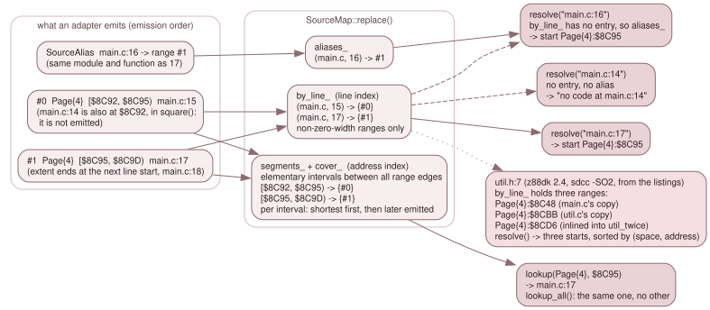

# 7.2 The source map

`SourceMap` (`src/debug/source_map.h`, `source_map.cpp`) is the store for source
positions. It knows no file format: an adapter ([7.3](03-loaders.md)) hands it a
vector of ranges, and it builds the two indexes that answer the two questions
the rest of the system asks. *Which source line is this address?* is a lookup by
`(memory, address)`. *Where is this source line?* is a resolve by `file:line`.
It lives in a header with standard includes and `debug/mem_space.h`, so the
adapters and their tests build without Qt or the emulator.



*The same ranges, indexed twice. The example is `main.c` in the z88dk 2.4
sccz80 fixture: lines 16 and 17 share `$8C95`, line 14 shares `$8C92` with line
15 but belongs to another function, and `util.h:7` has three starts.*

## What an adapter emits

```cpp
struct SourceLocation { std::string file; int line; int column; };  // one-based; column 0 = absent
struct SourceRange    { FetchSource space; uint16_t lo; uint32_t hi_excl; SourceLocation location; };
struct SourceAlias    { std::string file; int line; size_t range; };
```

A `SourceRange` says that the bytes `[lo, hi_excl)` of one memory `space` came
from `location`. The location has no address and no page: where the code is
belongs to the range. `hi_excl` runs to `0x10000`; a range with `hi_excl == lo`
is *zero-width*. No adapter in this tree emits one, because every extent rule
yields at least one byte ([7.4](04-formats.md)); the type allows it and the
store handles it: it is counted by `size()` and kept out of both indexes.
A `SourceAlias` names a `(file, line)` that has no bytes of its own and the
index of a range (in the vector given to `replace()`) it resolves through.

## `replace()`: one transaction

`SourceMap::replace(ranges, aliases, identity, loaded_file, format, texts, dot)`
builds a complete new map and move-assigns it over `*this` as its last step, so
an observer never sees a half-built store. The order of `ranges` is *emission
order* and matters: it is the tie-break below.

1. **Normalise.** A file name has `\` turned into `/` and leading `./` removed
   (`normalized_file()`). Equal `(file, line, column)` triples share one entry in
   `locations_`.
2. **The line index.** `by_line_` maps `(file, line)` to the indices of the
   non-zero-width ranges of that line, in emission order. An alias whose range
   index is out of bounds is dropped; the rest go to `aliases_`.
3. **The address index.** Take every edge (`lo` and `hi`) of every non-zero-width
   range, per memory, and sort them. The intervals between consecutive edges are
   *segments*; each segment lists, in `cover_`, every range that covers it. The
   segment's key is `(space_key << 20) | lo`, where `space_key` is
   `kind << 16 | index` (and `Cpu` always has index 0).
4. **The primary.** The ranges of a segment are sorted shortest first and, on a
   tie, the one *emitted later* first (`primary_first`). The first is the
   segment's primary location.

`loaded_file` is the adapter's absolute, lexically normalised path (built as the local `loaded`: `sld_loader.cpp:328`,
`z88dk_source_map.cpp:1183`), which is also where the search for a source file starts ([7.7](07-frontends.md)).
`identity`, `loaded_file`, `format` (`"SLD"` or `"z88dk"`; `clear()` resets it to
`"SLD"`), `texts` and `dot` (`SourceMap::dot()`: the map is a z88dk dot command's, so
the backend never judges it from memory at a load, [7.6](06-lifetime.md); `clear()` resets it)
are stored as given. Every `const SourceLocation*` the class
returns points into `locations_` and is valid until the next `replace()` or
`clear()`; code that keeps a location copies it. The backend does so before it
calls anything that might load a map.

## Looking up an address

`lookup(space, address)` finds the segment by binary search and returns the
primary location, or null when no range of that memory covers the address. It
allocates nothing. Because the key is the memory *and* the address, code from a
ROM slot or an overlay has a location only if a record names that memory; there
are no unqualified records.

`lookup_all(space, address)` returns every covering location in the segment's
order: the primary, then ascending length, then later-emitted first. That is the
case of nested ranges: an adapter that emits a long range for a function and a
short one for a statement inside it gets both, the statement first.

`SourceMap::same_position(a, b)` compares file, line *and* column, since one
statement can emit several ranges. The source steps use it ([7.5](05-breakpoints-steps-history.md)).

## Resolving a line

`resolve("file:line")` splits at the last `:`. The text before it is the file,
the rest must be a decimal line number of at least 1; otherwise the result is
empty with no error. The file is matched in two steps: an exact match against
the files of the map, else the unique file whose path ends in `"/" + text`, a
suffix on a component boundary. Two candidates make it *ambiguous* and the
result is empty. A file that is not in the map is empty too, so a typo is
silent at this level; the caller turns an empty result into its own message.

For a known file:

- **The starts are the line's entries.** Every non-zero-width range of the line
  is a start at `(space, lo)`, except a *continuation*: a range that begins
  exactly where another range of the same line in the same memory ends. A line
  that the compiler emitted as two adjacent ranges has one place to put a
  breakpoint, not two. The starts are sorted by `(space, address)` and unique.
- **An alias answers only when there are no starts.** The line's alias, if any,
  gives the start of the range it points at.
- **No code.** With neither, `error` is `"no code at <expression>"`. That text
  appears only for a file the map names, which is how a caller tells "this line
  has no code" from "this file is unknown".

`file_ranges(file)` is the reverse listing for one file, with the path *exactly
as the map holds it* (`SourceLocation::file`, no suffix matching): every
non-zero-width range as `{line, space, lo, hi_excl}`, ordered by line. Coverage
uses it ([7.1](01-which-memory.md)).

## Embedded texts

`SourceText { origin, lines }` is the text of a source file the toolchain did
not keep: `lines[i]` is line `i + 1`, empty where the listing shows nothing, and
`origin` names the listing it came from. The only producer is the z88dk listing
adapter, which keeps the text of z88dk's generated start-up code (the `.m4`
files) from `prog.lis` ([7.4.4](04-4-z88dk-listings.md)). `embedded_text(file)`
looks up the exact normalised name. Every `replace()` drops the previous
texts, since they came with the previous map.

## The C variable store

A z88dk map also carries the program's C variables. The adapter reads the
`__CDBINFO__` records into a `VariableStore` and hands it to `replace()`, which
keeps it like the embedded texts: `variables()` returns that one shared,
immutable object, a copy of the map shares it, and `clear()` and every `replace()`
without one drop it. What it holds, and how it is joined to the map's symbols, is
[7.9](09-c-variables.md).

## Program identity

A map can carry a statement of what the program's bytes looked like when it was
built, so a map for another build is not trusted. `SourceProgramIdentity` has
two forms, either or both:

- **A hash** (`sha256`, `org`, `size`): the SHA-256 of `size` bytes of *logical*
  memory from `org`, as they were right after the load. This is the SLD form
  ([7.4.1](04-1-sld.md)). `sha_matches()` refuses `size > 0x10000 - org`.
- **Byte checks** (`bytes`, a list of `SourceByteCheck { space, lo, bytes }`):
  bytes as they must read from one named memory at `lo`, `lo + 1`, and so on.
  This is the z88dk form, built from the section binaries beside the map
  ([7.4.3](04-3-z88dk-map.md)).

`has_identity()` is true when either is present. `verify_program(read,
read_space)` returns `nullopt` when there is no identity, otherwise whether it
all still matches: the hash through `read` (logical memory), then each byte
check through `read_space` for *its own* memory. A missing `read_space`, an
unreadable byte or a different byte fails the whole check.

The backend supplies the two readers in `Debugger::Impl::verify_identity()`
(`debugger_source.cpp`). The logical reader is `Mmu::peek()`. The space reader
is `Debugger::peek(Page{n}, addr & 0x1FFF)` and accepts only `Page`: a byte
check in any other memory reads nothing and so fails. It reads through
`Debugger::peek`, not through the CPU's view, so a page is read whatever the MMU
has mapped over it, and a debugger read touches no watchpoint and no latch.

### Units and spans, for programs that are not in memory yet

A tape's program is not in memory when its map is attached. `verify_spans()`
splits the identity into *units*, the things that can be judged separately:
one per memory a byte check lies in, and, for the SLD hash (which hashes logical
memory as one block), the single unit `MemSpace::cpu()`. A `VerifySpan` is the
code the CPU is about to run, `[lo, hi_excl)` of `space`, which triggers the
judgement of its `unit`; spans of one unit and space that touch or overlap are
merged, and the list is empty for a map with no identity. For the hash form
there is one span per non-zero-width range. `verify_unit(unit, read, read_space)`
judges one unit: the hash for `Cpu`, the byte checks of that memory otherwise,
and `nullopt` if the map has nothing to check there. [7.6](06-lifetime.md) shows how
the backend uses them.

## Related

- Where the ranges come from and what extent each adapter gives them:
  [7.4](04-formats.md).
- The `FetchSource` that qualifies every range: [7.1](01-which-memory.md).
- The facade verbs over this store (`source_map()`, `source_location()`,
  `load_source_map()`): [3.9.1](../03-subsystems/09-1-the-backend-api.md).
