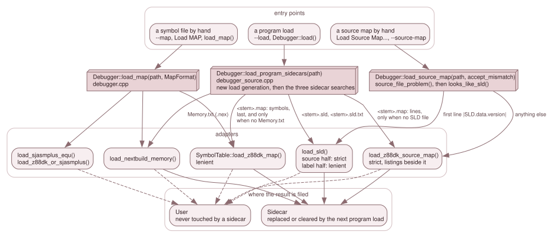

# 7.3 Loading: the adapter contract, sidecars and ownership

Four entry points put data into the stores, and they differ in who asks and in
what the result is filed under. This page is the contract the adapters keep, the
dispatch that picks one, the search for the files that sit beside a program, and
the ownership rule that decides which load may replace which.

*A program load searches for sidecars and files what it finds as the program's
(`Sidecar`). A hand load, from `--source-map`, Load Source Map or `--map`, is the
user's (`User`) and is never touched by a sidecar.*

## The adapter contract

Every adapter keeps the same promises, and a new one must too
([7.8](08-tests-and-new-producers.md) has the checklist).

- **Parse the whole input before touching a store.** `load_sld()` reads every
  line and calls `map.replace()` once, at the end; `load_z88dk_source_map()`
  places every record first and calls `map.replace()` last. A refusal returns
  before that, with the store untouched. The symbol loaders `clear()` their table
  only once the file has opened.
- **A source half is strict; a symbol half is lenient.** A record the source
  half cannot place refuses the half, with a reason that names the line
  (`"line 12: ..."`, `"malformed SLD record at line N"`). The symbol half skips
  what it cannot place and counts the rest: `parse_label()` in `sld_loader.cpp`
  returns false for a record that names nothing, and `SymbolTable::read_z88dk_map()`
  `continue`s past a symbol no rule places. A bad source record must not cost the
  user their labels, and a label that does not fit 16 bits must not cost them
  their lines.
- **One file can be two transactions.** A z88dk map is read twice
  (`SymbolTable::load_z88dk_map()` for the symbols, `load_z88dk_source_map()` for
  the lines). An SLD is read once and yields both: `load_sld(map, path, &labels)`.
  A file refused *as a whole* (a missing header, a bad device or identity
  record) loads neither half and leaves both stores as they were; a bad trace
  record refuses only the source half, and the labels still load
  (`SourceMapLoadResult::labels >= 0`).
- **A listing is dropped alone.** A z88dk `.lis` that does not hold up is left out
  with a note (`SourceMapLoadResult::listing_notes`), and its module keeps the
  map's records ([7.4.4](04-4-z88dk-listings.md)). It never refuses the map. The count reaches the
  frontends as `SourceMapLoad::listings` and the notes as `SourceMapLoad::listing_note`; the sidecar log
  says `and N listings` and one Warn per note.
- **Look before opening.** `source_file_problem(path)` (`debug/source_file.h`)
  returns a reason, or empty. It refuses anything that is not a regular file (a
  FIFO or device would block or never end) and a file over
  `SOURCE_FILE_MAX_BYTES`, 64 MiB; a missing file is left to the open, which
  reports it. `load_sld()`, `load_z88dk_source_map()` (and the section binaries
  and `.lis` files it reads), `load_z88dk_map()`, `load_simple_map()` and
  `load_nextbuild_memory()` call it. The two sjasmplus-capable symbol loaders
  differ from the others as follows. `load_z88dk_or_sjasmplus()`, which serves
  `--map`, must open `--map <(cmd)`, a pipe and so not a regular file, so it cannot ask
  first: it reads the file exactly once into memory, in chunks, and refuses the load
  when more than `SOURCE_FILE_MAX_BYTES` arrive (`"input is over the 67108864-byte
  limit"`, table untouched), a pipe included. `load_sjasmplus_equ()`
  (`MapFormat::SjasmplusEqu`, the Qt Map menu's sjasmplus load) is a path the user
  picked, so it does call `source_file_problem()`, like the Map menu's other loaders;
  the menu shows the reason in its "Load Failed" box. `load_z88dk_map()` and `load_simple_map()` refuse
  such a file with the table untouched and say why through their optional `why` argument; the cap refusal is row
  `Z88MAP-27`. A file that merely fails to open returns `-1` with `why` left empty (`load_nextbuild_memory()` alone sets "could not open Memory.txt file"), and the table is
  untouched there too (`if (!file.is_open()) return -1;` comes before `clear()`).
- **Emit only qualified ranges.** Every `SourceRange` carries a `FetchSource`
  ([7.1](01-which-memory.md)); the adapter decides it, and `SourceMap` never
  invents one.

A format is supported only once its extent rule (how far a record's range
extends) and its space rule (which memory a record belongs to) are written down;
those are the first two parts of every [7.4](04-formats.md) page.

## Dispatch by content

`Debugger::load_source_map(path, accept_identity_mismatch, verify_at_first_execution, dot_only)`
(`debugger_source.cpp:452`) is the hand load. After `source_file_problem()` it tells
the format *by content*, never by extension: `looks_like_sld()` is true when the
first line starts `|SLD.data.version|`, or when the file cannot be opened at all,
so that the SLD loader's own error names it. Anything else is read as a z88dk
map. A UTF-8 byte-order mark (EF BB BF) at the very start of the file is skipped
first, by `skip_utf8_bom()` (`source_file.cpp`), in the router and again by
`load_sld()` before it requires the first line to be exactly
`|SLD.data.version|1` (only a trailing CR dropped): a BOM'd SLD loads exactly as
the same file without the BOM (owner decision, 2026-11-01; rows `SRCDBG-Z88-30`
and `-33`). Only the very first three bytes count: a second BOM, or a BOM after
a leading blank line, is ordinary text, so such a file is not an SLD and goes to
the z88dk adapter, which refuses it (`SRCDBG-Z88-34`). Every
text loader skips it the same way: the z88dk source adapter, the `--list` listing
reader (whose first header names a source and carries rows, so a BOM left in
it would break the anchors and the file names), and the five symbol loaders
behind `--map` and Debug > Map (z88dk, sjasmplus EQU, Simple, NextBuild
`Memory.txt`, and the choose-by-content one, which erases one leading BOM from
the bytes it read, as a pipe cannot be rewound). Rows: `SRCDBG-Z88-35`,
`MAPBOM-01..06`, `Z88LIS-44`.

- **An SLD** goes to `load_sld(candidate, path, &labels)`.
- **A z88dk map** goes to `load_z88dk_source_map(..., Z88dkListings::Beside)`; its
  symbols stay with `load_map()` and `--map`. A map whose load returns `count == 0`
  (built without `-debug`, no usable listing) is refused with
  `"no source lines in '<path>' ..."` and the listing notes appended.

Before the map is filed as the user's, `load_source_map()` checks the program
identity ([7.2](02-the-source-map.md)): a mismatch is refused unless
`accept_identity_mismatch`, and for a program that is not in memory yet
(`verify_at_first_execution`, used for tapes) a map with an identity attaches
*pending* ([7.6](06-lifetime.md)). Only then does the user's store take it. `SourceMapLoad::identity_note` is the suffix a
frontend appends to its report: verified, not verified for lack of section
binaries, or verified for the code the binaries cover with N ranges unchecked
(`identity_note()` in `debugger_source.cpp`).

`Debugger::load_map(path, MapFormat)` (`debugger.cpp`) is the symbol-file load.
`MapFormat` has five values: `Z88dk`, `Simple` (`SYMBOL = $ADDR`), `NextBuild`,
`SjasmplusEqu` and `Z88dkOrSjasmplus`. The last is the one `--map` uses
(`ScriptHost`, `script_host.cpp`): `SymbolTable::load_z88dk_or_sjasmplus()` reads
the file once into memory and lets its *first line* pick the loader (an
sjasmplus EQU line, whatever its value, or anything else, an empty file
included, taken as a z88dk map). It is by content because sjasmplus names its
files freely and z88dk's assembler writes a `.sym` of its own, in the map format.
On success the symbols become the user's and a rule-4 z88dk symbol takes the RAM
page `predict_fetch` says is mapped (`SymbolTable::bind()`, [7.4.3](04-3-z88dk-map.md));
on failure (`-1`) the table and its owner are as they were.

### `--source-map`

`EmulatorConfig::source_map_file` is set from `--source-map FILE`
(`main.cpp:880`, `:2171`). `EmulatorConfig::source_map_no_program` (`emulator_config.h:288`),
set at `main.cpp:2182`, says which of three cases it is: `0` a program loads and the map
follows it; `1` there is no `--load`; `2` an RZX replay is the program (`--rzx-play`, or
`--load R.rzx`, told by the extension).

**With a program** (`0`). Each loop owner (`headless_app.cpp`, `sdl_app.cpp`,
`gui/qt_app.cpp`) calls `load_program_sidecars()` after its first successful `--load`
and then `emulator_attach_cli_source_map()` (`platform/emulator_boot.h:112`), the same call
as a hand Load Source Map with a mismatch refused. A refusal logs an error and the run exits 1.
When the program is a tape (`program_loads_later()`) the helper passes `deferred`, the map
attaches pending, and the loop owner watches it once per tick with
`emulator_poll_cli_source_map()` (`source_map_watch_`): a map dropped by the check logs
`--source-map: dropped: <reason>` and exits 1.

**Without one** (`1` and `2`). There is no program to judge a map by, so only the map of a z88dk
dot command is accepted. Each loop owner makes the load once, at start-up, before
`ScriptHost::start()`, so a `file:line` rule in a script resolves
(the `source_map_no_program != 0` block at `headless_app.cpp:77-88`, `sdl_app.cpp:252`, `gui/qt_app.cpp:352`). The call is
`emulator_attach_cli_source_map(dbg, file, deferred = false, dot_only = true, rzx = (case 2))`,
which passes `dot_only` to `load_source_map()`. After the adapter has parsed the file,
`dot_only && !candidate.dot()` returns `SourceMapLoad::not_dot` with the error "it is not the map
of a z88dk dot command" (`debugger_source.cpp:488`), and the helper words it for the frontend:
`--source-map requires --load FILE, or the map of a z88dk dot command: '<file>' is not one`, or,
for case 2, `--source-map with an RZX replay accepts only the map of a z88dk dot command` (`emulator_boot.h:120-125`).
The refusal makes the start-up fail (exit 1). A dot map is deferred whatever
`verify_at_first_execution` says: `defer = (verify_at_first_execution || candidate.dot()) &&
!verify_spans().empty()` (`debugger_source.cpp:497`), so it attaches pending with the note "identity
check pending: the dot command loads when it runs", and `source_map_watch_` is set from the result.
How it is then judged is [7.6](06-lifetime.md); how its sections are placed is
[7.4.3](04-3-z88dk-map.md), rule 5.

## The sidecars of a program

`Debugger::load_program_sidecars(path)` is called after every successful
`--load` in the three loop owners (`headless_app.cpp`, `sdl_app.cpp`,
`gui/qt_app.cpp`) and by `Debugger::load()` (`debugger_reconstruct.cpp`), which is
what a remote client's load verb runs. It looks beside the program for three
kinds of file, using the non-throwing `std::filesystem` calls and accepting only
a regular file (a FIFO would block the load; a broken or looping link is "no
sidecar"):

| Sidecar | Search | Applies to |
|---|---|---|
| NextBuild symbols | `<stem>.Memory.txt`, then `Memory.txt` in the program's directory (`nextbuild_sidecar()`) | a `.nex` only |
| SLD | `<stem>.sld`, then `<stem>.sld.txt` (`load_sld_sidecar()`) | any program |
| z88dk map | `<stem>.map` (`z88dk_map_sidecar()`, `program_has_z88dk_map()`) | `.nex`, `.tap`, `.sna` |

`source_file.cpp` holds the one table of program formats: `.nex` and `.sna` load
at once, `.tap`, `.tzx` and `.wav` load *later* (`program_loads_later()`: the
machine reads them over the following frames), and only `.nex`, `.sna` and `.tap`
have a z88dk map.

**Symbols.** The user's symbols are never touched (logged as "Kept the loaded
symbols ... not loading ..."); their rule-4 symbols are re-bound to the pages
mapped now at every program load. Otherwise the program's store is assembled in
one block, in this order, first wins on every key (`SymbolTable::merge()`):

1. `Memory.txt`;
2. the SLD's `L` labels, when the SLD file is not refused as a whole, its identity
   does not mismatch and the user's source map is not kept (an SLD with no label
   is not a symbol source);
3. the z88dk map's symbols, last, and only when **no** `Memory.txt` exists and its
   identity does not mismatch.

The log says what was attached: `Loaded N SLD labels from '<file>'` (`debugger_source.cpp:756`) and
`Loaded N z88dk symbols from '<file>'` (`:762`).

If nothing attached, a previous program's Sidecar symbols are cleared, also when
the new `Memory.txt` cannot be read (`SidecarLoad::symbols_unreadable`): a
previous program's data never survives into one it does not describe.

**Sources.** The user's source map is kept if there is one (logged). Otherwise a
previous Sidecar map is cleared, then: the SLD's source half if an SLD file
exists, *even a refused one*, whose refusal is reported; only if there is no SLD
file at all, the z88dk map's source half. A z88dk map with neither symbols nor
line records is not a map: ignored without a word. A map whose section binaries
or hash do not match memory is rejected whole, its symbols included. A tape
program's identity cannot be judged at the load call, so its map attaches pending.

**Ownership.** Each store has an owner, `Impl::StoreOwner`: `None`, `Sidecar` or
`User`, tracked explicitly because an empty-looking store can still be the
user's (a map of `; const` lines only). The rules, all in `debugger_source.cpp`
and `debugger.cpp`:

- Ownership changes only on a *successful* load.
- A sidecar load never touches a `User` store. A user's source map is carried
  into the new load generation without a second verification (the machine has not
  changed since the load call).
- A hand SLD's labels become the user's symbols (`Impl::attach_hand_labels()`,
  `symbols_from_sld`), unless the user loaded a MAP (then the count is `-1`, the
  MAP kept). A hand SLD with no labels clears only an earlier hand SLD's labels.
- `Debugger::clear_source_map()` and `clear_symbols()` set the owner to `None`.

**What was refused.** `SidecarLoad::problem` is the one-line account of what was
found and refused: `NextBuild symbols '<file>' rejected: <reason>` and/or
`source map '<file>' rejected: <reason>`, joined by `"; "`, empty when nothing
was refused. The file is named, not the program. `load_program_sidecars()` fills
it and logs each refusal as well. The headless loop warns
`--load: <problem>`, the SDL loop `load: <problem>`, the Qt loop hands it to
`DebuggerManager::report_sidecars()` in a debugger build (the log and the main
window's status bar for ten seconds) and warns otherwise, and a remote `Debugger::load()` logs `load: <problem>` at Warn to
every client. The Source tab reads the reason for the source half from
`source_map_status().reason`, which the next load or drop replaces.

For a program that is not in memory when the load call returns, see
[7.6](06-lifetime.md).
