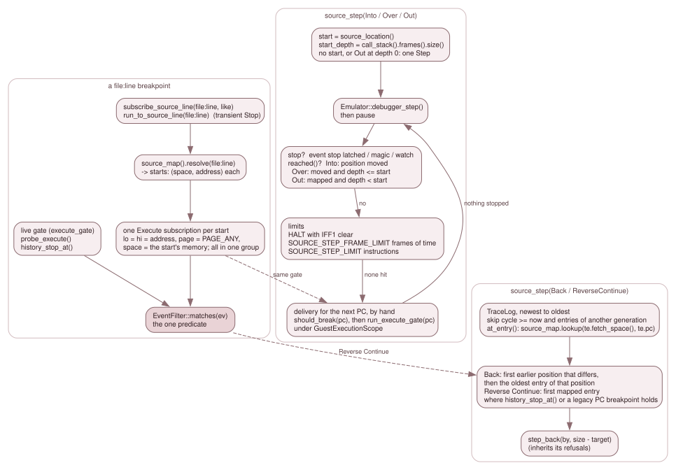

# 7.5 Breakpoints, steps, history and call frames

Everything on this page answers "where in the *source*" with machinery that
already existed for "where in memory": the `Execute` event, the debugger's Step,
the trace, and the call-stack tracker. None of it adds a new way to stop the
machine. It adds a way to name where, and a loop that ends on a source boundary.
[3.9.4](../03-subsystems/09-4-execution-control-and-rewind.md) owns the step
modes, the gates and rewind; this page does not restate them.

*Left: a `file:line` breakpoint is a group of `Execute` subscriptions that share
one predicate. Middle: a forward source step is a loop of the debugger's own Step.
Right: Back and Reverse Continue pick a trace entry and hand a count to
`step_back()`.*

## A line breakpoint is a group of `Execute` subscriptions

`Debugger::subscribe_source_line(by, "file:line", like)` (`debugger_events.cpp`):

1. `like` must be an `Execute` subscription, or the verb is refused; so is a
   departed client.
2. `source_map().resolve(file_line)` ([7.2](02-the-source-map.md)) gives the line's
   starts. No start refuses the verb (`RefusedUnavailable`).
3. A new `GroupId` is taken, and for each start `(space, address)` a copy of `like`
   is added with `filter.lo = filter.hi = address`, `filter.page = PAGE_ANY` and
   `filter.space = space`, all in that group.

The qualifier is the **canonical** one ([7.1](01-which-memory.md)): the memory the
location was compiled for. A line compiled into two places is two subscriptions in
one group, each matching only its own memory. The group verbs
(`unsubscribe_group()`, `set_group_enabled()`) act on all members, and refuse a
group the caller does not own with the same answer an unknown one gets. The Qt
Breakpoints panel shows a group as one row (`Row::group` in `breakpoint_model.h`).

`Debugger::run_to_source_line(by, "file:line")` (`debugger_control.cpp`) is Run To
for a line: it checks the execute gate and resolves the line *before* it pauses
anything, so a refusal leaves a running machine running; then it builds a
**transient** `Stop` `Execute` and calls `subscribe_source_line()` with it,
`run_to_subscribed()` and `arm_target(RunTo, by, starts.front().address, ...)`,
remembering every start in `armed_targets`. A transient subscription is removed
at the next stop that the backend caused (`Impl::apply_stop()`).

### One predicate

All of this relies on a single decision about whether an `Execute` event matches
a filter, `EventFilter::matches(ev)` (`event_table.cpp`: kind, range, legacy
`page`, then `space`). It has three callers, and they differ only in where the
`Event` comes from:

| Caller | The `Event` | Used for |
|---|---|---|
| `EventTable::filter_matches()`, from `Impl::deliver_to_subscribers()` | built by `Impl::execute_gate(pc)`: `phys_page` is the effective page, `space` is `predict_fetch(pc)` | the live gate, before an instruction runs, and a source step's delivery below |
| `Debugger::probe_execute(pc)` | the same event, built without recording a hit | the pure "what is armed here" query |
| `history_stop_at()` (`debugger_source.cpp`) | built from a `TraceEntry`: `pc`, `phys_page = te.mmu[te.pc >> 13]`, `space = te.fetch_space()` | Reverse Continue |

The first two use the prediction, the third the record ([7.1](01-which-memory.md)).
`history_stop_at()` honours only what does not depend on the machine of then: a
live (`Entry::live`: enabled, and on for its client), non-transient, unconditional `Stop` with no handler, which has not
already fired its `once`. A breakpoint with a condition or a handler cannot be
re-evaluated against a machine that is not there.

## `source_step()`

`Debugger::source_step(by, kind)` (`debugger_source.cpp`), with `SourceStep` =
`Into`, `Over`, `Out`, `Back`, `ReverseContinue`. It is refused inside a
delivery, and with `RefusedUnavailable` when there is no live source map
(`recheck()` runs first, [7.6](06-lifetime.md)).

### The forward steps

`Into`, `Over` and `Out` are a loop over `Emulator::debugger_step()`, the
debugger's own single Step, so a source step is exactly a run of Steps that stops
on a source boundary. First `execute_gate()` (the same refusals a Step has), then
the pause ownership and stop evidence exactly as `step_into()` sets them.

- **The start.** `start` is a *copy* of `source_location()` (a handler may load a
  map mid-step and invalidate the pointer), and `start_depth` is
  `call_stack().frames().size()`. With **no location** under the PC, or `Out` with
  no tracked frame, the step is one instruction: that is how an unmapped stretch is
  left.
- **The boundary.** `reached()` re-reads the location and the depth after each Step:

| Kind | Reached when |
|---|---|
| `Into` | the position moved (`same_position()` is false: file, line or column) |
| `Over` | the position moved **and** `depth <= start_depth` |
| `Out` | there is a location **and** `depth < start_depth` |

  `Over` and `Out` measure depth with the call-stack tracker, so they need it on
  (`set_call_stack_enabled`, a per-client request; with a C variable store and a non-observer client
  attached it is on by itself, [7.10](10-c-frames-and-values.md)).
- **The loop**, per iteration: `debugger_step()`, then `pause()`; stop if an event
  stop is latched, or the magic or watch stop fired; stop if `reached()`; stop at a
  `HALT` with interrupts disabled (`Warn`: "Source step stopped at a HALT with
  interrupts disabled"), because each Step there would spend two frames learning
  that only an NMI or a reset ends it; stop when the machine clock has advanced by
  `SOURCE_STEP_FRAME_LIMIT` frames (100, `SOURCE_STEP_FRAME_LIMIT`, `debugger.h:1460`) since the start
  (`Warn`); then the delivery below.
- **The limit.** After `SOURCE_STEP_LIMIT` instructions (1,000,000,
  `SOURCE_STEP_LIMIT`, `debugger.h:1456`) the step ends with a `Warn`.
- **The delivery.** `debugger_step()` delivers no `Execute` event, because `run_frame()`
  does that before each instruction and a Step does not run through it. So between
  instructions the loop gives the next PC `run_frame()`'s treatment itself, in its
  order: `DebugState::should_break(pc)` (the legacy PC breakpoint), then, when
  `execute_events_armed()`, `run_execute_gate(pc)` under a
  `GuestExecutionScope`. Handlers run, and a `Stop` records its hit and its
  `once`. If a handler moved the PC, the new address gets no delivery of its own
  (as in a run, the redirect target simply runs next) but the loop checks whether it
  is already the boundary.

A step ends the way a Step does: `finish()` pauses, and an event's own stop becomes
the reason in place of `Step`.

### Back and Reverse Continue

These search the retained trace; they do not run the machine. They need the trace
on (else the rewind refusal "the instruction trace is off") and they hand the result
to `step_back(by, n)`, so they inherit its refusals. Candidates are the entries
**before** the machine's current cycle (a Frame Back or a slider jump leaves newer
entries in the trace) and in the machine's **current load generation**
(`generation_of_seq()`, [7.6](06-lifetime.md)): Back never crosses a landing into
the history of the machine before it.

For each entry, newest first, `at_entry()` asks the map with the entry's recorded
identity, `source_map.lookup(te.fetch_space(), te.pc)`; an entry whose fetch space
is `cpu()` ("none recorded") has no location. An entry with no location is skipped
by both kinds.

- **`Back`** takes the newest earlier entry whose position differs from the current
  one (`same_position()`; a loop on one line, or several records for one statement,
  count as one step), then walks older entries (passing unmapped ones) while they are
  at that same position, and lands on the oldest: the first instruction of the
  previous statement, the inverse of `Into`.
- **`ReverseContinue`** takes the newest mapped entry for which `history_stop_at()`
  is true or the legacy store has a PC breakpoint at its address
  (`breakpoints().has_pc()`).

`step_back(by, size - target)` lands on `trace[size - n]`'s PC. When no entry
qualifies the verb refuses with "no earlier mapped source position in the retained
trace" or "no earlier source breakpoint in the retained trace".

## The call stack the steps lean on

`CallStack` (`debug/call_stack.h`) is a debug-only shadow of the machine's calls. It
is told about each instruction by `Emulator::step_one_instruction()`
(`on_instruction_pre()` with the opcode and its predicted memory, then
`on_instruction_post()` with the new SP and PC and the recorded fetch) and about an
accepted `INT` or `NMI` by `on_interrupt()`. Frames are oldest first, up to
`MAX_DEPTH` = 256. A frame is a `CALL`, an `RST`, an `INT` or an `NMI`
(`CallType`), with `caller_pc`, `target_pc`, `sp_at_call` and the two memories of
[7.1](01-which-memory.md).

**What ends a frame.** Not just the stack pointer. `CallStack::return_to()`: a taken `RET` that lands on the **newest frame's own return point**
ends exactly that frame: for a `CALL`, `caller_pc + 3`; for an `INT` or `NMI`,
`caller_pc` (or `caller_pc + 1` when the interrupt ended a `HALT`, which the CPU had
stepped past). Any other `RET`, and every `RST` frame (whose inline `DEFW` operands
make the return point vary), ends frames by the stack pointer: those whose
`sp_at_call` is below the new SP are popped (`pop_frames_to_sp()`). The reason is
that SP alone is wrong for a routine that moves its own return address:

- sccz80's `l_debug_push_frame` (every `-debug` function) re-pushes the return
  address two bytes lower, so the frame would survive its `RET` by the SP rule;
- a `__z88dk_callee` routine moves it up, so the `RET` of a call it makes (or of an
  ISR that interrupted it) would pop its frame.

The price is stated in the code: a routine that drops its return address and leaves
by a direct `JP nn` keeps its frame until a `RET` ends it by SP. (A routine that leaves by an
indirect jump has its frame ended: below.)

**A return with no `RET`**. Some sccz80 runtime helpers return by an indirect jump, and
some routines jump indirectly without returning. `CallStack::indirect_jump_to()`
(`call_stack.cpp:96`) judges a `JP (HL)`, `JP (IX)` or `JP (IY)` when the newest frame is a
`CALL` frame; the frame ends in two cases:

- **A. The jump lands on the frame's return point** (`caller_pc + 3`), whatever SP is. The
  `l_gintspsp` family (`l_gcharspsp`, `l_g2intspsp`, `l_g2charspsp`, `l_glong2sp`: sccz80's loads
  of an `int`/`char` stack variable) swaps a value into the slot with `EX (SP),HL` and jumps with
  SP at the slot or one `PUSH` below it. `l_long_sub`, `l_long_and`, `l_long_or`, `l_long_xor`,
  `l_long_eq` and `l_long_ne` (`long` arithmetic and comparisons) `POP IX` the return address,
  pop their arguments and `JP (IX)` with SP above the slot. Nothing but a return jumps to the
  return point.
- **B. SP is above the frame's slot and the frame has no live stored copy of its return
  address.** `l_case`, `l_long_case` and `l_i64_case` (`switch`) `POP HL` the "return address" as
  the inline case table, walk it and `JP (HL)` to a case label (or the default continuation) in
  the caller: they store nothing back, so they have left.

A *stored copy* is what tells a routine that has left from one that has only moved its return
address up. A `__z88dk_callee` routine pops its return address and its arguments and pushes the
return address back (`POP r; POP args; PUSH r`, or `...; EX (SP),r`), so SP is above its CALL's
slot for the whole body, and its internal jumps are not returns. `CallStack::note_stack_store_()`
(`call_stack.cpp:59`) records, in `CallFrame::ret_stored_at`, the address where a `PUSH qq`, `PUSH IX`,
`PUSH IY`, Z80N `PUSH nn` or `EX (SP),HL/IX/IY` put `caller_pc + 3` above the slot of the newest
`CALL` frame; the latest store wins. The copy is live (`CallStack::ret_copy_live_()`,
`call_stack.cpp:69`) while it sits at or above SP and still holds that value. The words are read
through a stack reader that `Emulator::Emulator()` (`emulator.cpp:42`) installs over `Mmu::peek()`
(`mmu.h:367`), which has no watchpoint or latch side effect. Without a reader (the bare tracker
rows) nothing is recorded and clause B is "SP above the slot".

Then `pop_frames_to_sp()` ends the older frames whose slot is below SP. Only the newest frame is
judged and recorded, so recursion (every deeper call is a newer frame at a lower SP) and an
interrupt routine (its `INT` frame is the newest) cannot end an outer frame. Kept, on purpose:

- **`bit_beep_raw_callee`** (`POP AF; POP HL; POP DE; PUSH AF; JP asm_bit_beep_raw`, which loops by
  `JP (IX)` with SP four bytes above the slot) and any hand-written `__z88dk_callee` routine: the
  copy is live.
- **The classic retrofit callee shims** (`_clga_callee`, `_draw_callee`, ...: `LD HL,retaddr; EX
  (SP),HL; LD (save),HL; JP (HL)`): SP is AT the slot, which clause B never ends.
- **`banked_call`**: it `POP`s its return address but enters the target with `CALL l_jphl`; the
  `JP (HL)` is in `l_jphl`'s own frame, at its slot, to a function (rows `SRCDBG-CS-21`,
  `SRCSTEP-01` to `-03`, `-08`).

The residuals, stated plainly. A routine that moves its return address above its slot by anything
but `PUSH`/`EX (SP)` (`LD (IX+n),r`, `LDIR`) or holds it in a register, then jumps internally with SP
above the slot, loses its frame early. A routine that drops its return address with SP left at or
below its slot and jumps elsewhere keeps a stale frame until a `RET` ends it by SP (rex's
`saveRegAlloc`; no z80 target), and so does one that pushes a value equal to `caller_pc + 3` that
is not its return address. None of these occurs in either install's z80 libraries.

The survey: every `JP (HL)`, `JP (IX)` and `JP (IY)` in both installs' `libsrc` (491 lines, 242
distinct code windows; `EX (SP)` and `POP r` families included). G1, return by jump: clause A
(`l_gintspsp` family, `l_long_*`, `l_i64_*`, `l_command_line_parse`, the math48 and mbf helpers,
`asm_im2_push_registers`, the sdcc 64-bit callees and others). G2, return slot consumed with a jump
into the caller: clause B (`l_case`, `l_long_case`, `l_i64_case`). G3, trampolines reached by
`CALL` (`l_jphl`, `l_jpix`, `l_dcal`): SP at their own slot, kept. G4, call emulation (push a
return label, jump to a function: FZX, cpm, `call_extrom`): SP below the slot, kept. G5, tail
jumps to a function or state: kept, including after a callee prologue (the copy is live). G6, jumps
within a routine's own body (`asm_bit_beep_raw`, `beeper`, SP1): kept, including with SP above
the slot after a callee prologue. G7, other CPUs (Rabbit, GBZ80, 8080/8085): not applicable. Rows
`SRCDBG-CS-16` to `-27`, `SRCSTEP-14` to `-48` on the `intarg`, `longsw` and `calleejp` z88dk
fixtures and the `sjasmcallee` SLD fixture (`test/fixtures/z88dk/*/*-intarg`, `*-longsw`,
`*-calleejp`; `test/fixtures/sjasmcallee`), `QCSP-04` to `-06` for the panel. There is no 80cc
`calleejp` build: master's `-compiler=80cc` does not honour `__z88dk_callee` on an extern declaration.

`CallStack::on_slot_without_fetch()` handles the esxDOS shim, which returns from
the `RST $08` it serviced: that frame ends, and only that one.

These rules are why `Out` and `Over` cross `banked_call` and `l_debug_push_frame`
correctly, which `v2.4/sccz80-banked-run` and `master/sdcc-banked-run`
(`test/fixtures/z88dk/README.md`, finding Z3) exist to prove on a running program.

## Where it is tested

- `source_debug_test`: `SRCBP-*` (line breakpoints and groups), `SRCRUN-*` (run to
  line), `SRCSTEP-*` and `SRCDBG-STEP-*` (the forward steps), `SRCDBG-BACK-*`,
  `SRCDBG-HIST-*` and `SRCDBG-GATE-*` (Back, Reverse Continue and the generation
  filter), `SRCDBG-CS-*` (the call stack's frame identities; `SRCDBG-CS-08` to `-15` pin the
  frame-ending rule above: the esxDOS shim, a `RET` used as a jump, `__z88dk_callee`,
  `RETI`/`RETN`, an `RST` frame, an `INT` that ended a `HALT`; `SRCDBG-CS-16` to `-27` pin the jump rule).
- `step_out_test` (the Step Out `RET` predicate, `check_step_out()`) and
  `rewind_call_stack_test` (the tracker restored across a rewind).
- `script_events_test`: the DSL's `on execute FILE:LINE`.
- `mmu_integration_test`: `FSRC-*` for the identities the steps and breakpoints use.
