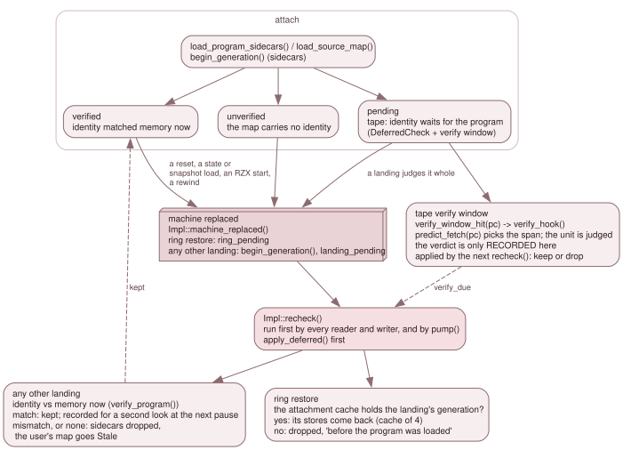

# 7.6 Lifetime: resets, snapshots, rewind and tapes

The stores describe a program. When the machine is replaced, whether by a reset,
a snapshot, a state load, a rewind or the arrival of a tape's program, they may
describe a program that is no longer there. This page is the set of rules that
decides, for each store and each kind of replacement, between *keep*, *drop* and
*stale*. All the rules run in one place, `Impl::recheck()`
(`src/debug/debugger_source.cpp`).

*A landing only marks the new generation. `recheck()` judges it, run first by
every reader and writer. A rewind inside the ring restores what was attached
there; any other landing keeps a map only if its identity matches memory now; a
tape's program is judged where the CPU first runs it.*

## The load generation

A **load generation** is a counter that says which machine's history a store and
a trace entry belong to. `Impl::generation_counter` is the source, and
`DebugState::load_generation()` publishes the current value. It lives in the
backend, not in the `Emulator`, because a cold boot rebuilds the emulator and a
counter it owned would restart and collide with the cache keys. It is host-side
state: it is not saved in a state file.

A new generation begins in two places (`Impl::begin_generation()`):

- `load_program_sidecars()`: the sidecars about to be attached belong to the
  program loaded now;
- `Impl::machine_replaced()`, for any landing that is **not** a rewind-ring
  restore.

Each rewind slot records the generation it was taken in (`RewindBuffer::Slot::generation`),
and `RewindBuffer::restore_nearest()` sets it as the current one *before* loading
the state, so the hook that fires inside the load already sees the landing's
generation, and sets `DebugState::restoring_from_rewind()` for the duration
(`RingRestore`).

## The hook only marks; `recheck()` judges

`Emulator::init()` and `Emulator::load_state()` end by calling
`debug_after_machine_transition_()`, which calls the machine-replaced hook the
`Debugger` installed (`DebugState::notify_machine_replaced()`). The hook
(`Impl::machine_replaced()`) resets the backend's own stop evidence with `arm(None)`
and then sets one of two flags: `ring_pending` for a ring restore (and notes the
restored generation), or, for any other landing, begins a generation and sets
`landing_pending`. It does nothing else, because the machine may still be
half-built when the hook fires (inside `init()`, or a warm start).

`Impl::recheck()` does the work, when somebody looks. Every reader runs it first
(`source_map()`, `source_map_status()`, `source_location()`, `lookup()`,
`lookup_name()`, `symbols()`, `executed_source_lines()`, `source_step()`), and so
does every writer (`load_map()`, `clear_symbols()`, `load_source_map()`,
`clear_source_map()`, `load_program_sidecars()`), so a pending landing is judged
before the writer's change and cannot undo it later. `Debugger::pump()` runs it too,
so a landing is announced to listeners even if nobody reads. It returns at once
when nothing is pending. Transitions are collected in `pending_log` and announced
to listeners at Info *after* the flags are cleared, so a listener that reads back
sees a settled backend.

## Tier 1: a rewind-ring restore

When `recheck()` finds `ring_pending`, and the landing's generation `g` differs
from the one the stores are attached for (`attach_gen`), it puts back the
attachment of that generation:

- The record comes from the **attachment cache**, `Impl::attach_cache`: one
  `Attachment` per generation, holding the sidecar `SourceMap` and `SymbolTable`
  (shared, immutable), the reason text, and the sidecar identity checks still to
  make. It keeps the last `ATTACH_CACHE_MAX` = 4 (`debugger_impl.h:156`); a
  when a fifth is added the oldest record is evicted. `cache_push_current()` replaces a
  generation's record in place.
- A restored store is assigned into the existing objects, so the Qt panels'
  `&symbols()` stays valid.
- With no record, the sidecar stores are cleared with "this point of the history is
  before the program was loaded".
- The user's symbols never change with lifetime. The user's source map is
  re-verified only if it was last judged in another generation, and not at all while
  it is still waiting for a tape's program.

Log lines say what happened ("Restored the program's ... of this point in the
history", "Dropped the program's ... before the program was loaded").

## Tier 2: any other landing

A reset, a snapshot load, a state loaded from outside the ring, an RZX playback
start, or a program loaded by hand: `fresh` is true (`landing_pending` and the
generation is the newest one), and the stores are judged by **identity**
([7.2](02-the-source-map.md)).

- **The program's sidecars** are kept only if the source map carries an identity
  and `verify_identity(source_map)` (over `Mmu::peek()` and
  `Debugger::peek(Page{n})`) matches memory now. Then the generation moves
  (`attach_gen = g`) and the attachment is cached. A mismatch, or a map with no
  identity, drops the sidecars with the reason "its binary identity does not match
  the program now in memory", or "the machine was reset or replaced and it has no
  binary identity to check". Sidecar symbols with no source map beside them have
  nothing to check, so they are dropped at such a landing too. The attachment is
  dropped from the stores but its cached record stays: a rewind into the
  generation before the landing brings it back.
- **A kept map is checked again.** A reset's ROM may clear RAM only later, so a
  kept map sets `pause_verify_sidecar` (or `pause_verify_user`) and the clock; at the
  next time the machine is paused with the clock moved, `recheck()` verifies it again
  and drops the map if it no longer matches. A run that is never paused does not get
  this second look.
- **The user's source map** is judged the same way (`verify_user()`) and, on a
  mismatch or no identity, goes **stale**, not away: `source_map()` and
  `source_location()` answer empty, `source_map_status()` says `Stale` with the file
  and the reason, and loading it again by hand makes it live.
- **A program the guest loads for itself** (the NextZXOS browser, `LOAD ""`) is
  invisible to the backend: it sees no landing, so its predecessor's sidecars stay
  until a reset or a load. Loading the same program again (a rebuild) attaches the new
  build's map (`SRCLIFE-17`); a map loaded by hand across such a load stays the
  user's, stale without an identity and live when the new build matches it
  (`SRCLIFE-18`).

Back and Reverse Continue count a trace entry only if it belongs to the current
generation: `Impl::trace_gens` holds `(first trace sequence number, generation)`
markers, kept in step with the trace's retained window
(`note_generation()`, `generation_of_seq()`) and cleared when a cold boot makes a
new `TraceLog`.

## A tape's program: the verify window

A tape's program is not in memory when `load_program_sidecars()` returns, so a map
that carries an identity (an SLD's hash, z88dk byte checks) cannot be judged yet. It
attaches at once and **pending** (`SidecarLoad::sources_pending`,
`SourceMapStatus::pending`; for a hand load, `load_source_map(path, accept,
verify_at_first_execution)`), and the attach line ends `(identity check pending:
the program loads from tape)`. Rule-4 sections bind at the attach, since that is
where the loader puts the bytes.

- **The check.** `Impl::add_check()` stores a `DeferredCheck`: a *copy* of the map
  (the live store may be replaced under it), the units still to judge and their
  `SourceMap::verify_spans()`, and which stores answer for the verdict:
  `guards_sources` (the live source store, the user's or a sidecar's) and
  `guards_symbols` (the sidecar symbols that came with the map, so they go with a map
  of another build even when the user's source map is the one kept). At most one check
  per owner.
- **The trigger.** `DebugState` has a one-shot **verify window**: a range of PCs set
  by `Impl::sync_verify_window()` to `[min lo, max hi)` over the pending spans of all
  checks (`set_verify_window()`). While it is set the machine is armed (`verify_hold_`
  is an `armed()` contributor of its own, with `magic_hold_`, in `refresh_gates_()` and
  `SuspendScope`). The emulator asks `verify_window_hit(pc)`, two compares, first in
  `run_frame()`'s armed block (`emulator.cpp:10032`), before `consume_step_off()`, the
  legacy breakpoint test and the execute gate, and in `step_frame_slot()` for a debugger
  Step (`:11456`).
- **The verdict is recorded, not applied.** On a hit, `Impl::verify_hook(pc)` takes
  `predict_fetch(pc)`, finds the spans of each check that contain `pc` in *that exact
  memory*, judges each unit now with `verify_identity_unit()` (through
  `Debugger::peek`, so it reads page 20 while it is unmapped and touches no watchpoint,
  latch or ring), removes the unit and its spans, and sets `verify_due`. A mismatch
  sets `mismatch`. The hook never pauses, and does nothing in `replay_mode()`.
- **Applying it.** `Impl::apply_deferred()` is the first thing `recheck()` does when
  `verify_due`, so a reader, or a stop on the very instruction that triggered the
  check, already sees the map judged. It logs one Info line per memory judged
  (`Verified ... in page 20; N memory spaces still to check`), `Verified ... the program
  loaded from tape matches its binary identity` when the last matches, and on a
  mismatch drops the sidecar map with its symbols through `drop_sidecars()`, or the
  user's map to `None` (not `Stale`: it was refused, as a mismatch at load refuses it),
  at error level with `Rejected ... does not match its binary identity`. The window
  stays set for the units not run yet, and is cleared when none remains.
- **Landings meanwhile.** A landing that is not a ring restore judges a pending map
  *whole*, as it does any carried map (a match clears the check, a mismatch, or a
  reset before the program arrived, drops it); a ring restore brings back the
  generation's `Attachment::checks`, updated at every judged space, so a rewind keeps
  what was verified. A user's pending map is carried into the next program's load,
  and across rewinds, still pending.
- **`--source-map` with a tape.** The loop owner polls `source_map_status()` once per
  tick; a map dropped by the check exits 1 ([7.3](03-loaders.md)).

## What the backend cannot see

Only landings it is told about and loads that go through it. A program the guest
loads itself (`LOAD ""`, the NextZXOS browser) is invisible, which is why its
predecessor's sidecars stay until a reset or a load. And an identity is a snapshot of
the image as it was right after the load: a program may legitimately change
variables inside its own image afterwards, which is why a hand load can accept a
known mismatch (`accept_identity_mismatch`).

## Where it is tested

`source_debug_test`: `SRCLIFE-*` (ring restores, the attachment cache and its
eviction, state and snapshot landings, RZX start, the stale user map, rewind past a
load, a rebuild), `SRCDBG-TAPE-*` (the verify window and the deferred checks, per
memory) and `SRCDBG-OWN-*` (ownership). `source_debug_posix_test` holds the
rows whose sidecars are POSIX file types (a looping link, a FIFO), which wine cannot
create.
