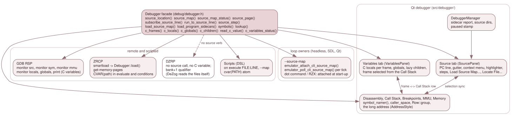

# 7.7 The frontends

Every frontend reaches the stores through the backend facade
(`src/debug/debugger.h`) and nothing else; none holds a `SourceMap` or a
`SymbolTable`. This page says what each one reads, and describes in full the
only one with a source *view*: the Qt debugger's Source tab. For the verbs
themselves see [3.9.1](../03-subsystems/09-1-the-backend-api.md); for a user's
steps see chapter 10 of the user guide, *Source-level debugging*.

*The facade at the top is the whole interface. The Qt window is the only
frontend that draws source text; GDB, ZRCP and scripts print or subscribe;
DZRP has no source surface and no C variable surface at all.*

| Frontend | Reads | Adds | Page |
|---|---|---|---|
| Qt debugger | `source_location()`, `source_map()`, `source_map_status()`, `source_page()`, `lookup()`, the breakpoint groups, `executed_source_lines()`, `c_frames()`, `c_locals()`, `c_globals()`, `c_children()`, `read_c_value()`, `c_variables_status()` | The Source tab, the Variables tab, the Breakpoints rows, the Call Stack column, symbol names, the long address | below, and [3.10.2](../03-subsystems/10-2-the-qt-debugger.md) |
| GDB RSP | `source_location()`, `symbols()`, `mmu_slots()`, `c_frames()`, `c_locals()`, `c_globals()`, `read_c_value()`, `c_variables_status()` | `monitor src`, `monitor sym`, `monitor mmu`, `monitor locals`, `monitor globals`, `monitor print` | [3.10.4](../03-subsystems/11-the-gdb-rsp-server.md) |
| ZRCP | `load()`, `mmu_slots()`, `read_c_value()` (through the DSL) | `smartload` reaches the sidecars; `get-memory-pages` names the memory; `CVAR(path)` in `evaluate` and in conditions | [3.10.5](../03-subsystems/12-the-zrcp-server.md) |
| DZRP | Nothing | None: no source and no C variable surface | [3.10.3](../03-subsystems/10-the-dzrp-server.md) |
| Scripts | `source_map().resolve()`, `load_map()`, `read_c_value()` | `on execute FILE:LINE`, `--map`, the `cvar(PATH)` atom | [3.10.6](../03-subsystems/13-the-debugger-scripting-language.md) |
| Loop owners (headless, SDL, Qt) | `load_source_map()`, `source_map_status()` | `--source-map` | [7.3](03-loaders.md) |

## The Qt Source tab

`SourcePanel` (`src/debugger/source_panel.*`) shows the line of the PC from the
backend's source map and carries the source-step buttons. It holds no copy of the
map. What it keeps is presentation: the file shown (`shown_file_`), the text loaded
and its modification time (`loaded_source_`, `loaded_mtime_`), whether the view was
placed (`placed_`), the Disassembly's selection (`disasm_range_`), the address being
browsed (`browse_addr_`) and the reason `report_sidecars()` gave it.

### What one refresh does

`SourcePanel::refresh_()` (`source_panel.cpp:590`) runs while the machine is paused,
whenever the window's paused stamp changed ([3.10.2](../03-subsystems/10-2-the-qt-debugger.md):
the stamp carries a flag for "the loaded file changed on disk",
`DebuggerManager::paused_stamp()`, `debugger_manager.cpp:969`; the flag is
`SourcePanel::file_changed_on_disk()`, `source_panel.cpp:551`). In order:

1. `update_buttons(paused)` (`source_panel.cpp:494`): the forward steps need a paused machine and a
   non-empty map; Back and Reverse Continue also need `rewind_blocked()` empty and the
   trace on. It emits `steps_available(forward, backward)`, so the Debug > Source menu
   items and the buttons share one predicate.
2. Running: `show_running()` says "Running", drops the highlight and the browse.
3. `source_map_status()` says Stale or None: a message and nothing else
   (`show_message()`). A pending status appends a note to whatever is shown:
   *Source map not verified yet: it is checked when the program first runs its code*, or
   for a dot command *...when the dot command runs* (`status.dot`, `source_panel.cpp:623`).
4. The location is `source_location(pc)`, or, while browsing, `source_location(browse_addr_)`
   (the browse ends if that address has no line now, or another map is loaded, `source_panel.cpp:631-641`).
   The memory shown in the label is `memtext::text(dbg_, style_, source_page(addr), addr)` (`source_panel.cpp:647`).
5. The text. A file the map carries as embedded text (`SourceMap::embedded_text()`, the
   m4 output of the CRT from `prog.lis`, [7.2](02-the-source-map.md)) is shown from the map
   and labelled `(m4 output, from <listing>)`. Otherwise a z88dk record in a `.m4` file with
   no embedded text gets a message of its own, decided before any file is read (z88dk counts
   the m4 *output*, which the build does not keep). Otherwise
   `source_search::resolve()` finds the file (below); no file gives "source file not found"
   and enables Locate File. A file is reloaded when its modification time changes, so an
   edit-and-rebuild never highlights a line of the old text (`lastModified()`, `source_panel.cpp:691-704`). A line past the end
   of the file found gives "has only N lines; it is not the text the build used" (`file_lines`, `source_panel.cpp:711-713`; the line
   count ignores the final newline, `file_line_count()`, `source_panel.cpp:60`). The label's tooltip is the path found.
6. The label ends with `SourcePanel::also_text()` (`source_panel.cpp:575`): `lookup_all()` for the address,
   minus the primary and any entry with the same `file:line`, as `  also: f:l, ...`; then the
   browse text `(browsing; the PC is at f:l, $addr)`; then the pending note.
7. The extra selections, in this order so a later one wins on its own line: memory coverage
   (`executed_source_lines()`, tint `coverage_line`), the Disassembly's linked lines
   (`linked_lines_()`, tint `linked_line`), the PC's line (the editor's `Highlight`, only
   when the file shown is the PC's file).
8. Placement. The cursor moves and the view centres only when something moved: the line,
   the address, `placed_` cleared or `place_now_` set (`place_now_`, `source_panel.cpp:796-811`). A browse centres only a
   line that is out of view. A user who scrolled away on a paused tick stays put.

`follow_pc()` (`source_panel.cpp:557`) clears `placed_` and the browse and refreshes at once. It changes what
the tab shows without moving the machine, so the paused stamp cannot see it;
`DebuggerWindow::activate_follow_pc()` (`debugger_window.cpp:1608`) calls it, and
`apply_pause_state(true)` runs that at every stop and step, so a stop at the very PC and line
already shown still puts the view back.

### Finding the file

`source_search::resolve(recorded, map_file, dirs)` (`src/debug/source_search.h`, Qt-free so
the SDL-only and Windows trees test it): an absolute name; then the map's directory and each
of its parents; then the search directories; tried suffix-major, the longest trailing part of
the normalised name first, then the directories in order; a leading `..` is dropped.
`DebuggerManager` owns the list: `set_source_dirs()` (`debugger_manager.cpp:311`) takes the
configured one (`MainWindow::push_source_dirs()`, `main_window.cpp:3166`, fed by
`apply_startup_config()`, `:2948`: the saved list with the command line's `--source-dir` or
`paths.source_dirs` value over it), and **Locate File...** (`SourcePanel::locate_file()`, `source_panel.cpp:438`)
adds to a second, session-only list through `DebuggerManager::on_source_dir_located()` (`debugger_manager.cpp:323`). The effective
list (configured, then located, duplicates dropped) is pushed to the panel by
`DebuggerManager::push_source_dirs()` (`debugger_manager.cpp:303`) on every change and again in `ensure_window()`, since the window is
created lazily. Locate derives the directory with `source_search::root_for()`, refuses a file of
another name, and asks whether to save it; `source_dir_save_requested` is MainWindow's, which
appends to `[paths] source_dirs` and refuses a directory that holds the list separator, as
Preferences and `--source-dir` do: it would load back as two (it stays searched for the session). The
session-only list is kept when the configured list changes (`set_source_dirs()` touches only the
configured one). The
manager announces each change (`source_dirs_changed`, because `src/debugger/` names no logger)
and MainWindow logs `Source search path: ...`.

### Loading a map by hand

The Source tab's **Load Source Map...** button and the Debug > Source > Load Source Map... item
are one slot, `DebuggerManager::on_load_sld()` (`debugger_manager.cpp:863`). Its file dialog
offers `*.sld`, `*.sld.txt` and `*.map`; the backend tells the format by content
([7.3](03-loaders.md)), so a z88dk map loads as source lines only, and the mismatch box and the
failure title name no format. The Map menu's Load MAP File items load symbols through
`load_map()`; they append the backend's reason to their failure box when a file was refused
rather than unreadable. The sidecar report is `DebuggerManager::report_sidecars()` (`:905`):
the log, and the main window's status bar for ten seconds.

### Colouring

`SourceHighlighter` (`source_highlighter.*`, a `QSyntaxHighlighter` that exists only in
`jnext_debugger`).

- **The language.** `source_language_for(file, text)` (`source_highlighter.cpp:409`): the
  extension, lower-cased, with a trailing `.m4` dropped (`zxn_crt.asm.m4` is assembly): `c` and
  `h` are C; `asm`, `s`, `z80` and `inc` are assembly; `bas` is Boriel. Otherwise the first 200
  lines vote: a line counts for a language when its first word is in that language's set alone
  (a column-0 label is skipped); the winner needs three votes and strictly more than the others
  (`kMinVotes`, `source_highlighter.cpp:463`); else Plain.
- **The word tables.** The Z80/Z80N mnemonics and register words are not listed anywhere: they
  are enumerated once from `disasm_one()` over the seven opcode pages, so a new Z80N opcode is
  coloured the day the disassembler names it. The directive, C and Boriel tables are committed
  with the upstream file and commit they were read from (z80asm `scan_def.h` and `keyword.def`,
  sjasmplus `directives.cpp`, ISO C11 6.4.1, Boriel `keywords.py`).
- **The scanners** are hand-written, linear per line, and carry multi-line comments and embedded
  assembly in the block state. The classes are the owner's ten (`Role`: Text, Keyword,
  Instruction, Preprocessor, Label, String, Char, Integer, Float, Comment); Text is the editor
  palette's text colour and never a format. Punctuation and operators (`kKeywordPunct`, `source_highlighter.cpp:280`)
  are Keyword, tested at each scanner's fall-through point after comment, string, char, number
  and word detection, so those win; Qt merges adjacent equal formats, so `->` or `<<=` is one Keyword
  range. A sign is part of a number only inside an exponent (`-5` is a Keyword and an Integer). C and
  Boriel numbers have their own scanners: Float is a point or an exponent, including the C hex-float
  `p` exponent; Boriel's `t_HEXA`, `t_OCTAL` and `t_BIN` are tried before `t_NUMBER`, and a `$` or `%`
  suffix belongs to its identifier. The scanners are allocation-free per word. Formats set the
  foreground colour and nothing else, so the line geometry and the gutter alignment equal Plain's.
- **Entering a text.** `SourcePanel::set_source_text()` (`source_panel.cpp:514`) is the one way:
  the language first, then the text, so a load is highlighted once with its own language.
- **Schemes.** `SourceScheme` (`platform/source_scheme.h`) is the order of the words of the
  `source.colour_scheme` key: Auto, Light, Dark, Borland (`static_assert`s in `app_config.cpp`
  and `source_highlighter.cpp:470`). `scheme_colours()` (`:587`) holds one table per concrete
  scheme: background, text, the current-line bar's two colours, the coverage and linked-line tints, and a
  colour per class. Dark is derived, not kept: `palette_tint::ink()` of each Light colour over a fixed dark
  palette (`#242424` and `#F0F0F0`, `make_dark()`, `:531`), so it does not depend on the application's own
  dark palette. Every scheme meets one legibility rule,
  which row `QSRC-195` checks: text and classes 4.5:1 against the background (WCAG 1.4.3), bar
  text 4.5:1, bar against background 3:1, and any two colours at least CIE76 12 apart unless the
  scheme declares them shared (Borland's owner-given groups).
- **Applying one.** `SourcePanel::apply_scheme_()` (`source_panel.cpp:525`) takes the *panel's* palette (the
  application's, never the editor's) in, resolves Auto against it (`resolve_scheme()`), hands the
  classes to the highlighter (`apply_palette()` rehighlights only when a class colour changed, never on a paused tick or a repeat) and
  puts the background, text and bar colours on the *editor's* palette (`Base`, `Text`, `Highlight`,
  `HighlightedText`). The background is a palette role, not a format, so it fills the whole
  viewport. `set_colour_scheme()` (`source_panel.cpp:542`) applies at once (Preferences Apply while the machine
  runs) and refreshes, because the tints are selections `refresh_()` builds and a paused tick
  redraws only when the machine moved. The setting is held by
  `DebuggerManager::set_source_scheme()` (`debugger_manager.cpp:317`) and pushed by
  `ensure_window()`, fed by `MainWindow::apply_startup_config()`.
- **What a scheme does not reach.** The gutter and its header paint from the panel's palette, so
  a scheme never colours them, and the breakpoint marks stay as they are. The current-line marker
  is an `ExtraSelection` reading the editor's `Highlight`; Qt draws a selection's colours over
  the layout's formats, so no syntax colour shows on that line.

### The gutter and breakpoints

The editor is a private `QPlainTextEdit` subclass, `SourceEdit` (`source_panel.cpp:99`), with a
gutter widget in a left viewport margin and a header strip above it (`setViewportMargins`; objects
`source_gutter` and `source_gutter_header`), because the visible blocks' geometry is protected.

- **Columns.** `BP | Line`: the number is `blockNumber() + 1` (`paint_gutter()`, `source_panel.cpp:155`).
- **The mark of a line** is computed at paint time, for the visible lines only
  (`SourcePanel::line_mark()`, `source_panel.cpp:970`, over `line_state()`, `source_panel.cpp:925`), so it is never stale and needs
  no cache. `line_state()` derives, for line L of the file shown: `starts` (where the map says L
  begins, from `resolve(file:line)`, so an alias line is marked), `placed` (those starts the
  memory mapped *now* supplies), `drawn` (this GUI's Execute breakpoints, from
  `BreakpointModel::pc_breakpoints()`, that the Disassembly would draw: a logical one, or one tied
  to `source_page(addr)`, sitting on a placed start or on any instruction whose primary line is L),
  `hidden` (breakpoints tied to exactly a start whose memory is not mapped now) and `armed` (starts
  carrying one of this GUI's Execute breakpoints, mapped now or not). Every start armed is the full
  glyph, some the left half; a line is drawn at all only while a breakpoint is drawn on it.
  `breakpoint_glyph.h` paints the glyph for both panels.
- **The PC wedge**: `paint_pc_marker()` (`breakpoint_glyph.h:46`), the amber wedge
  `paint_gutter()` draws on `highlighted_line()` only, in the 5-px strip after the number cell
  (`x` in `[width-6, width-2]`, which no pinned pixel reading uses); the colour goes through `palette_tint::ink()`, and the text
  highlight stays the palette's own.
- **A click** calls `SourcePanel::toggle_breakpoint_at_line()` (`source_panel.cpp:1013`), the one toggle: it
  removes what the line shows plus a hidden group tied to an unmapped memory, else
  `add_source_line()` (not idempotent, hence the check). The context menu calls the same
  function. A line with no code shows the store's reason as a tooltip.
- **In the model.** `BreakpointModel` lists an Execute subscription with a fetch-source qualifier as
  the GUI's own row (`Row::space`). A `file:line` is one backend group
  (`subscribe_source_line()`) armed at every place it compiled to, and the model folds the group into
  ONE row with its location count (`Row::group`, `Row::locations`; the Symbol / Source cell reads
  `main.bas:11 (2 locations)`). Remove, the Enabled cell and Edit act on the whole group, and the row
  is enabled only while every location is. The Add and Edit dialogs and Breakpoints > Add Execute
  Breakpoint share that rule and show the store's reason ("no code at main.bas:5"). The gutter draws a
  location only while its `FetchSource` supplies the address (`pc_marked(addr, space)`), and a click
  on its dot removes that location, not the group. The Call Stack's last column looks up each frame's
  caller with its recorded `FetchSource` (`CallFrame::caller_space`).

### The context menu

`SourcePanel::fill_context_menu()` (`source_panel.cpp:1128`, called from the editor's and the gutter's
`contextMenuEvent`) offers the Disassembly's actions on the source line: Copy, Copy with Addresses,
Select All; Toggle Breakpoint; Run to Here (`run_to_line_requested`, which `DebuggerManager` runs as
`Debugger::run_to_source_line` behind its corruption gate; Enter in the editor and the bindable Run to
Cursor, while the tab has the focus, are the same request); Show in Disassembly
(`show_address_requested`, `DisasmPanel::show_address()`); and the watch and data-breakpoint entries.
Those entries come from `operand_menu.{h,cpp}` (`add_operand_actions()`), shared with the
Disassembly's own menu so the two cannot differ. The Source tab fills a `MenuOperands` from the
labels at the line's places and the word under the pointer. A word is classified as a register in
parentheses, a number or a name, and a name goes through `SourcePanel::symbol_for_word()` (`source_panel.cpp:1038`),
the single seam for the C names (`resolve_key("@" + word)`; `@` forces a symbol).

After the Show in Disassembly entry the menu carries the user-annotation entries: Add / Rename
Label…, Remove Label and Add / Edit Comment…, from `add_annotation_actions()`
(`src/debugger/annotation_menu.cpp:77`), once per place the line compiled to
(`SourcePanel::fill_context_menu()` calls `add_annotation_actions`, `src/debugger/source_panel.cpp:1208`). The Disassembly
shows the labels and comments; the Source tab does not. How they are stored, saved and drawn is
[7.4.6](04-6-user-annotations.md), section 10.

### Selection sync with the Disassembly

`DebuggerWindow::create_panels()` wires the two panels with four `connect()` calls
(`connect()`, `debugger_window.cpp:1496-1510`), and nothing else couples them. Each carries only what the *user*
did in its sender, so no move echoes.

- **Source to Disassembly.** `SourcePanel::source_lines_selected(file, first, last, reveal)` is
  emitted by `emit_lines_()` (`source_panel.cpp:860`), only when the file or the lines changed (`lines_file_`,
  `lines_first_`, `lines_last_`; a message and Running emit an empty file, and `none = true` says the
  text stays but nothing of it is selected). The lines are `selected_blocks_()`'s, the same rule as
  Copy with Addresses (a selection ending at a block start does not take that block). The editor's
  `cursorPositionChanged` / `selectionChanged` slot passes `reveal = true` (`selectionChanged`, `source_panel.cpp:409-414`); a move the
  panel makes itself (the PC placement of `refresh_()`, a text load, `set_disasm_selection()`) runs
  under a `SyncScope` (`syncing_`), so that slot stays silent, and ends with `emit_lines_(false, ...)`,
  so a stop tints the PC statement's other instructions without scrolling.
  `DisasmPanel::set_source_lines()` (`disasm_panel.cpp:438`) stores the range; a row is linked
  (`source_linked()`, `linked_at_()`, `:425-433`) when `lookup_all()` in its own space has a location
  on a selected line of that file, the primary or not. `paintEvent` fills a linked row with
  `source_sync_colors::linked()` before the PC row, the selection and the coverage bar. With `reveal`
  and no linked row in view, the view centres on the first start of `resolve(file:line)` that is
  mapped now; otherwise it never moves.
- **Disassembly to Source.** `DisasmPanel::selection_changed(lo, hi, caret)` comes from the user paths
  only (`notify_selection_()`, `disasm_panel.cpp:413`: a press, a drag, a navigation key, Select All, the menu's
  collapse), when the triple differs from the last one sent. `show_address()` and a refresh do not
  emit; `set_source_lines()` forgets the last triple, so the next click on the same lines is a change
  again. `SourcePanel::set_disasm_selection()` (`source_panel.cpp:817`) is ignored while running or
  without a map, stores the range (`disasm_range_`, dropped when the machine runs, so a stop shows no
  tint of it), and sets `browse_addr_` unless the caret's primary line is the PC's own statement.
  `refresh_()` then describes `browse_addr_` instead of the PC. The lines of the instructions in the
  range (`linked_lines_()`, `:879`, walking `instruction_length` over `memory_reader()`) get an
  `ExtraSelection` in the scheme's `linked_line`, after the coverage tints and before the PC's. There is no cache of those lines: a full 64K
  range cost about 3.5 ms when measured at design time (not re-measured since), and it is
  paid at each `refresh()`, which runs only when the paused stamp changed, not on every tick.
- **Show in Source.** `DisasmPanel::show_source_requested(addr)`, from a menu item present only while
  a map is loaded and enabled only where `lookup()` finds a line. The window raises the Source tab and
  calls `SourcePanel::show_address()` (`source_panel.cpp:836`).

Browsing ends at `follow_pc()` (every stop), `show_running()`, the map going away (the None and Stale
branches of `refresh_()`), another loaded map (`browse_map_`), an address with no line now, and **Go to
PC Line** (`go_to_pc_line()`, `source_panel.cpp:842`). A message about the browsed line itself (file not found, a `.m4`
line without a listing) does not end it, so the message and Locate File... stay usable, and Go to PC Line stays enabled. Every accepted
Disassembly selection places the cursor on the caret's line (`place_now_`, cleared by the placement
itself, so the next ticks leave the cursor and scroll alone). A Source move made while the machine runs
announces nothing. The gutter, the menu, Copy with Addresses and Run to Cursor act on `shown_file_`, so
they act on the file browsed. Rows `QSRC-176` to `QSRC-189` and `QSRC-201` to `QSRC-208` pin the
behaviour; `source_sync_colors.h` is the one definition of the linked colour for both views; the Source tab keeps one
per scheme (`SchemeColours::linked_line`), tested for legibility like the coverage tint (row `QSRC-189`).

## The Qt Variables tab

`VariablesPanel` (`src/debugger/variables_panel.*`) is a tab of the bottom-right tab widget, between Watches and
Breakpoints (the window has no docks: its layout is fixed). It shows the C variables of one call
frame and the globals and statics as a `QTreeWidget` (Name, Type, Value, Address). Like every CAP-SRC reader it holds no copy
of a store, and it **formats nothing**: every value, type, refusal and note is the facade's text (`c_locals()`,
`c_globals()`, `c_children()`, [7.10](10-c-frames-and-values.md)); the panel only joins a row's notes onto its value
(`  (note; note)`, also the tooltip) and spells its address.

- **Paused only.** `refresh()` returns at once unless `set_paused(true)` (`DebuggerManager::set_panels_paused()`), like the Call
  Stack. `DebuggerWindow::refresh_panels()` calls it after the Call Stack's own refresh.
- **Frames.** A frame selector lists `c_frames()`: `<function> at <file>:<line>`, or `<not C code> $XXXX`, frame 0 suffixed
  `(current)`. **A refresh at a new master cycle (a new stop) selects frame 0**; one at the same cycle (an idle tick, an input redraw, a
  style switch) keeps the choice, so a frame picked in an older caller survives everything but moving the machine.
- **One mapping.** The Call Stack panel lists the tracked CALLs newest first, with no row for frame 0 or for a frame found through
  the saved-frame-pointer chain; `c_frames()` takes frame k's PC from the CALL `tracked[n-k]`, so **Call Stack row i is C frame i + 1**.
  That is written once, in `VariablesPanel::call_stack_row()` (`variables_panel.cpp:117`) and `frame_of_call_row()`. `CallStackPanel::call_selected(row)` (emitted
  only for the user's choice: a refresh and `select_row()` set a guard) goes to `select_frame(row + 1)`, and `frame_changed(k)` goes back to
  `select_row(call_stack_row())`, which emits nothing, so there is no loop. After each refresh the window re-selects the row the chosen
  frame maps to (-1 clears it), because a refresh may have rebuilt the Call Stack's rows.
- **Lazy children.** An item that is an aggregate or a pointer to something (not `void *`) has the child indicator and no children.
  Expanding it calls `c_children(frame, path, 0, 100)`; when `total` exceeds 100 the children are **range items** `[0..99]`, `[100..199]`, ...,
  each read with its own `first`. A refused expansion (`null pointer`, an unreadable pointer) is one placeholder item with the facade's
  reason. The panel never decodes a type.
- **Rows act on themselves.** A row that another visible variable of its name shadows, and a Globals row whose `function::name` is shared by two block statics, has an internal handle as its `path` (`#<n>`, never typed or shown). Edit and expand go through `write_c_value_row()` and `c_children_row()` with that path, so they act on the variable the row shows and not on the innermost one the name reaches; the keys are `prefix + path`, so the two rows have two keys. A message about such a row names the variable (`t (shadowed, in f)`, `f::n (static)`), built from the row's root label (`RoleRootLabel`, inherited by its children). **Watch** is a name expression: it uses `CValueRow::name_path`, and where that is empty (a shadowed row) or ambiguous (a shared static path, also in Locals) the action is disabled and its tooltip says why. `itemFromIndex()` is protected in Qt5, so the delegate reaches it through `VarTree::item_of()`.
- **In-place refresh.** Every item has a key (a path, a range, a file group, prefixed by the section and, for Locals, the function).
  `sync()` compares a parent's children with the new rows by key: unchanged keys are updated in place, so the selection, the scroll
  position and the expansion stay; changed keys rebuild that parent and re-open the items whose key the user had open (`expanded_`).
  Only open items are re-read; a closed item's children are dropped, to be read when it opens.
- **Addresses.** A global's `where` is a page address (`long_address(addr, space, style, next_layout)`); a stack slot or a followed
  pointer is a CPU address, spelled with the memory mapped there NOW (`memtext::now_of(mmu_slots(), addr)`: what a read reaches); a register
  local shows its register names. Debug > Physical Addresses reaches the panel through `apply_address_style()` like every other.
- **Editing.** The Value cell of an item whose facade row is `ok` and not an aggregate is editable (`Node::editable`: a pointer is, its
  value is its address): a double-click on the cell, or the context menu's Edit Value, calls `edit_item()` while paused. The editor is the
  `ValueDelegate`'s line edit, which holds `RoleEditText` (the first space-separated word of the facade's value: string slicing, so the panel
  still formats no number) and fills it once per editor (a keystroke is host input, so the manager's next paused tick redraws the row and the view offers the editor its data again: a refill would put the old text back over what is being typed, QVARW-09), and never writes the model: `setModelData()` hands the text to `commit_edit()`, which writes nothing when it equals the
  edit text and otherwise calls `write_c_value(client_, frame_, path, text)`. On success nothing else happens: the write bumped the revision, so
  the manager's next paused tick redraws every panel (`paused_stamp()`), this one with the value read back. On a refusal `variables_message` shows
  `<path>: <why>` (cleared by the next success or a new stop) and the cell keeps its value, because the model was never written. `client_` is the
  window's, set by `DebuggerManager::set_panels_client()` like the Memory panel's, so the MUTATE line names it. No new setting, so no CLI flag. The Watches
  C rows stay read-only.

### C watches in the Watches tab

A `WatchEntry` has a kind, `Memory` (the address watch) or `CVariable` (`CVarWatch`: the facade `path`, the `function` and CDB
`module` of a parameter or local, empty for a global, a file static or a static local). `VariablesPanel::watch_item()` (the right-click
menu's one action, refused while the machine runs: the tab shows the last stop, and a binding taken from the live machine would not be what the user pointed at) builds it and emits `watch_requested`; the window connects that to `WatchPanel::add_c_watch()`, and the current tab does not change.

- **Binding.** A Locals item is bound to the frame's function: at each paused refresh `refresh_c_row()` reads it with `read_c_value(k, path)`, k
  the NEWEST `c_frames()` frame whose function has that name and module (not a frame index: it would go out of scope at every new call of the
  same function), and when there is none the Value is `out of scope: <function> is not on the call stack` with Address and Memory empty.
  A Globals item (its path is `file::name`) and a static local (pinned from Locals as `function::name`, with the file before it, `a.c::init::done`, when the function name is not unique, exactly as `c_globals()` spells it: `find_var()` prefers the CURRENT frame's function for a bare `fn::`, which could be another module's) are unbound and read in frame 0 by a
  path no local can shadow.
- **Paused only.** `DebuggerManager::set_panels_paused()` tells the Watch panel; a running machine does not read a C row, which keeps the
  text of the last stop (kept in the entry, so an Add or Remove that rebuilds the table shows it again). Memory rows are unchanged.
- **No store.** Every C row shows `c_variables_status().why`, and binds again when a store with that function and path is attached.
- **Columns.** Address is the 16-bit address or the register names; Label the path plus ` (in function)`; Type and Value the facade's text
  (a refusal is placeholder-coloured text); Memory the space the value is in (`memtext::text()`, a stack slot or pointee by what is mapped now).
- Edit does nothing on a C row; Remove works on both kinds. C watches are not saved (no watch of any kind is).
- **While running**, a frame chosen in the Variables selector or the Call Stack is ignored by `select_frame()`, and both go back to the
  frame the tree shows.

Rows `QVAR-01` to `-32` (`debugger_variables_panel_test`) pin the tab; `CVCH-*` and `SRCDBG-CVCH-*` the children.

## Which memory a view names

Every Qt view names the memory behind an address through `debug/long_address.h`
([7.1](01-which-memory.md)) and nowhere else. The Qt-side wrapper is `src/debugger/memory_text.h`:
`memtext::text(dbg, style, space, addr)` (`memory_text.h:25`) and `memtext::next_layout(dbg)` (`:20`), which is
true only for the Next machine type (`MachineType::ZXN_ISSUE2`); any other machine prints the Friendly
tag whatever the style.

`DebuggerWindow` holds one `AddressStyle` and hands it to each panel (`set_address_style()`,
`apply_address_style()`) and to the `BreakpointModel`, whose rows are spelled in it; a toggle refreshes
them all. The style is the setting `debugger.physical_addresses` (Debug > Physical Addresses, `--set`,
a run override like `debugger.attached`).

Which space a view prints is a rule per view (design 10.3):

- The line at `PC` and the Source tab show the fetch prediction (`source_page()`).
- The other Disassembly lines, the MMU panel, the Memory panel's CPU view, Watches and Stack show the
  live data route of the address's slot (`SlotInfo::now`), the memory the bytes beside the tag came
  from.
- The Memory panel's Slot and Page views show the space shown; a slot paged to nothing (NR >= 0xE0) is
  `FLOAT`, never a page the tag grammar refuses.
- The Call Stack and the Breakpoints list show the recorded identity.
- Where a qualifier was already printed the tag replaces it in place; elsewhere a column was added
  (Disassembly **Mem**, MMU **Memory**, Watches and Stack **Memory**, Call Stack **Caller** and
  **Target memory**). The Memory panel paints its tag as the item after the ASCII column, so
  `dump_row()` and the coverage underline never move. The legacy page qualifier of another client keeps
  its `@NN`, which is a different thing ([7.1](01-which-memory.md)).

The instruction at the PC is read as the CPU will fetch it, not as a data read.
`Debugger::memory_reader()` (`debugger_inspect.cpp:838`) takes the bytes of that one instruction
(at most four) from `Emulator::predict_instruction_bytes()` and every other address from
`Mmu::peek()`; at a DivMMC instant entry the M1 itself maps DivMMC, so a peek at the PC would show
other bytes than the ones that execute. The Disassembly, `step_over()` (`debugger_control.cpp:175`: `is_call_like()` at `:184` and `instruction_length()` at `:190`
read through it) and ZRCP `cpu-step-over`
(`ZrcpServer::cmd_cpu_step_over`) all use it (rows `LADDR-17` to `LADDR-20`).

## GDB, ZRCP, DZRP, scripts

**GDB RSP** (`src/remote/gdb/rsp_server.cpp`). `monitor src [ADDR]` (`monitor_src()`, `:1063`) prints
`$8CB8 main.c:19 P04` or `$8CB8 unmapped P28`: `source_location()` and the tag of
`source_page(addr)`. `monitor sym` (`monitor_sym()`, `rsp_server.cpp:1026`) prints the tag of the memory the lookup
used; a name prints its tag when it is paged. `monitor mmu` (`monitor_mmu()`, `rsp_server.cpp:923`) prints each slot's `now` tag and,
on the Next, the physical text of the slot's first byte. The server's own symbol and source verbs are
described in [3.10.4](../03-subsystems/11-the-gdb-rsp-server.md).

The C variables are three more verbs over the facade of [7.10](10-c-frames-and-values.md), read-only; the write
is a fourth, `monitor set var [FRAME] PATH = VALUE` (`monitor_set_var()`, `rsp_server.cpp:1215`), over `write_c_value()`: `OK` and the value read back, or
`refused: <why>` and `E01`.
`monitor_locals()` (`rsp_server.cpp:1107`) prints the header of frame N (`frame 0: main at main.c:21, fp $FF51 (prologue)`, from
`c_frames()`), then one `(type) name = value` line per `c_locals()` row, and a `[note]` line under a row that has notes.
`monitor_globals()` (`rsp_server.cpp:1156`) prints one line per `c_globals()` row named by its `name_path` (the typed path, never an internal handle), so a name pastes into
`print`, and marks `(ambiguous path)` the entries whose path names more than one static (`print` refuses those), with the memory the variable lives in (`$903E P04`). `monitor_print()` (`rsp_server.cpp:1179`) takes the raw rest of
the line, not the split words, because a C path may hold spaces (`p -> y`); a leading decimal word is the frame (a C path cannot
start with a digit). A refusal (no C variables, an unknown name, no such frame) is text and `OK`, as `monitor src` does; a
wrong argument is `E01`. They exist for any RSP client and for what `z88dk-gdb` gets wrong on its own: it resolves a file
static by name across modules, prints the 48-bit float as `<> 0.000000`, shows an array with the wrong count and reads
every global through the 16-bit view. Only the client of z88dk's master has `monitor`, so v2.4 cannot reach them.

**ZRCP.** `CVAR(path)` is jnext's one extension of ZEsarUX's condition dialect: `evaluate` does not hand its text to the
DSL, it first translates it (`translate_condition()`, `zrcp_condition.cpp`), and `cvar(...)` was `Error parsing`. The tokeniser takes
`CVAR(` followed by the raw path up to the first `)` as one `Tok::CVar` operand (`tokenise()`, `zrcp_condition.cpp:155`); a `(`, a
`"`, a missing `)` and an empty path do not tokenise. The translator turns it into the DSL's `cvar(path)` and the canonical text
echoes `CVAR(path)` with the path's case kept. Conditions compile through the same translation, so a breakpoint may carry it
(`PC=8D3EH AND CVAR(a)=2`); a read that fails is ZEsarUX's `Error evaluating parsed string`, with no reason. A condition with no
`PC=` first term is checked at every instruction, and a `CVAR` in it builds the C frames each time: put a `PC=` term first.
The write is `set-register CVAR(path)=value` (`cmd_set_register()`, `zrcp_server.cpp:1190`): the command table's census pins ZEsarUX's
`ls`, so no command can be added, and the extension is a branch of the one assignment verb. It takes the path up to the first `)`, then `=`, and
the trimmed rest as the value (a value ZRCP's `parse_number()` reads, decimal or `nnnnH`, is converted to decimal text; anything else, `-5`,
a fraction, `'A'`, `0x10`, goes as typed) and calls `write_c_value()` in frame 0. Success answers `set-register`'s own register line; every failure
is ZEsarUX's `Error changing register`, with no reason.
`smartload "file"` (`ZrcpServer::cmd_smartload`, `zrcp_server.cpp:2652`) calls
`Debugger::load()` (`debugger_reconstruct.cpp:465`), which calls `load_program_sidecars()` after a successful load
(`load_program_sidecars()`, `debugger_reconstruct.cpp:528-532`), so a program loaded over ZRCP gets its symbols and
source map like `--load`, and a refused sidecar is logged to every client as a Warn line.
`get-memory-pages` (`memory_pages()`, `zrcp_format.cpp`) names the eight slots of a Next from what each
reads now (`SlotInfo::now`): `RO` the boot ROM, `O<n>` the 8 KB ROM page `2*image + half`, `A<n>` RAM,
`SR<n>` config-mode SRAM, `DIV` DivMMC; the overlays ZEsarUX has no spelling for print the slot's own
mapping. On the other machines segment 0 is `DIV` while DivMMC is paged in.

**DZRP.** No source surface and no C variable surface: `grep` finds no `source_*` call and no `c_*` or
`read_c_value()` call in `src/remote/dzrp`, and the protocol has no command that could carry a variable. DeZog reads
the SLD or the map itself and evaluates its own breakpoint conditions (jnext arms a conditional DZRP breakpoint
unconditionally). So a DeZog user gets no C variables from jnext. What DZRP shares with this chapter is the legacy `bank+1` qualifier
([7.1](01-which-memory.md)). `CMD_GET_REGISTERS` reports `0xFF` for every ROM slot
(`is_rom`, `dzrp_server.cpp:549-553`), because DeZog has no bank for the ROM values
`0xE0`-`0xFE`.

**Scripts.** `on execute FILE:LINE` resolves through `source_map().resolve()` at load time (`source_map().resolve()`, `script_engine.cpp:330`) and
subscribes one `Execute` per start, each with the `space` its place was compiled for
(`space`, `script_engine.cpp:346`); an unknown line is a diagnostic that names the reason. `--map` loads symbols
with `MapFormat::Z88dkOrSjasmplus` (`script_host.cpp:187`, [7.3](03-loaders.md)). Held scripts and the
rest of the language are in [3.10.6](../03-subsystems/13-the-debugger-scripting-language.md).

`cvar(PATH)` is the one atom that reads a C variable: `eval_int()` (`evaluator.cpp:276`) calls
`read_c_value(0, path)` (frame 0, where the CPU is) and `c_int32_scalar()` ([7.10](10-c-frames-and-values.md)) and returns
the int32. The store is looked up at each evaluation, so a script compiled before the program loaded works once the sidecars
attach, and every refusal is an `EvalError`, never a 0.
`set cvar(PATH) = v` is the write: `parse_lvalue()` makes it an `ExprKind::CVar` target and the `Set` action of `script_engine.cpp` calls `write_c_value()` in frame 0 with the int32 as `CNewValue::From::Int32`; a refusal is `fail()` with the facade's reason.

**Reading C variables inside a delivery.** A predicate runs inside the loops over the event table, and `cvar()` is the first
reader there that runs `recheck()` (`c_frames()` and `read_c_value()` do): the first `cvar()` after a verdict the verify hook
recorded in guest execution (`verify_due`, a tape program running its code) runs `apply_deferred()` and `sync_call_stack()` in the
middle of a delivery, and announces `pending_log` to the listeners. That is safe, and the reasons are checkable: nothing reachable
from `recheck()` reads or writes the event table (`EventTable` is touched in `debugger_source.cpp` only by `history_stop_at()`,
which reads it), the log listeners are no-ops or printers (`ScriptEngine::on_log()`), so none can `subscribe()` under the Execute gate's range-for over
the table, and a map dropped there only makes the reader say so. Row `EVAL-CVAR-09` runs it on the tape fixture, both ways: right bytes (the map is verified
inside the predicate, which then reads) and one wrong byte (the map is dropped inside the predicate, which is false with the
facade's reason).

**Headless, SDL, Qt loops.** `--source-map` is attached by `emulator_attach_cli_source_map()` after the
first successful `--load` (or at start-up for a dot command or an RZX replay, [7.3](03-loaders.md)) and
watched per tick by `emulator_poll_cli_source_map()` (`source_map_watch_` in `HeadlessApp`, `SdlApp` and
`QtApp`); a map dropped by the identity check sets exit code 1.
