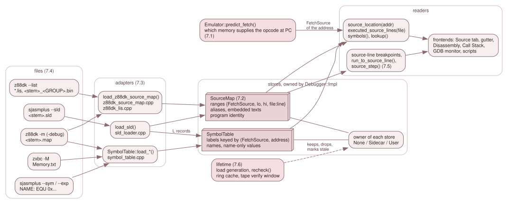

# 7. Source-level debugging

A program built from C, assembly or BASIC source can be debugged by `file:line`
instead of by address: a breakpoint set on a line, a step that moves a
statement at a time, a Source tab that follows the program counter. JNEXT does
this from files the toolchain already writes (an sjasmplus SLD, a z88dk map and
its listings, a NextBuild `Memory.txt`). It reads them into two stores and
answers every question about them from those stores plus one fact only the
running machine knows: which memory supplies the instruction at an address
right now.

This chapter is the maintainer's description of that machinery. The user's
side, with the procedures (loading a map, setting a line breakpoint, stepping
by statement), is chapter 10 of the user guide, *Source-level debugging*. Nothing
here repeats a procedure; where a page needs one, it says so and points there.

*The files on the left are written by other people's tools. An adapter reads
each into a store; the stores belong to the backend; the machine contributes
only the memory identity of the address being asked about. Lifetime (7.6)
decides what happens to the stores when the machine is replaced.*

## The three layers

**Adapters** know a file format and nothing else. Each parses a whole file
before it touches a store, and each hands over compiler-neutral data
([7.3](03-loaders.md), [7.4](04-formats.md)). They live in `src/debug/`:
`sld_loader.*`, `z88dk_source_map.*`, `z88dk_lis.*`, `z88dk_space.*` and the
loaders of `symbol_table.*`.

**Stores** know no format. `SourceMap` (`source_map.*`) holds ranges of bytes
tagged with the memory they came from ([7.2](02-the-source-map.md));
`SymbolTable` (`symbol_table.*`) holds labels keyed by that memory and an
address. Both are owned by `Debugger::Impl` and replaced only by a complete,
successful load.

**Consumers** ask a question and get an answer about the machine as it is now:
the location of an address, the addresses of a line, the name of a label, the
lines a run has executed. They go through the facade (`debug/debugger.h`);
none holds a store.

What ties the layers together is `MemSpace` (`debug/mem_space.h`), the type
that names *which memory* a byte lives in. A source range, a label and a
breakpoint are all qualified by it, and [7.1](01-which-memory.md) is the page
that explains why: on a Next the same logical address can be a RAM page, a
ROM, the DivMMC's memory or the Multiface's, and a line number is only
meaningful for one of them.

## The pages

| Page | Answers |
|---|---|
| [7.1 Which memory supplied the instruction](01-which-memory.md) | What `MemSpace` and `FetchSource` mean, how the machine predicts and records the one that supplies a fetch, how a space is spelled (the long address and its stable tags), and how coverage is keyed by it |
| [7.2 The source map](02-the-source-map.md) | The range store: the primary location, `lookup_all()`, `resolve()`, aliases, embedded texts, and the program identity |
| [7.3 Loading](03-loaders.md) | The adapter contract, content dispatch, the sidecar search, and who owns what |
| [7.4 File formats and records](04-formats.md) | One page per input: sjasmplus SLD and `--sym`/`--exp`, the z88dk map and listings, `Memory.txt`; each with the producer's code, the grammar, the rules and a real excerpt |
| [7.5 Breakpoints, steps, history and call frames](05-breakpoints-steps-history.md) | Source-line breakpoints, `source_step()`, Back and Reverse Continue, and the call stack they lean on |
| [7.6 Lifetime](06-lifetime.md) | What happens to the stores on a reset, a snapshot, a rewind, an RZX, a tape load or a dot command |
| [7.7 The frontends](07-frontends.md) | Who reads the stores: the Qt Source tab in full (refresh, file search, highlighter and schemes, gutter, selection sync with the Disassembly), the long address in the views, and the GDB, ZRCP, DZRP, script and command-line surfaces |
| [7.8 Tests, fixtures and adding a producer](08-tests-and-new-producers.md) | The suites, where the fixtures come from, and the checklist for supporting another toolchain |

## Where the code lives

| Area | Files |
|---|---|
| Stores and adapters | `src/debug/source_map.*`, `sld_loader.*`, `z88dk_space.*`, `z88dk_source_map.*`, `z88dk_lis.*`, `symbol_table.*`, `source_file.*`, `source_search.*` |
| Memory identity | `src/debug/mem_space.h`, `long_address.*`, `mem_coverage.*`; the arbiter in `src/memory/mmu.h`; `Emulator::predict_fetch()` in `src/core/emulator.cpp` |
| The backend's side | `src/debug/debugger_source.cpp` (stores, sidecars, lifetime, `source_step()`), `debugger_impl.h`, `debugger_events.cpp` and `debugger_control.cpp` (line breakpoints, run to line), `debugger_inspect.cpp` (coverage), `trace.*`, `call_stack.*` |
| The loop owners' side | `src/platform/emulator_boot.h` (`--source-map`), and the three `load_program_sidecars()` callers in `headless_app.cpp`, `sdl_app.cpp` and `gui/qt_app.cpp` |
| The Qt frontend | `src/debugger/source_panel.*`, `source_highlighter.*`, `breakpoint_model.*`, `debugger_manager.*`, `memory_text.h` |

## Who reads the stores today

[7.7](07-frontends.md) is the map from a frontend to the part of the chapter it depends on, with the
Qt Source tab described in full. In short: the Qt debugger draws the source; GDB prints it
(`monitor src`); ZRCP's `smartload` reaches the sidecars; scripts subscribe to `FILE:LINE`; the loop
owners attach `--source-map`; DZRP has no source surface at all (DeZog reads the SLD or map itself).

The facade verbs themselves (`load_map()`, `source_map()`, `source_location()`,
`source_step()`, `subscribe_source_line()`) are listed in
[3.9.1](../03-subsystems/09-1-the-backend-api.md).
