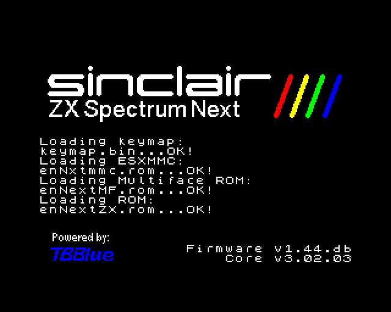
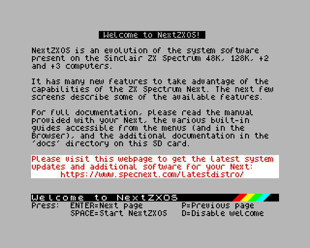
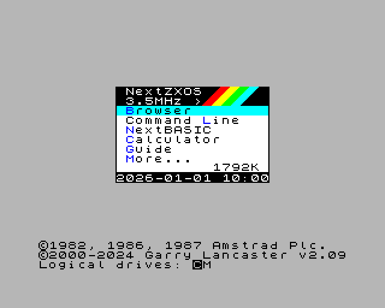

# The first boot

The machine boots in three visible stages.

**The firmware splash.** The Next's own boot firmware starts, loads the keymap
and the ROMs off the SD card, and reports the firmware and core versions.

**The NextZXOS welcome.** NextZXOS starts and introduces itself. Press **Enter**
to page through the welcome screens, **Space** to skip straight to the system,
or **D** to stop it appearing on future boots.

**The NextZXOS menu.** This is the working system: the Browser for loading
programs from the SD card, a command line, NextBASIC, and the built-in guide.
Move with the cursor keys and select with **Enter**.

If you reached this screen, everything works. The whole sequence takes a few
seconds.

**Fast boot.** A plain Next start (no program to load) runs its first 15
seconds at full speed with the sound off, so the firmware splash and the NextZXOS start-up
pass quickly instead of taking about twelve seconds. Press any key to return to
normal speed at once; **Shift** is a good choice, as it does nothing else. The
key you press still reaches the program. To reach the firmware's own menu, press
**Space** while the splash shows, or set **Fast boot** to Off in
**Settings > Preferences** (`--fast-boot 0` for one run, `--fast-boot SECONDS`
for another length).

To see nothing of the start-up and have the first picture be the screen fast boot
ends on (the NextZXOS welcome, or the menu once you have turned the welcome off
with **D**), tick **Hide the screen during fast boot**
in Preferences (`--set startup.fast_boot_hide_screen=true` for one run). The
window stays black until fast boot ends; any key shows the screen at once. If
the first picture is still the start-up, raise **Fast boot**.
