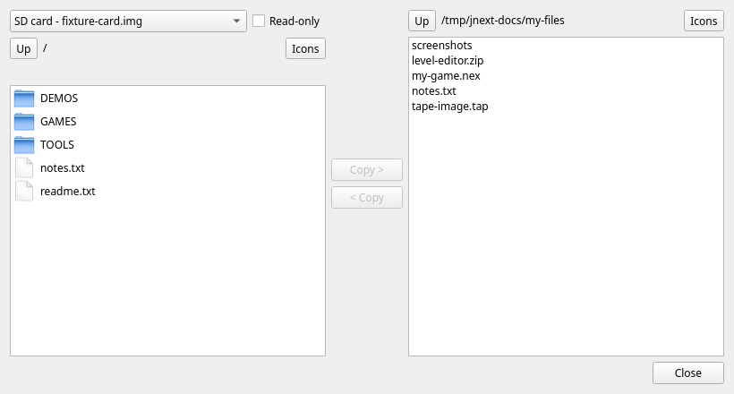

# 5.13 The SD card file manager

**File ▸ SD Card File Manager…** (or the SD card button on the toolbar, next to **Load**)
opens a window to move files between the SD card of the running machine and a folder
of your computer, with the mouse. The card is on the left, a folder of your computer
on the right. It needs no command line, and it works on the card that NextZXOS is
using, however it was made.



## Opening it

The machine is **paused** while the window is open, so that nothing in the guest
changes the card under your hands, and the status bar shows the paused indicator
(this is the same pause as **Machine ▸ Pause**). The window is modal: neither the main window
nor the debugger window takes keys until you close it. Closing it gives the machine back as it was:
running if it was running, paused if you had paused it yourself. The one exception
is a change to the card, described under [Changing the card](#changing-the-card).

The menu entry has no keyboard shortcut. It is refused, with a message, while the
SD-card upgrade or go-back actions are working on the card.

## The two panes

- **The card pane** (left) lists a folder of the card in the slot chosen in the box
  above it: **SD card** or **Second SD card (D:)**. A slot with no card is greyed.
  Names are shown as the card stores them, long names included. A name that holds a
  character outside plain ASCII (the card stores such names in code page 437, the
  DOS code page of FAT short names; an accented letter is one) is shown as `%XX`,
  two hex digits for each such byte, because the host cannot spell it; it works
  with every action. An entry the card cannot address by any name (a short name
  repeated behind an earlier entry, or a name holding the byte 7F) is listed but
  cannot be acted on, and its tooltip says so.
- **The host pane** (right) is an ordinary folder of your computer, with your
  desktop's own file icons.

Each pane has its own **Up** button and its own **Icons** button, which switches that
pane between a list and an icon view; the other pane is not touched. Double-click a
folder to enter it. The panes show only the folder you are in, one level at a time.

The card pane always shows what the machine has mounted. If the card in the slot is
changed from outside the window while it is open, the pane notices, says so, and shows the new card's top folder.

## What you can do

| To | Do this |
|---|---|
| Copy files and folders to the card | Select them in the host pane and press **< Copy**, or drag them onto the card pane |
| Copy files and folders to your computer | Select them in the card pane and press **Copy >**, or drag them onto the host pane |
| **Move** instead of copy | Hold **Shift** while you drop (the source is removed when it has been copied) |
| Rename | Select one item and press **F2**, or use the pane's context menu |
| Delete | Select items and press **Delete**, or use the context menu |
| Make a folder | **New Folder** in the pane's context menu |

The context menu (right-click) of each pane also offers **Copy**.

- **Folders** are copied with everything in them.
- If the name is already there, you are **asked** before it is replaced; a folder is
  merged into, replacing the files that have the same names.
- **Delete** on the host sends the item to your computer's **trash**. Delete on the
  card is **permanent**: the card has no trash, and the confirmation says so.
- A file JNEXT is itself using cannot be deleted, renamed or overwritten from this window: the card image of a slot, a writes
  file, a recording being made, a loaded tape. The message names the reason and
  nothing is touched.
- A copy that fails part way says what was done, what failed and what was not
  attempted.

## Read-only cards

The card pane has a **Read-only** box. Tick it to browse and copy *off* the card
with every card-writing action disabled. It is also ticked for you, and greyed, with
the reason shown beside the card, when the card cannot be written:

- the card is not FAT32 (JNEXT writes only the first FAT32 partition of a card; a FAT16 card is shown read-only);
- JNEXT was started with `--sdcard-readonly`;
- the machine state forbids a card change right now, for example an RZX recording is
  in progress;
- the card cannot be read at all.

Copying *off* a read-only card always works.

## Changing the card

NextZXOS keeps its idea of the card (the directories and the file system state) in the
memory of the machine. A change made behind its back would leave that stale, so a
card change ends in a **hard reset**.

The first time you change the card in a visit (a copy to it, a move, a rename, a
delete or a new folder on the card), the window asks **Change the SD card?** and tells
you the machine will restart when the window closes. If you say *No*, nothing
happens. When you close the window the machine is reset and runs again, and the
status bar says so. Browsing, and copying *to* your computer, never restart anything.

If the machine could not be reset at once, it restarts as soon as it can and stays
paused: press **Pause** again to run it.

If a card is mounted with `--sdcard-writes FILE`, the changes go to that file, as
every other write of the machine does ([3.3 Using your own image](../03-first-run/03-using-your-own-image.md)).

## What it remembers

The window opens on the card, the card folder and the host folder it was closed on,
also after JNEXT is restarted. The machine wins: if the card it remembers is no longer
mounted, it opens on the card that is (the first one), at its top folder; a folder
that has gone is replaced by the top folder (the card) or the nearest folder that
still exists (the host). No message is shown for any of this.

The three values are kept in the settings file and can be set from the command line
like any other setting:

```
jnext --set sdcard_manager.host_dir=$HOME/games
```

The keys are `sdcard_manager.card`, `sdcard_manager.card_dir` and
`sdcard_manager.host_dir`.
