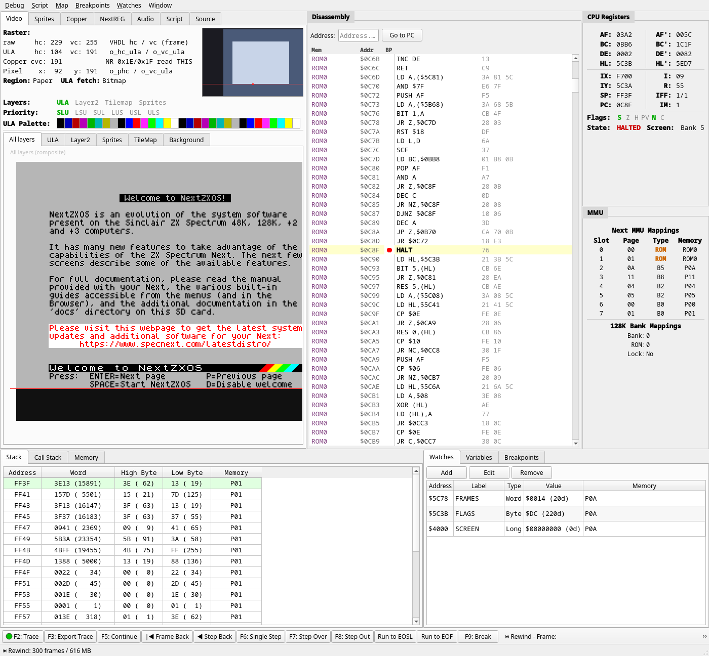

# 6. The debugger

JNEXT ships with a full source-less debugger for ZX Spectrum Next software: it
halts the machine at an instruction boundary and shows you the CPU, the memory
map, every video layer, the Copper program, the NextREG file and the AY
registers, all as the hardware sees them at that instant.

This chapter is a reference. Each panel and each function has its own section,
so you can look one up while you are debugging.

**[Debugger scripting](scripting/index.md)** has a section of its own: scripts
that watch the running machine and stop, log or check the moment something
happens — a write into your code, an MMU slot out of step, an interrupt handler
that returns with a clobbered register — in the GUI while you play, and
headless as tests in your build. It is the most powerful tool JNEXT gives you.

**[The Source Debugger](source-debugger/index.md)** is the other section of its
own: debugging a program by its source lines (C, assembly, BASIC) instead of its
instructions. It has a worked first session in C with z88dk, the build options
that make a source map, the sjasmplus and Boriel routes, and the messages and
limits to know. Start there if your program comes from a compiler.

Open the debugger with **Alt+D**, with **Debug ▸ Debugger** or **View ▸
Debugger** (the same entry, in both menus), or with the Debug button (a magnifier over a chip) on the
emulator toolbar. The same actions close it. While it is closed
the debugger costs nothing — no breakpoint checking, no call-stack tracking, no
panel refreshes. Closing it also resumes the machine if it was paused.

The debugger opens in its own window, positioned to the right of the emulator
window. It has its own menu bar — **Debug**, **Map**, **Breakpoints**,
**Watches** and **Window** — and a control toolbar along the bottom.

**Window ▸ Attach to emulator window** keeps it pinned to the emulator's
right-hand edge as you drag or resize that window; the setting is remembered
between sessions. This needs a window system that lets an application position
its own windows, so it works on **X11** and is unavailable on **Wayland**,
where the menu item is greyed out. That is not something JNEXT can work
around: Wayland's window-management protocol has no request for an application
to place its own window — placement belongs entirely to the compositor. To get
attachment under a Wayland session, run JNEXT on XWayland's X11 interface:

```console
$ QT_QPA_PLATFORM=xcb jnext
```

A native XWayland session reports itself as `xcb` and so looks like X11 from
inside the application, while the compositor still discards the moves. JNEXT
therefore checks whether its moves actually land, and if several in a row are
ignored it stops trying, unticks the menu item and says so in the status bar.
Re-tick it to retry. That automatic stop does not change your saved
preference.

## Which memory an address is in

An address alone does not say which memory answers it: `$C000` may be RAM page
`0x0E` today and page `0x14` tomorrow, `$0000` may be a ROM, the boot ROM or the
DivMMC. Where a view shows an address it also names the memory behind it, by the
tags of [the trace log](functions/06-the-trace-log.md): `P0E` (RAM page 0x0E),
`ROM0` to `ROM3`, `BOOT`, `DIVROM`, `DIVRAM3`, `MFROM`, `MFRAM`, `ALTROM0`,
`L2P12`, `CFG17`, `FLOAT`. The tag names the memory the bytes beside it came
from: the **live** memory for the Disassembly, Memory, MMU, Stack and Watches
views (what a read of that address returns now, an overlay included), the memory
the opcode comes from for the line at `PC` and for the Source tab, and the
**recorded** memory for the Call Stack and the trace log.

**Debug ▸ Physical Addresses** switches every view from the tags to the place
the byte sits in the Next's memory: `$060000` is the 21-bit address in the SRAM
(RAM page *n* is at `(n + 0x20) × 8 KB`; ROM, DivMMC and Multiface have their own
areas), and the two block RAMs and the boot ROM, which are not in the SRAM, read
`BRAM5+$0000`, `BRAM7+$0000` and `BOOT+$0000`. RAM pages 5 and 7 (`P0A`, `P0B`,
`P0E`) are the block RAMs the CPU reads, while Layer 2 sees the SRAM copy
`L2P0A`; the two are different memory. A machine that is not a Next has no such
layout, and the setting changes nothing there. The choice is kept between
sessions; `--set debugger.physical_addresses=true` applies it to one run.



The layout is fixed: video-related tabs on the top left, disassembly in the
centre, CPU registers and MMU down the right, and memory/stack tabs and
watch, variables and breakpoint tabs along the bottom. The splitters between the areas can be
dragged.

The window itself can be made smaller than the panels need. When it is, the
panel area gains scrollbars and pans instead of cutting anything off, and the
control toolbar along the bottom stays put — buttons that no longer fit move
into a **»** overflow menu at its right-hand end. The size is remembered
between sessions, and is clamped to the screen it reopens on, so a window saved
on a large monitor never comes back unreachable on a small one.

Five panels — CPU Registers, Disassembly, Stack, Call Stack and Variables — only show data
while the machine is **paused** (CPU Registers and Disassembly are also greyed out while it runs). That is
deliberate: reading them every frame would slow the emulation down for no
benefit, since the values would be a blur. The rest refresh about four times a
second while the machine is running, except the Video panel's layer views, which
show a dark placeholder until you pause.

---
