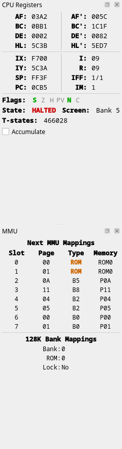

# CPU registers

The full Z80 state at the paused instruction:

- `AF` `BC` `DE` `HL` and the alternate set `AF'` `BC'` `DE'` `HL'`
- `IX` `IY` `SP` `PC`
- `I`, `R`, `IFF` (shown as `IFF1/IFF2`) and the interrupt mode `IM`
- **Flags** — `S Z H PV N C`, green and bold when set, grey when clear
- **State** — `Running`, or `HALTED` in red when the CPU is in a `HALT`
- **Screen** — which bank the ULA is displaying (`Bank 5` or `Bank 7`), plus the
  Timex mode when one is active (`Alt`, `HiCol`, `HiRes`)
- **T-states** — the CPU T-states executed since the last stop. After a single
  step it is what that instruction took; after a run to a breakpoint, a Step Over
  or a Pause, what the whole run took. Tick **Accumulate** to add the stops up
  instead: the total starts at 0 when you tick it and grows across steps and
  runs until you untick it. The count starts again at 0 when time goes back
  (Step Back, Frame Back, the rewind bar, Reverse Continue), after a hard reset
  or a program load, and when the debugger window opens; a soft reset does not
  restart it. At 7, 14 or 28 MHz each instruction counts its own T-states at the
  speed in force (a NOP is 4 at any speed).

All values are read-only here; to change memory or a NextREG use the Memory or
NextREG panels.
