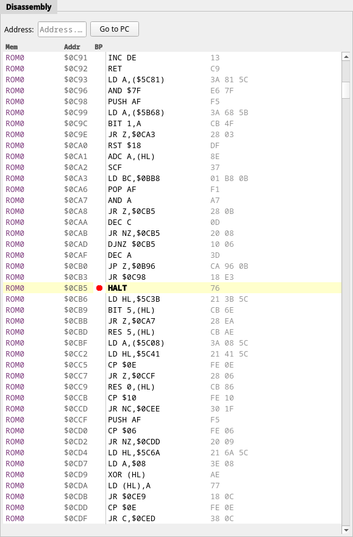

# Disassembly



Z80 plus all 26 Z80N instructions, disassembled live from memory as the CPU
sees it. Columns, left to right, are the **Mem** column (which memory the
line's bytes come from: `P04`, `ROM0`, `DIVROM`, or the physical address;
[details](../index.md#which-memory-an-address-is-in)), the address, the **BP**
column (the breakpoint gutter), the mnemonic and the raw opcode bytes, so the
instruction sits next to where you set its breakpoint. At a DivMMC entry the line at `PC` shows the
DivMMC ROM's instruction, the one the CPU is about to run, with `DIVROM` beside it. The line at `PC` is highlighted in yellow and set in bold;
the lines you select are highlighted in blue — over the top of the yellow, so
the `PC` line stays recognisable inside a selection, and clear of the BP column,
so breakpoint dots stay visible.

- **Click the BP column** (the gutter between the address and the instruction) on any line to set or clear an execute breakpoint (shown
  as a red dot). A breakpoint that has been
  [suspended](08-breakpoints.md) — unticked in the Breakpoints panel, or
  covered by its master switch — is drawn as a hollow red ring instead;
  clicking its gutter still removes it. The gutter draws and changes only this window's own
  breakpoints, never one that GDB, ZRCP, DeZog or a script set: see
  [Whose breakpoints the gutters show and change](08-breakpoints.md#whose-breakpoints-the-gutters-show-and-change).
- With [memory coverage](../functions/15-memory-coverage.md) on, a green bar
  sits just right of the BP column, before the instruction, on every line whose instruction ran.
- **Click and drag** over the listing to select a range of lines, or click one
  line to select just that one. **Shift+click** extends the selection from
  where it started, and **Shift + ↑ ↓ Page Up/Down Home End** do the same from
  the keyboard. **Ctrl+A** selects everything in the view.
- **Address** box: type a hex address (`8000`, `$8000`, `0x8000`) or a loaded
  symbol and press Enter to centre the view there. A number wins over a symbol
  spelled like one; write `@name` to mean the symbol.
- **Go to PC** re-centres on the current instruction.
- A **Label** column appears between the BP column and the instruction once any label is known: the name
  of the line's own address in its memory, loaded or your own, shortened after 16 characters. Your
  comment follows the opcode bytes as `; first line`. See
  [Your own labels and comments](../functions/16-user-labels-and-comments.md).
- With a source map loaded, a selection here moves the [Source](15-source.md) tab (the cursor goes
  to the line of the instruction you clicked, and the lines of the whole range are tinted), and the
  instructions of the Source tab's selected lines are tinted pale violet here. The right-click menu
  adds **Show in Source**, which raises the Source tab on the line of that instruction; it is
  disabled, with the tooltip *no source line at $A000*, where no line covers the address, and not
  offered without a source map.
- The scrollbar spans the whole `$0000`–`$FFFF` address space. **↑ ↓**,
  **Page Up/Down**, **Home** and **End** navigate; **Enter** runs to the
  selected line.

## Copying the listing

**Ctrl+C**, or **Copy** in the right-click menu, puts the selected lines on the
clipboard as **assembly only** — mnemonics and operands, one instruction per
line, indented four spaces. The address column, the opcode bytes and the
breakpoint gutter are all stripped, and symbols from a loaded
[MAP file](../functions/05-symbols-from-z88dk-map-files.md) are kept, so what
you paste is what you would have written by hand:

```
    LD HL,screen_buf
    NOP
    CALL entry
```

**Copy with Addresses** is the same selection with the address and opcode
columns kept, for a bug report or an annotated trace. It keeps the order of an
assembler listing (address, bytes, instruction), not the panel's:

```
$8000  21 34 12     LD HL,screen_buf
$8003  00           NOP
$8004  CD 00 80     CALL entry
```

A z88dk C symbol is painted by its C name (`counter`) but copied by its
assembler name (`_counter`), so the pasted text still assembles.

Right-clicking inside the selection keeps it; right-clicking outside collapses
it onto the line you clicked, so **Copy** on a line you have not selected
copies that one line. Both chords only apply while the disassembly panel has
focus — click in it first if you have been typing somewhere else.

A few things worth knowing:

- The selection is a range of **addresses**, not of screen rows. Scrolling the
  view, stepping the CPU and **Go to PC** all leave it alone, and a copy still
  produces the whole range even when none of it is on screen any more.
- The text is disassembled from memory **at the moment you copy**, not from
  what is painted. That is what makes the point above work, and it also means
  copying while the machine runs freely — when the panel has deliberately
  stopped redrawing — gives you the code that is in memory now.
- Copying with nothing selected does nothing; it never clears the clipboard.

## What the line at PC is about to do

While the machine is paused, the line at `PC` ends with a hint in blue, after
its opcode bytes:

- For a conditional jump, call or return (`JP cc`, `JR cc`, `CALL cc`, `RET cc`)
  and for `DJNZ`, it shows `[taken]` or `[not taken]`, judged from the current
  flags (or from `B` for `DJNZ`). For `RET cc` a taken return also shows where
  it goes, as `[taken -> address]`, because the return address is on the stack
  and not in the instruction.
- For an instruction with a memory operand written as `(HL)`, `(BC)`, `(DE)`,
  `(IX+d)`, `(IY+d)`, `(nn)` or `(SP)`, it shows the address and the value
  there, as `[(address)=$value]`: a byte, or a word for the 16-bit loads and
  `EX (SP),HL`. For `(IX+d)` this is the only place the final address appears.
  An address that has a label is shown by its name.

The hint describes the instruction as it will run from the current state. It is
read from the registers and memory without disturbing anything, and never from
an I/O port, so an `IN` or `OUT` has none. At a DivMMC or Multiface entry
point, where the instruction itself switches that memory in or out, the value is read
from the memory the instruction will see. A pending interrupt can run before the instruction does,
and then the hint and the arrow and marker below do not apply. The hint, the arrow and the marker are not copied
with the listing, and none of them is shown while the machine is running.

### Where it goes

A jump, call or return that will be taken shows where it goes:

- an arrow after the hint: ↑ when the destination is above in the listing, ↓ when it is
  below, ↺ when it is the line itself (`JR $`). A condition that does not hold shows
  nothing more, and neither do `JP (C)`, `HALT` and the repeating block instructions
  (`LDIR` and the like), which are not jumps;
- the destination line, when it is in the view, shows `[<- PC]` in the same blue column.
  It stays marked when you scroll the `PC` line out of view, so you can follow the arrow
  to it. A destination inside an instruction, as the listing decodes it, marks no line:
  Follow (**F12**) shows the code decoded from there;
- `RET`, `RETI`, `RETN` and `JP (HL)` / `(IX)` / `(IY)` write their destination nowhere on
  the line, so it is shown before the arrow, as `[-> address]` (by name when it has a
  label).

```text
P04  $8756      LD A,$05          3E 05      [<- PC]
P04  $8758      PUSH AF           F5
 ...
P04  $8767      JR Z,$8756        28 ED      [taken] ↑
```

Stopped on a `RET` instead (a separate stop), the `PC` line reads:

```text
P04  $8771      RET               C9         [-> $8E02] ↓
```

The marked line shows the memory mapped now, like every line other than the `PC` line:
after `RST $08` into DivMMC the jump maps the DivMMC ROM in, and the line at `$0008` still
shows the ROM mapped now.

## Navigating: Follow, Back and Forward

**Follow** (**F12**, the **Go** menu, or the right-click menu) takes the line with the caret (the `PC` line when there is none) to
where it goes:

- a jump, call or relative jump (`JP`, `CALL`, `JR`, `DJNZ`, `RST`) goes to its target. A
  conditional one is followed whether or not its condition holds: Follow is about the
  operand, and the hint on the `PC` line already says taken or not;
- `JP (HL)`, `JP (IX)` and `JP (IY)` go to the register as it is now, and `RET`, `RETI`
  and `RETN` (conditional or not) to the return address at `SP` as it is now;
- an instruction with a memory operand (`(HL)`, `(BC)`, `(DE)`, `(IX+d)`, `(IY+d)`,
  `(nn)`, `(SP)`) shows that address in the [Memory](04-memory.md) panel, in its CPU
  view, and raises its tab. The Disassembly does not move;
- anything else does nothing. `JP (C)` has no target: it needs a port read, which the
  debugger never does.

**Back** (**Alt+Left**) and **Forward** (**Alt+Right**) return through the places the view left
by a jump: the last 100 are kept, and Back puts the view and the caret exactly where they were.
A jump is a Follow, the Address box, **Go to PC**, and a request from another panel: **Show in
Disassembly** from the Source tab, a click on a register or a row of the
[Symbols](17-symbols.md) tab. The automatic re-centre on every stop, scrolling and the keys
do not record. Jumping somewhere new discards what Forward could have gone back to. When the
keyboard focus is in the Source tab's text, the three keys act on the Source tab instead.

The three keys are rebindable: [Changing the keys](../functions/09-changing-the-keys.md).

## The right-click menu

The right-click menu is where most of the day-to-day work happens:

| Entry | Effect |
|---|---|
| Copy | The selected lines as assembly only |
| Copy with Addresses | The selected lines with the address and opcode columns |
| Select All | Select every line in the view |
| Toggle Breakpoint | Execute breakpoint on this line |
| Run to Here | Resume until this address is reached |
| Go to Address… | Jump to the address box |
| Add / Rename Label…, Remove Label, Add / Edit Comment… | Your own label and comment for this line's address, in its memory ([Your own labels and comments](../functions/16-user-labels-and-comments.md)) |
| Watch *symbol* / Watch `$nnnn` | Watch this line's symbol, or a 16-bit immediate in the instruction |
| Watch `(HL)` `(DE)` `(BC)` `(IX` `(IY` `(SP)` | Watch the address the register currently holds |
| Break on Read / Break on Write | Data breakpoint on that immediate, or on the register's current value |

The register entries only appear when the instruction actually references that
register indirectly, and they capture the register's value *at the moment you
open the menu* — they are a shortcut for "watch what HL is pointing at right
now", not a moving target.

The panel does not follow `PC` while the machine runs freely, or during a
"Run to Here" — it is only redrawn when execution stops.
