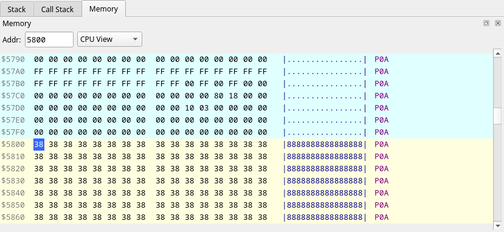

# Memory

A hex editor over the address space: address, sixteen bytes in two groups of
eight, the ASCII rendering and, after it, the tag of the memory the row's bytes
come from (`P0A`, `ROM0`, `DIVROM`; the physical address in
[the physical style](../index.md#which-memory-an-address-is-in)).

- The **Addr** box takes a hex address (`5800`, `$5800` or `0x5800`) or a
  loaded symbol (`@name` when the name looks like a number) and centres the
  view on it.
- The **page selector** chooses the window. `CPU View` shows the whole 64K as
  the CPU sees it — paged-in DivMMC, Multiface or Layer 2 memory included.
  `Slot 0`–`Slot 7` show the 8K **page** mapped in that slot (its label names
  it as `Slot 6 (P14)` or `Slot 0 (ROM0)`, and follows the program's paging) — the page itself, so a DivMMC,
  Multiface or Layer 2 overlay switched on over the slot does not show there;
  a ROM slot shows the ROM. `Page...` asks for a page number (hex, `00`–`DF`,
  the numbering of `NEXTREG $50`–`$57`) and shows that page whether any slot
  maps it or not.
- In `CPU View`, rows are colour-coded: the row containing `SP` in orange,
  pixel VRAM `$4000`–`$57FF` in cyan, and attributes `$5800`–`$5AFF` in yellow.

With [memory coverage](../functions/15-memory-coverage.md) on, each byte the
program executed, read or wrote has a three-part underline (green X, blue R,
orange-red W) and the top bar shows the key.

To edit, click a byte and type two hex digits — the write happens on the second
digit and the selection advances to the next byte. Arrow keys move the
selection, **Page Up/Down**, **Home** and **End** scroll, and **Esc** clears
the selection. In `CPU View` writes go through the MMU exactly as a `LD (nn),A`
would, so ROM stays read-only; in a slot or `Page...` view they write the page
itself, where an overlay does not see them, and a ROM slot stays read-only. While an RZX recording or playback is running an edit is
refused — a write the recording does not contain would make its replay go
wrong — and the byte keeps its value.

## Find, save, load and fill

Right-click the panel (or press the **Menu** key or **Shift+F10**) for the tools menu:
**Find...**, **Find Next**, **Save Block...**, **Load Block...** and **Fill Block...**. A right-click on a
byte selects it first. **Find Next** is greyed until you have made a find. Each tool answers in the
debugger window's status bar, where the text stays for a few seconds like a rewind refusal.

All four work on the view the selector shows. A start address is in that view's own numbering: the CPU
address in `CPU View`, the offset inside the 8K page (`0000`-`1FFF`) in a slot or `Page...` view. The Start
box takes a number or a symbol, like the Addr box, and opens on the selected byte (or the first row on
screen). Lengths are in hex (`1B00`, `$1B00` or `0x1B00`), like every number in the panel.

- **Find** looks for hex bytes or text. In hex mode the pattern is pairs of digits, spaced or not
  (`CD 34 12`, `cd3412`); a `?` stands for any digit, so `CD ?? 80` matches `CD` then any byte then `80`,
  and `2?` matches `$20`-`$2F`. The optional **Mask** is hex bytes of the same count: where a mask bit is
  0 the byte's bit is ignored (`FF 00 FE` ignores the middle byte and the low bit of the last). In text
  mode, tick **Text**: printable ASCII, and **Match case** off matches `key` against `KEY`. The search
  covers the selected view only (the 64K of `CPU View`, or the 8K of a slot or page), starting at the
  selected byte (or the top of the view), and the first matching byte becomes the selection. **Find
  Next** continues from the byte after it, and wraps round to the top of the view, saying `(wrapped)`.
  The Disassembly follows a hit when the byte has a CPU address: in `CPU View` its own, in a slot view the
  slot's, in a `Page...` view the lowest slot that maps the page. A page no slot maps cannot be shown
  there, and the message says so.
- **Save Block** writes `Length` bytes from `Start` to a file, raw, as the view shows them.
- **Load Block** reads a raw file into memory at `Start`. Leave **Length** blank to load the whole
  file; a Length shorter than the file loads only that much. A file shorter than the Length loads what
  it has, and the message says `Loaded 4 of 8 bytes ... the file holds only 4 bytes`.
- **Fill Block** repeats the **Value** (hex bytes: `00`, `DE AD BE`) over `Length` bytes from `Start`; the
  last repetition is cut to fit.

A block in `CPU View` never wraps past `$FFFF`: a block that would is refused (Save, Fill) or cut there
(Load, with the reason in the message). A block in a slot or `Page...` view carries on into the following
pages, up to page `DF`. Bytes that fall on ROM are skipped, and the message says how many landed (`Loaded 8
of 16 bytes ... the rest is ROM, which is read-only`); a Load or Fill that lands nothing because the whole
block is ROM says `ROM is read-only`.

Load and Fill work while the machine runs, like typing a byte, and count as a memory edit for
[rewind](../functions/07-backward-execution-rewind.md): they are refused while an RZX recording or
playback is running, as an edit is. Find and Save only read, so they work in both.
