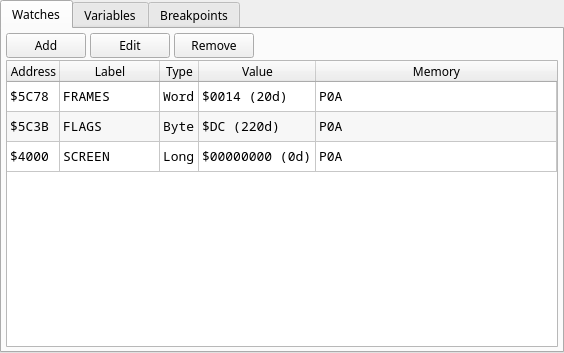

# Watches

A list of addresses whose values you want to keep an eye on: address, your
label, the size, and the live value. **Add**, **Edit** and **Remove** manage
the list; you can also add a watch from the disassembly right-click menu, or
from **Watches ▸ Add Watch…** in the menu bar. A watch you add by typing a
symbol is labelled with it; a z88dk C symbol is labelled with its C name
(`counter`, also when you typed `_counter`). See
[Watches and watch sizes](../functions/04-watches-and-watch-sizes.md) for what the sizes mean.
