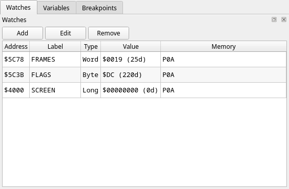

# Watches

A list of addresses whose values you want to keep an eye on: address, your
label, the size, the live value and the **Memory** the address reads from now
(`P00`, `P14`: it follows the program's paging;
[details](../index.md#which-memory-an-address-is-in)). **Add**, **Edit** and **Remove** manage
the list; you can also add a watch from the disassembly right-click menu, or
from **Watches ▸ Add Watch…** in the menu bar. A watch you add by typing a
symbol is labelled with it; a z88dk C symbol is labelled with its C name
(`counter`, also when you typed `_counter`). A **C variable** is added from the [Variables](16-variables.md) tab (right-click ▸
**Watch**): its row shows the variable's path, the C type, the value and where it is, is read at each stop (not while the
machine runs), and cannot be edited. A local says `(in function)` and reads in the newest call of that function, or
`out of scope` when there is none. An **expression** watch (Type ▸ **Expression** in the Add/Edit dialog) shows the value of any
[debugger-script expression](../scripting/04-reading-the-machine.md): registers (`HL`, `A`), `mem16[@ptr]`, `phys[0x0A, 0x100]`,
symbols (`@name`) and arithmetic. Names are upper case, and `4000` is decimal there (use `$4000` or `0x4000` for hex), so `BC`
is the register, not the address `$00BC`. A text that does not compile, or that names an event's data (`ADDR`), is refused
with the reason when you press OK. The value is re-evaluated at every stop and about four times a second while the machine
runs; an expression that fails at run time (a division by zero, `mem[]` out of range) shows its error in the Value cell
until it succeeds again. An expression row has no address or Memory column. See
[Watches and watch sizes](../functions/04-watches-and-watch-sizes.md) for what the sizes mean.
