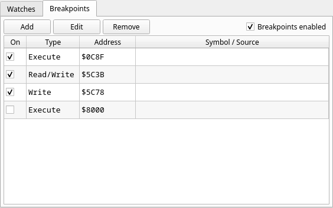

# Breakpoints

Every breakpoint in one list, sorted by address: an **On** checkbox, the type,
the address and — with a MAP file loaded — the symbol at that address, or with
a source map the source line. The Add dialog takes a symbol or, for an Execute
breakpoint, a source line (`main.bas:120`); see
[Source-level debugging](../functions/14-source-level-debugging.md).
**Add**, **Edit** and **Remove** manage them; double-clicking a row edits it.
The list, the disassembly gutter and the Source tab's BP column stay in sync in both directions.

## Whose breakpoints the gutters show and change

Every breakpoint belongs to whoever set it. The debugger window is one owner; GDB
(`z88dk-gdb`, a GDB-protocol client), ZRCP, DZRP (DeZog in VS Code) and a debugger script are
others, each its own. They all stop the same machine, and the **Breakpoints panel** lists all
of them together, but the **breakpoint column of the Disassembly and of the Source tab** draws
and edits only the debugger window's own breakpoints:

- **Drawing.** A red dot or ring in either column is a breakpoint this window set (a gutter
  click, **Toggle Breakpoint**, the Add dialog, the Breakpoints menu). An Execute breakpoint
  that GDB, ZRCP, DeZog or a script set at the same address draws nothing there. It is a row in
  the Breakpoints panel, marked `(client N)` after its type, read-only: its **On** box cannot be
  ticked, and **Edit** and **Remove** refuse it.
- **Clicking.** A click on a line that carries only someone else's breakpoint **adds the window's
  own** breakpoint beside it (two rows in the list, the line now shows a dot) and does not touch
  the other. A click on a line with the window's own breakpoint removes **that** one only. The
  window never removes another client's breakpoint, from a gutter, from the right-click menu,
  from **Remove** or from **Clear All Breakpoints** (which clears only the window's own).
- **Seeing and removing the others.** Read them in the Breakpoints panel. To remove one, use the
  tool that set it (`delete` in GDB, the breakpoint list in DeZog, the ZRCP command, the
  script). The **Breakpoints enabled** master switch below is shared: unticking it suspends every
  owner's breakpoints.
- **Data breakpoints** (Read, Write, ports) are not drawn in the gutters at all, whoever owns them.

## Turning breakpoints off without losing them

Deleting a breakpoint to get past it, and typing the address back in
afterwards, is the thing this panel exists to stop.

- **The On checkbox** on a row disables just that breakpoint. It stays in the
  list with its address and type; it simply does not fire. Tick it again and it
  is back exactly as it was. Every breakpoint is created **enabled**, from
  every route — the Add dialog, the Breakpoints menu, a gutter click or the
  disassembly's right-click menu.
- **Breakpoints enabled**, next to the buttons, is the **master switch**. Unticking
  it suspends *every* breakpoint and watchpoint at once, and ticking it back
  restores each one to its own On state — the individual checkboxes are left
  alone while it is off, which is what makes the round trip exact. Use it to
  let a program run through a session's worth of breakpoints and then pick up
  where you left off.

Step Into, Step Over, Step Out and **Run to Here** keep working while the
master switch is off, so a suspended machine is still one you can walk through.

## Watchpoints watch the *program*, not you

A read or write watchpoint fires on an access made by the program you are
running. Looking at the same address — keeping it in the Watches panel,
scrolling the Memory panel over it, having it in the displayed part of the
stack — is not an access and never stops the machine, however often the panels
refresh. Saving a snapshot does not trip one either.

So you can safely watch an address in a panel and watchpoint it at the same
time, which is usually what you want to do.

In the disassembly gutter and the Source tab's BP column, a suspended breakpoint — individually disabled, or
any breakpoint while the master switch is off — is drawn as a **hollow red
ring** instead of a filled red dot. It stays visible, in the same place, so you
can still see where your breakpoints are; it just does not look armed.
