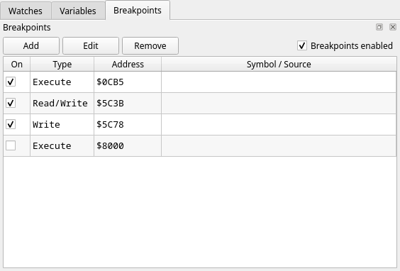

# Breakpoints

Every breakpoint in one list, sorted by address: an **On** checkbox, the type
(Execute, Read, Write, Read/Write, IO Read, IO Write, Interrupt, NMI or Audio Write), the address
(empty for Interrupt and NMI, which have none; for Audio Write, what it watches) and — with a MAP file loaded — the symbol at
that address, or with a source map the source line. The Add dialog takes a symbol or, for an Execute
breakpoint, a source line (`main.bas:120`); see
[Breakpoints on a source line](../source-debugger/06-breakpoints-and-steps.md).
The **Hits** column counts how many times each of your own breakpoints fired (another client's row
shows none), and **Reset Hits** zeroes them all; a breakpoint made with *Count hits only* shows
`(count only)` after its type and never stops the machine
([counting hits](../functions/03-breakpoints-execute-read-write.md#counting-hits-instead-of-stopping)).
The **Condition** column shows the condition of your own breakpoints (a tooltip carries the last run-time error
of one that failed; another client's conditional breakpoint reads `(condition)`). An address range reads
`$8000-$80FF` and a port with its own mask `$00FE/FFFF`
([ranges, masks and conditions](../functions/03-breakpoints-execute-read-write.md#ranges-port-masks-and-conditions)).
**Add**, **Edit** and **Remove** manage them; double-clicking a row edits it.
**Breakpoints ▸ Save as Script…** keeps your own breakpoints in a file and
**Load from Script…** brings them back
([how](../functions/03-breakpoints-execute-read-write.md#saving-and-loading-breakpoints)).
The list, the disassembly gutter and the Source tab's BP column stay in sync in both directions.
A breakpoint qualified with the memory its opcode comes from reads `$8005 P04` or
`$0008 DIVROM` in the address column
([which memory an address is in](../index.md#which-memory-an-address-is-in)); the `@14`
of `$C000 @14` is another client's *page* qualifier (a DZRP or script breakpoint), which
is a different thing.

## Audio Write breakpoints

The **Audio Write** type stops the machine on a write to the sound hardware. The dialog has:

- **Audio target**: *AY register* (a write to an AY register), *AY chip select* (a TurboSound
  chip-select command), *DAC* (the DAC ports and the NextREG 0x2C to 0x2E mirror of them) or
  *Any* (every target, the beeper included).
- **AY chip / DAC channel**: *Any*, the AY chip 0 to 2, or the DAC channel A to D. It is off for *Any*.
- **AY register**: *Any* or R0 to R15, for the *AY register* target. R13 reads
  *R13 (envelope restart)*: every applied write to it restarts the envelope, even one that does not
  change the value.
- **Value** and **Value mask** (hex, two digits): stop only on a written byte whose bits under the
  mask equal the value. A mask needs a value, and the value cannot have bits outside the mask.
- **Dropped writes only** (with the DAC target the channel is forced to *Any*: a discarded DAC write reached no channel): stop on the writes the machine discarded instead of the applied ones.
  Unticked (the default), a write the machine discarded (the AY ports switched off, the chip held in
  reset, a DAC that is off) does not stop, because it never reached the chip.

The row reads, for example, `AY1 R13 restart`, `AY R7 value 0x38`, `AY select 2`, `DAC dropped` or
`Any audio`. The machine stops after the instruction that wrote, except for a write through the NextREG
mirror by the CPU and a Copper write, which stop one instruction later. A breakpoint made by a script
(`on ay_write reg 8..10`) that the dialog cannot express is listed read-only.

**Save as Script** writes an Audio Write breakpoint as `on ay_write ...` when it is an AY register
write, and as `on audio_write ...` for every other target and for *Dropped writes only*; nothing is
left out, and `jnext --script FILE` runs the file
([events](../scripting/03-events.md#audio-ay_write-audio_write)).

## Whose breakpoints the gutters show and change

Every breakpoint belongs to whoever set it. The debugger window is one owner; GDB
(`z88dk-gdb`, a GDB-protocol client), ZRCP, DZRP (DeZog in VS Code) and a debugger script are
others, each its own. They all stop the same machine, and the **Breakpoints panel** lists all
of them together, but the **breakpoint column of the Disassembly and of the Source tab** draws
and edits only the debugger window's own breakpoints:

- **Drawing.** A red dot or ring in either column is a breakpoint this window set (a gutter
  click, **Toggle Breakpoint**, the Add dialog, the Breakpoints menu). An Execute breakpoint
  that GDB, ZRCP, DeZog or a script set at the same address draws nothing there. It is a row in
  the Breakpoints panel, marked `(client N)` after its type, read-only: its **On** box cannot be
  ticked, and **Edit** and **Remove** refuse it.
- **Clicking.** A click on a line that carries only someone else's breakpoint **adds the window's
  own** breakpoint beside it (two rows in the list, the line now shows a dot) and does not touch
  the other. A click on a line with the window's own breakpoint removes **that** one only. The
  window never removes another client's breakpoint, from a gutter, from the right-click menu,
  from **Remove** or from **Clear All Breakpoints** (which clears only the window's own).
- **Seeing and removing the others.** Read them in the Breakpoints panel. To remove one, use the
  tool that set it (`delete` in GDB, the breakpoint list in DeZog, the ZRCP command, the
  script). The **Breakpoints enabled** master switch below is shared: unticking it suspends every
  owner's breakpoints.
- **Data breakpoints** (Read, Write, ports) are not drawn in the gutters at all, whoever owns them.
- **Count-only breakpoints, ranges and conditional breakpoints** are not drawn in the gutters either; the gutters
  show and toggle plain breakpoints only, so a click beside one of them adds a plain one.

## Turning breakpoints off without losing them

Deleting a breakpoint to get past it, and typing the address back in
afterwards, is the thing this panel exists to stop.

- **The On checkbox** on a row disables just that breakpoint. It stays in the
  list with its address and type; it simply does not fire. Tick it again and it
  is back exactly as it was. Every breakpoint is created **enabled**, from
  every route — the Add dialog, the Breakpoints menu, a gutter click or the
  disassembly's right-click menu.
- **Breakpoints enabled**, next to the buttons, is the **master switch**. Unticking
  it suspends *every* breakpoint and watchpoint at once, and ticking it back
  restores each one to its own On state — the individual checkboxes are left
  alone while it is off, which is what makes the round trip exact. Use it to
  let a program run through a session's worth of breakpoints and then pick up
  where you left off.

Step Into, Step Over, Step Out and **Run to Here** keep working while the
master switch is off, so a suspended machine is still one you can walk through.

## Watchpoints watch the *program*, not you

A read or write watchpoint fires on an access made by the program you are
running. Looking at the same address — keeping it in the Watches panel,
scrolling the Memory panel over it, having it in the displayed part of the
stack — is not an access and never stops the machine, however often the panels
refresh. Saving a snapshot does not trip one either.

So you can safely watch an address in a panel and watchpoint it at the same
time, which is usually what you want to do.

In the disassembly gutter and the Source tab's BP column, a suspended breakpoint — individually disabled, or
any breakpoint while the master switch is off — is drawn as a **hollow red
ring** instead of a filled red dot. It stays visible, in the same place, so you
can still see where your breakpoints are; it just does not look armed.
