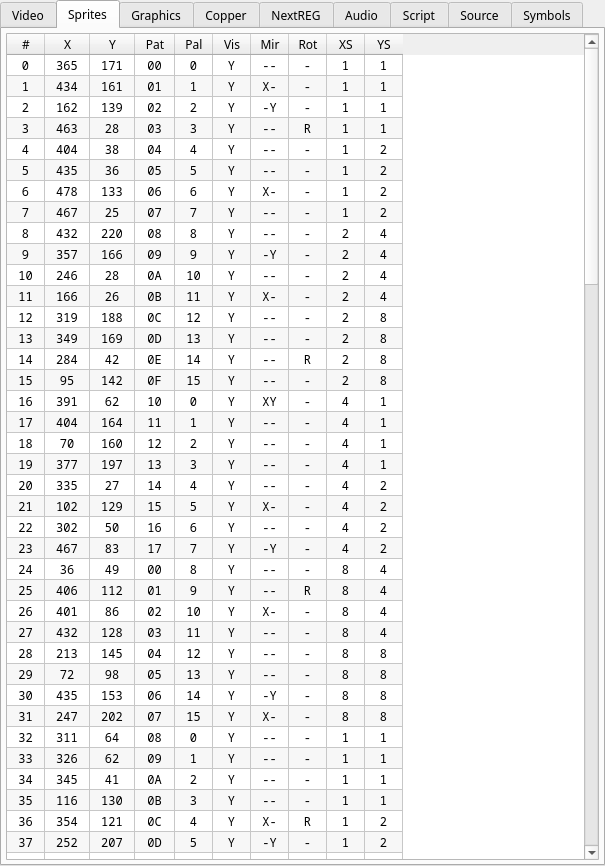

# Sprites

All 128 sprite slots, one per row: index, `X`, `Y`, pattern number, palette
offset, visible, mirror (`X`/`Y`), rotate, and the X and Y scale factors as
`1`, `2`, `4` or `8`.

The pattern graphics themselves are on the [Graphics](18-graphics.md) tab.
