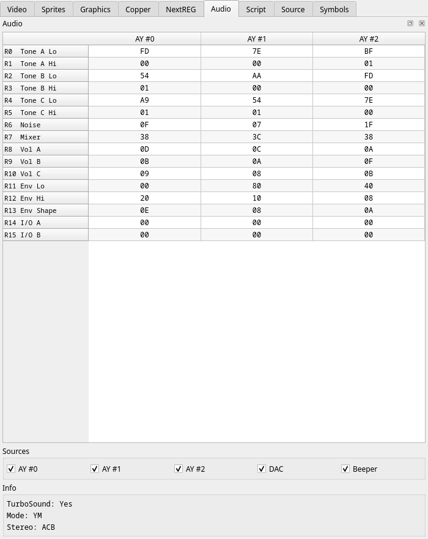

# Audio

The **Sources** strip at the top lets you mute each AY chip, the DAC and the
beeper independently, whichever tab is showing; a checked box is audible. This
is a debugging aid on the output stage only: the Z80 cannot observe it, and it
is not part of a saved state or a rewind slot, so muting a chip to work out
which one is making a noise does not change the program's behaviour.

Each channel also has its own **M** (mute) and **S** (solo) buttons, described
under [Mute and solo](#mute-and-solo) below.

Below it are five tabs: **Chips**, **DAC & Beeper**, **Log**, **Tracker** and
**Scopes**. Log, Tracker and Scopes are not available yet.

## Chips

The header reports whether TurboSound is enabled, whether the chips are in AY
or YM mode, whether the stereo layout is ABC or ACB, the PSG mode set in
NextREG 0x06 (YM, AY, YM ZXN-8950, or held in reset) and whether the AY ports
are open. The last line counts the AY writes the machine discarded; click
**show** to jump to the table that says why (see DAC & Beeper below).

Each of the three chips has a block of its own:

- the chip header: **ACTIVE** marks the chip the AY ports reach, then the
  register address latch (`0x00` to `0x1F`; with bit 4 set the writes are
  ignored, as on the hardware), the pan (`L R`, `L -`, `- R`, `- -`), whether
  the chip is mono, and whether it reaches the mix;
- one row per channel: the tone period, the note and the cents off it, **T**
  and **N** (lit when the mixer register enables the tone or the noise on that
  channel), the volume or `Env` when the channel follows the envelope, and a
  level bar;
- the noise period, the envelope shape drawn as four characters (`\___`,
  `/___`, `\\\\`, `\/\/`, `\'''`, `////`, `/'''`, `/\/\`), the envelope period,
  its note (only for the shapes that repeat: 8, 10, 12 and 14) and the current
  step with its direction (`31 falling`, `0 rising`, `31 holding`).

Notes are named at the PSG clock the emulated machine runs at, 1.75 MHz on a
Next. A tuning table made for the 128K Spectrum (1.7734 MHz) therefore plays
about 23 cents flat here, and the panel shows that. The level bar is the level
the channel plays when its tone or noise gate is open, so it does not flicker
with the square wave. Every write to register 13 restarts the envelope, so the
step shown right after one is the start of the new shape.

The **Hex** box swaps the decoded view for the raw table: all 16 registers of
the three chips side by side, named.

The Chips tab is refreshed every frame while the Audio panel is visible and
Chips is the current tab; with another tab current, or the panel hidden behind
another one, the panel is refreshed at about 4 Hz with the rest of the window.

## DAC & Beeper

**DAC.** The four DAC channels, A to D, each as the byte last written (`0x80` is
silence) and a bar over the whole range, so silence sits mid-bar. The line above
says whether the DAC is enabled (NextREG 0x08 bit 3); with it off every channel
reads `0x80`.

**Port families.** One lamp per NextREG 0x84 bit from 1 to 7, lit when that family
of ports is open: Soundrive 1 (ports 1F, 0F, 4F, 5F), Soundrive 2 (F1, F3, F9,
FB), Profi Covox (3F, 5F), Covox (0F, 4F), Pentagon/ATM (FB), GS Covox (B3) and
Specdrum (DF). Pentagon/ATM works only while Soundrive 2 is off, so its lamp is dark
while Soundrive 2 is lit even if bit 5 is set.

**Beeper.** Lamps for EAR and MIC (port 0xFE bits 4 and 3) and for the tape EAR
input, then whether the internal speaker is on (NextREG 0x08 bit 4), whether the
beeper goes to the speaker only (NextREG 0x06 bit 6), and whether EAR and MIC reach
the mix: they do not when both of those are set.

**Pi I2S.** Lamps for the left and right inputs and whether the Pi's audio goes to
EAR (NextREG 0xA2).

**DAC channels.** Under the DAC values: an **M** and an **S** button per channel (see
[Mute and solo](#mute-and-solo) below).

**Host.** The output, AY, DAC and beeper gains in dB, the sources and channels muted
(from the Sources strip and the M buttons), and whether the emulator is synthesising audio at all (it is not
with `--silent`).

**Dropped writes.** A table with one fixed row per reason an audio write is thrown
away. Each row shows how many writes were dropped and, for the latest, the port, the
value, the PC (only when a program wrote it), the frame and who wrote it: CPU, DMA,
Copper or Debugger. What to change for each reason:

- AY ports off: set NextREG 0x84 bit 0.
- AY held in reset: take NextREG 0x06 out of `11`.
- Chip select, TurboSound off: set NextREG 0x08 bit 1.
- Ignored 0xFFFD value: the value is neither a register select (bits 7:5 clear) nor
  a chip select.
- Register address 16-31: select a register from 0 to 15 before writing data.
- DAC port family off: set the NextREG 0x84 bit of the family the program writes to.
  A write to port F1 or F9 with Soundrive 2 off is also passed on to the memory
  paging port, as on the hardware.
- DAC off: set NextREG 0x08 bit 3.
- DAC mirror, DAC off: the same, for writes to NextREG 0x2C to 0x2E.

A write with the family off and the DAC off is counted as a family drop: the port is
not decoded at all. Counts survive a reset, a state load and a hard reset, and are
cleared only by **Clear**. Writes made from the debugger or a script count as
Debugger, and stepping back or rewinding does not count the replayed writes again.
Double-click a row written by the CPU to show the instruction in the Disassembly.

The DAC & Beeper tab is refreshed at about 4 Hz with the rest of the window.

## Mute and solo

Every one of the 13 channels (the 9 AY channels, 3 per chip, in the Chips tab,
and the 4 DAC channels in the DAC & Beeper tab) has an **M** and an **S**
button. A channel is heard only if both its Sources box and its M allow it: M
checked means the channel is muted, and the box and the button are independent
switches.

- **M** mutes or unmutes that channel. The channel keeps running, so unmuting
  it resumes mid-note; a muted DAC channel reads as the DAC's silent midpoint (0x80), not as zero, so muting adds no click.
- **S** solos the channel: the other twelve channels are muted. The Sources
  strip is left alone, so a source you have switched off stays off (the
  beeper follows its own box). Clicking S again ends the solo and restores the
  mutes you had before it. Soloing a second channel moves the solo and still
  restores the first set of mutes. Any other change to the mutes (an M click,
  a script, another debugger client) ends the solo, so ending it never undoes
  that change.

Like the Sources boxes, channel mutes are a listening aid on the output stage
only: the Z80 cannot observe them, they survive a reset and a state load, and
they are not in a snapshot or a rewind slot. They change what you hear and what
is recorded from the mix (a WAV recording or a video capture). The buttons
follow the live mutes, so a mute set by a script shows on them.

A script reads and sets the channel mutes with `AUDIO_CHANNEL_MUTE`: bit 0 to 8
are the AY channels (bit `3 * chip + channel`, channel A = 0), bit 9 to 12 are
DAC A to D, and a set bit is a muted channel.

---
