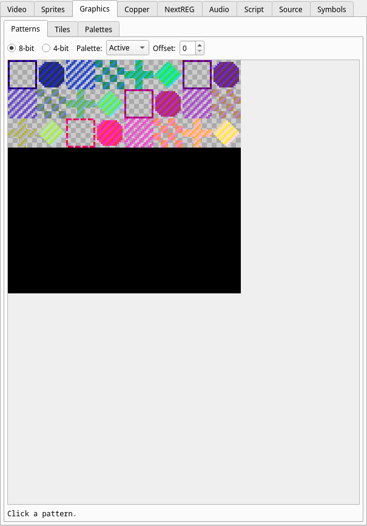

# Graphics

The graphics the machine holds in memory, drawn as pictures: the sprite patterns, the tile definitions and
the eight palettes. It shows the machine at the instant it paused, using the registers and memory as they are
then; it does not replay the per-line changes a raster effect makes.

Three sub-tabs:

- **Patterns** shows every sprite pattern in an atlas, 8 to a row, numbered as the **Pat** column of the
  [Sprites](10-sprites.md) tab numbers them. Choose **8-bit** (64 patterns) or **4-bit** (128 patterns), the
  sprite **Palette** (**Active** follows the machine's sprite palette select; **First** and **Second** pick one), and the
  palette **Offset** (0 to 15) a sprite would use. A pixel equal to the sprite transparency index (NextREG
  0x4B; for 4-bit patterns its low nibble) is not drawn.
- **Tiles** shows the tilemap's tile definitions, 16 to a row. What it shows follows the machine: text mode
  (1 bit per pixel) or 4-bit tiles, 256 or 512 of them, and the bank (5 or 7) and base address, all from NextREG
  0x6B and 0x6F; the line above the atlas states them. Choose the tilemap **Palette** and **Offset** (0 to 15, or
  0 to 127 in text mode). A 4-bit tile pixel whose nibble equals the tilemap transparency index (NextREG 0x4C)
  is not drawn; a text-mode pixel is not drawn when its colour equals the global transparent colour
  (NextREG 0x14).
- **Palettes** lists all 256 entries of any of the eight banks (ULA, Layer 2, Sprites and Tilemap, each first and
  second), with the colour, its RGB333 values (red green blue, 0 to 7 each), the 9-bit value in hex and **Pri**: `P`
  when the entry's priority bit is set, `-` when not (every bank stores it, but only Layer 2 palettes use it: a
  Layer 2 pixel with the bit set is drawn above the other layers). The bank each layer is reading now is marked
  `(active)`.

Patterns and tiles are shown as stored, without the mirror or rotate a sprite or map entry may apply. Transparent
pixels show a checkerboard. **Click** a cell to outline it and read where it lives in memory below the atlas.
The tab draws only while it is the one on show.
