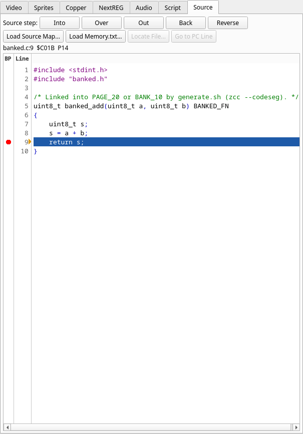

# Banked code, and which memory a line is in

A Next program pages code in and out, so one address can hold different code
at different times. This page is how the Source tab, the Call Stack and the Breakpoints panel
cope with that, how to read the memory tag next to an address, and what z88dk's `__banked`
needs. The build commands for `__banked` are in
[Building programs with z88dk](02-building-with-z88dk.md#banked-code).

## Pages, and the page a line is built for

Each source record names the 8K RAM page its code was built for, and the debugger matches the RAM page
that supplies that address *now*: the Source tab, the Call Stack and the Breakpoints panel never show
a line of code that is not the one in memory. Code supplied by ROM or by an overlay
(DivMMC — including the instruction at which its automatic paging switches on
or off —, the Multiface, the Layer 2 read mapping, the boot ROM) is not any RAM
page, so page-tagged records never describe it; the Source tab names that memory
(`ROM0`, `DIVROM`) and says there is no source mapping. Labels follow the page too: a label assembled for a bank names
its address only while that bank is mapped there, in the disassembly, the
Breakpoints and Call Stack panels, and a remote debugger's `monitor sym`; a label
assembled for no bank names it always.

A statement covers every byte up to the next one: the data of a
`DB` after an instruction belongs to that instruction's statement, and so does everything after the last
statement of a page up to the end of that 8K page. Only addresses below a
page's first statement, and pages with no statement at all, are unmapped.

Code your program copies somewhere else at run time (a routine moved out of a
bank into low memory, say) has no record where it runs unless your build made
one, and shows as unmapped there.

## Reading the tag

The line above the Source tab's text ends with the memory the opcode comes from:



`banked.c:9  $C01B  P14` is the line, the CPU address and the memory: `P14` is RAM page
`0x14`, which z88dk calls `PAGE_20` (it counts in decimal, the tags in hex), mapped at `$C000`.
The picture is the `-run` build of the banked example from
[Building programs with z88dk](02-building-with-z88dk.md#banked-code), stopped by a
breakpoint on `banked.c:9`. A program that is not banked reads `main.c:19  $8CB5  P04`: a NEX
program's code at `$8000` is page `0x04`. In the Breakpoints panel the address column
spells it the same way (`$8CB5 P04`), and a breakpoint on a line of banked code is tied to that
memory: it fires only while that memory supplies the address, and the disassembly gutter shows
it only then.

The tags are the debugger's own: `P0E` (RAM page `0x0E`), `ROM0` to `ROM3`, `BOOT`, `DIVROM`, `DIVRAM3`, `MFROM`, `MFRAM`,
`ALTROM0`, `L2P12`, `CFG17`, `FLOAT`, explained in
[which memory an address is in](../index.md#which-memory-an-address-is-in).
The same tags are in the trace log and in `monitor src` over the GDB server: on the banked
example `monitor sym banked_add` answers `banked_add = $C000 P14`.

**Debug ▸ Physical Addresses** replaces the tag by the place the byte sits in the Next's memory
(`--set debugger.physical_addresses=true` does it for one run). RAM page *n* is at `(n + 0x20) × 8 KB`
in the SRAM (except pages `0x0A`, `0x0B` and `0x0E`, the block RAMs, which read `BRAM5+$0000`, `BRAM5+$2000` and `BRAM7+$0000`, as in `monitor mmu`), so page `0x04` is `$048000` (the GDB server's `monitor mmu` prints it so for the slot at
`$8000` of a NEX program) and page `0x14` is `$068000`. The setting changes nothing on a machine that
is not a Next.

## What z88dk's `__banked` needs

A function in a `PAGE_n` or `BANK_n` section is found only while its 8K page is mapped where it runs.
The map's address for a `BANK_n` section carries the bank in its high bits; JNEXT reads the page from the
section and the address, and the map's symbols follow the page as its lines do
(`@name` and the disassembly name a banked symbol only while its page is mapped); the 24-bit
`__PAGE_<n>_head` that the pragma produces is read by its low 16 bits.

z88dk's `__banked` on newlib `+zxn` needs
`-pragma-define:CRT_ORG_PAGE_<n>=0x<page><org>` (the page in the top byte,
for example `0x14C000` for `PAGE_20`) and a stack below the banking segment
(`-pragma-define:REGISTER_SP=0xC000`): without them the program itself calls
page 0 or loses its stack. **Over** and **Out** step across `banked_call` and
the `-debug` helpers; **Out** lands on the calling line at the return address
(mid-statement), as gdb's `finish` does.

A section of your own memory map is in the bank of the block it is placed in, as appmake builds
it: with

```
SECTION BANK_8_CODE
    ORG 0x100000
section game_code
section game_const
```

`game_const` is in bank 8 (pages 16 and 17), and a `PAGE_95_CONST` block is page 95 and the pages
it runs on into. The block name only has to contain `BANK_<n>`, `PAGE_<n>` or `DIV_<n>`; what
follows the number is free (`BANK_<n>_L` and `_H` are the lower and upper 8K of the bank). The map
says which block each section is in from z88dk nightly 2026-10-21 on; with an older z88dk such a
section is refused when its addresses have 24 bits ("names no bank or page").

Code in a section that names no page (`CODE`, `code_compiler`, the program
itself) is tied to the RAM page the MMU maps at that address when the program
is in memory (page 4 at `$8000` for a NEX).

DivMMC sections (`DIV_n`) have no fixed bank (the program, or a dotn command's
allocator, chooses it when it runs): a line in one is refused, with the line named,
rather than attached half. The exception is a NextZXOS dot command, see [Dot commands](03-dot-commands.md).
