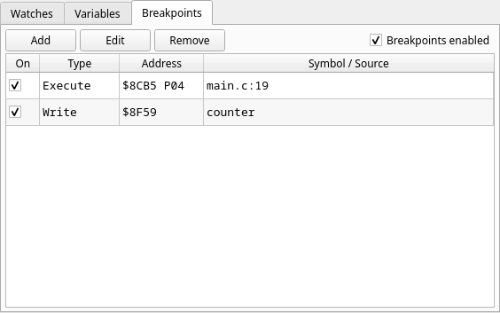
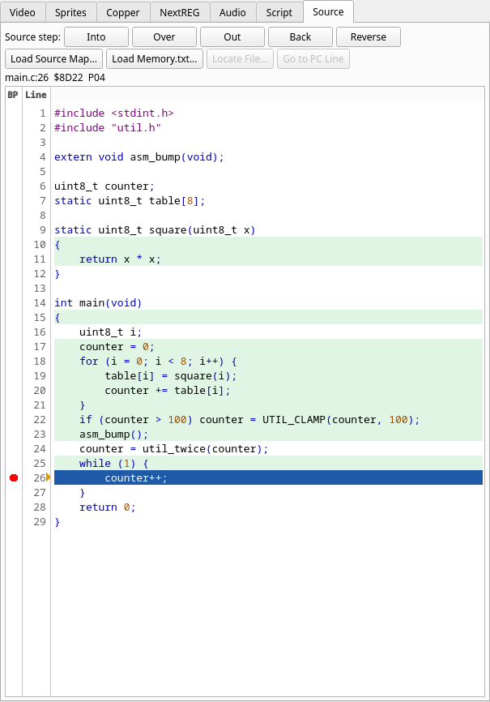
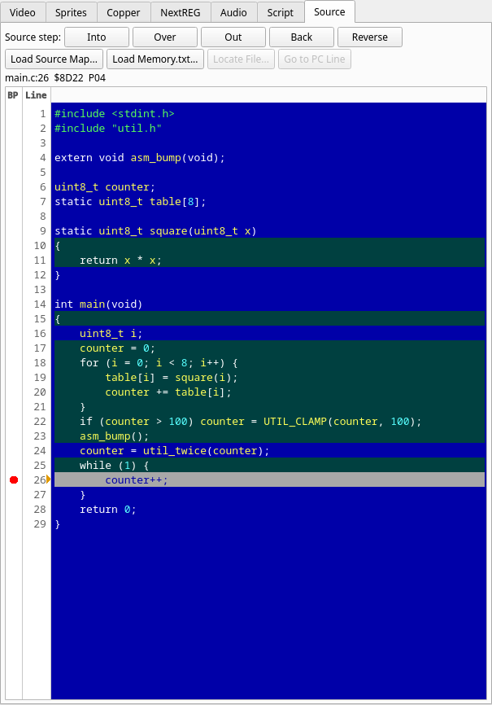

# In the Source tab: names, watches, coverage and colours

Things that work from the Source tab beyond stepping. The tab's controls
are in [its panel page](../panels/15-source.md).

## C names

A z88dk C variable or function has an underscore in front of its name in the
map (`_counter`). JNEXT shows and accepts the C name:

- `counter` works wherever `_counter` does: the **Add** dialogs of the
  Breakpoints and Watches panels, **Go to Address** in the Disassembly and Memory
  panels, and a script's `@counter`;
- the views show `counter`.

A number wins over a symbol in an address field: `FE` or `B` is that address even
when the program has a variable of that name. Write `@FE` to mean the symbol.

See [Symbols from MAP files](../functions/05-symbols-from-z88dk-map-files.md).

## Your own labels and comments

Right-click a source line and **Add Label…** names the address it compiled to (a line with several
places asks which); **Add Comment…** attaches a note to it. They are kept in a `.jdp` file with
**Map ▸ Save Annotations**, belong to the memory the line was compiled for, and show in the
Disassembly. See [Your own labels and comments](../functions/16-user-labels-and-comments.md).

## Watching and breaking from the source

In the example of [A first session](01-a-first-session.md), right-click `counter` on line 20
and choose **Watch**: it joins the Watches panel under its C name. **Break on
Write** from the same menu stops the machine whenever the program writes it. What
the menu offers, and for what under the pointer, is described in the panel page's
[right-click menu](../panels/15-source.md#right-click-menu).

A write breakpoint on `counter` is listed in the Breakpoints panel by its C name, next to the
line breakpoint on `main.c:19`:

The address column spells `$8CB5 P04` for the line, which is in RAM page `0x04`
([banked code](07-banked-code.md)), and `$8F59` for the variable.

## Which lines have run

Switch on memory coverage and every line of the shown file that has run gets a
tinted background; the current line keeps its own highlight. Use **Debug ▸
Coverage ▸ Enable Coverage**, or start JNEXT with `--coverage` to record from the
first instruction. Marks are visible while the machine is paused, like the rest
of the debugger.

It answers "did this code ever run?" without a breakpoint. In the example,
enable coverage while the machine is paused at the start, add a breakpoint on
`main.c:26` and Continue: the lines of `main` before it are tinted, and `counter++` in the final
`while (1)` is not, since it has not run yet. Coverage is kept per physical
memory, so the same address in two RAM pages has separate marks. All of it is in
[Memory coverage](../functions/15-memory-coverage.md).

The picture is that run on the z88dk 2.4 build. Line 24, `counter = util_twice(counter);`, did
run but is not tinted: this build puts its code under line 25 (the two lines start at the same
address, `$8D12`, and the later one owns it), so line 25 is tinted for it. This is the toolchain's
line attribution again, as in [A first session](01-a-first-session.md#step).

## Colours

The text is coloured by its language (C, Z80 and Z80N assembly, Boriel ZX Basic), and the colours
come from a scheme: **Auto** (the default, Light or Dark after the application's theme), **Light**,
**Dark** or **Borland C++ 3.1**. Choose it in **Preferences ▸ Debugger**, or for one run with
`--set source.colour_scheme=auto|light|dark|borland`; it applies at once, and is stored as
`colour_scheme` in the `[source]` section of the configuration file. The scheme sets the text, the
background, the current-line bar and the coverage tint, which is pale green in Light, a dark
green in Dark and a dark teal in Borland. The same stop as above in the Borland scheme:

The ten colour classes and what each one covers are in the panel page,
[the Source tab](../panels/15-source.md); the setting is in
[Preferences](../../04-configuration/01-preferences.md).

## Following the disassembly

The Source tab and the Disassembly follow each other's selection, and a small amber arrow marks the
line the CPU is on. When a toolchain attributes the same address to more than one source line, the
position line lists the others after `also:`. All three are described in the panel page's
[Following the disassembly](../panels/15-source.md#following-the-disassembly).
