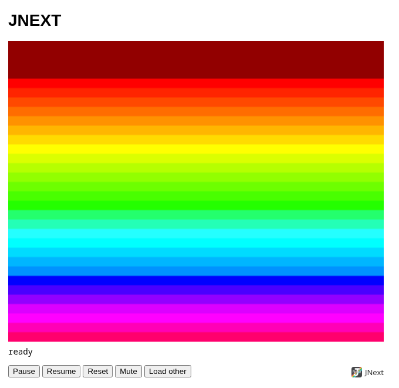
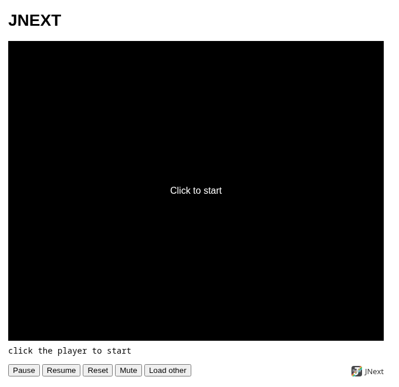

# 8.1 A page with a game

## The quick way

The release's `jnext-VERSION-web.zip` holds `plain.html`, a whole page in one file.

1. Unzip it, and put your program (say `game.nex`) beside `plain.html`.
2. Serve the folder over `http://localhost` (any static web server will do).
3. Open `plain.html?file=game.nex` in the browser.
4. Click the player. The program starts.

Every player carries a small "JNext" link with its icon, which takes the visitor to the project site, www.jnext.es. When the page has controls for the player (`plain.html` and the widget do) the link is at the right end of them; otherwise it is under the player, at its right edge. A page with controls of its own puts it there with the `creditIn` option (see [8.2](02-options-and-the-player.md)).



The page is that simple because its core is this:

```html
<div id="player"></div>
<script src="jnext-VERSION.js"></script>
<script>
  jnext.mount(document.getElementById('player'), {
    file: 'game.nex',
    width: 640, height: 512,
    poster: 'game.png',   // optional: a picture shown before the click
    onProgress: (phase, fraction) => { /* show a progress bar */ },
    onReady: () => { /* the program is running */ },
    onError: (message) => { /* tell the visitor */ }
  }).then((player) => { window.player = player; });
</script>
```

Before the click the player shows "Click to start", over the `poster` picture when the
page gave one (without it the player area is empty until the click):



## What happens, in order

1. `mount()` checks the options. A name it does not know, or a value of the wrong
   type, rejects the promise at once and names the option. Nothing is downloaded.
2. The player shows "Click to start". Nothing has been downloaded or built yet.
3. The visitor clicks. The page now gets NextZXOS's SD card
   ([8.4](04-the-image-and-what-the-browser-keeps.md)): the card the browser kept on an
   earlier visit, or one it makes from the official NextZXOS file from specnext.com.
4. The program in `file` is fetched and the machine starts (browsers allow sound only
   after a click).
5. For a `.nex`, the first time the machine boots NextZXOS in a browser it is
   recorded, so the next visit starts in a moment.
6. `onReady()` is called when the program is in the machine and a frame has been shown.

The progress calls of steps 3 and 5:

| call | meaning |
|---|---|
| `onProgress('download', fraction)` | NextZXOS is being downloaded |
| `onProgress('choose', 0)` | the visitor is being asked to choose the NextZXOS file |
| `onProgress('build', fraction)` | the card is being made from the file the visitor chose |
| `onProgress('warm-start', fraction)` | NextZXOS boots once and the machine is recorded |
| `onProgress('restore', 1)` | this visit used the stored recording |

A `.tap`, a `.tzx`, a `.wav`, an `.rzx` recording, a snapshot or no program records
nothing ([8.4](04-the-image-and-what-the-browser-keeps.md)).

## Requirements

- **Secure context.** The page is served over `https://`, `http://localhost` or
  `http://127.0.0.1`. The cache and the SHA-256 check need it.
- **Program on another site.** That site's server must send
  `Access-Control-Allow-Origin`, because the page fetches the file.
  `file: {data, name}` needs no request.
- **MIME type.** Serve the `.wasm` file as `application/wasm`. With another type the
  page still starts, after a warning in the browser's console. No special headers are
  needed otherwise.
- **NextZXOS.** It is not part of JNEXT and is not shipped with it. You give the player
  nothing to find it with: it gets it from specnext.com, or asks the visitor to download
  it from there ([8.4](04-the-image-and-what-the-browser-keeps.md)).

## The example pages

| page | what it does |
|---|---|
| `plain.html` | `jnext.mount()` with a status line and buttons: Pause, Resume, Reset, Mute, Load other |
| `widget.html` | The ready-made widget ([8.5](05-two-ways-to-embed.md)) |
| `itch-game.html` | The page of an itch.io upload ([8.3](03-itch-and-limits.md)) |
| `itch-host.html` | A page that embeds `itch-game.html` in an `iframe`, as itch.io does |

All four declare a device-width viewport, so a phone lays them out at its own width instead of
980 px. `plain.html`, `itch-host.html` and `itch-game.html` also fit the player to a phone's
width. The widget keeps the size it is given (640 x 512 unless you set `data-width` and
`data-height`, [8.5](05-two-ways-to-embed.md)), so on a phone set them to fit. A page of
your own needs the same `<meta name="viewport">` tag ([8.2](02-options-and-the-player.md#phones-and-tablets)).

## Advanced configuration

**Query string of the examples**

- `plain.html` reads `?file=` (the program) and `&other=` (the program the "Load other"
  button loads).
- Without them it uses the constants at the top of its script. They also choose how the
  page gets NextZXOS (`card.source`, [8.4](04-the-image-and-what-the-browser-keeps.md)).
- `itch-game.html` takes `?file=`.
- `itch-host.html` embeds `itch-game.html`, or the page named by `?game=` (an `http://`
  or `https://` URL only).

**Messages from `itch-game.html`**

It posts `jnext-ready`, or `jnext-error: <message>`, to the page that embeds it.

**More `mount()` options**

The full list is in [8.2](02-options-and-the-player.md).
