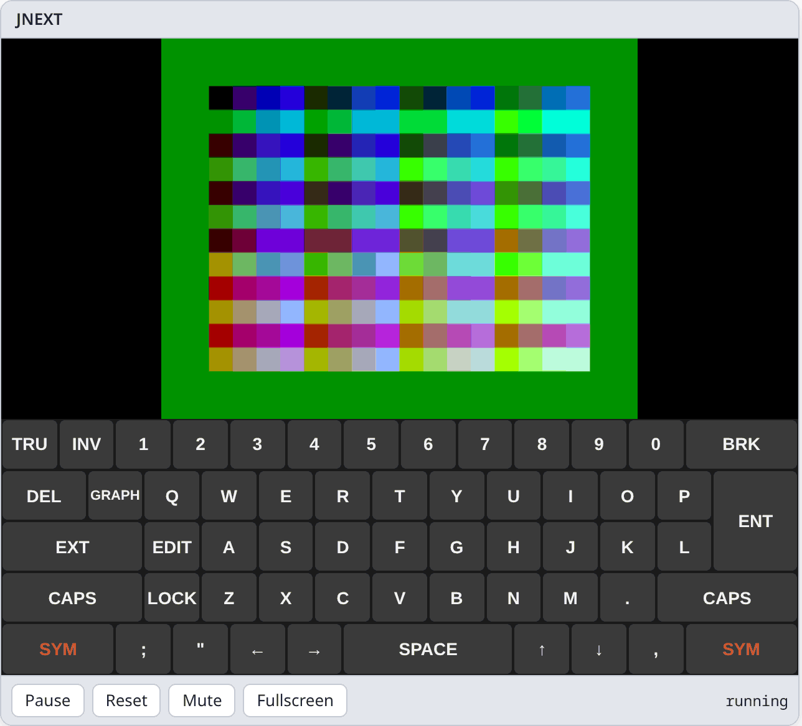

# 8.2 Options and the player

## The options most pages use

| option | type | what it is |
|---|---|---|
| `file` | URL, `{url}`, `{data, name}` or `{card}` | The program to run, as `--load`. `{card: '/GAMES/Next/Game/game.nex'}` runs a NEX that is on the SD card, with its directory (see [8.4](04-the-image-and-what-the-browser-keeps.md#a-program-from-the-card)). Without it the machine boots to the NextZXOS menu. |
| `width`, `height` | number (CSS pixels) or CSS length | The box the player fills; the picture is letterboxed inside it. Default `100%`. |
| `poster` | URL | A picture, a screenshot of the game, shown in the player area before the click so the player is not black on load. The emulator replaces it when the visitor starts the player. Without it nothing is shown there. |
| `machine` | string | `--machine`. |
| `muted` | boolean | `--set startup.silent`: no audio device for the session. |
| `keepWrites` | boolean | `--sdcard-writes`, with a file the page manages: what the program writes to the card, and the file a NEX saves through esxDOS (saves, high scores), is kept in the visitor's browser and is there at the next visit. Off by default; what it keeps, and what it cannot, is in [8.3](03-itch-and-limits.md) and [8.4](04-the-image-and-what-the-browser-keeps.md). |
| `card` | `{source, dirs}` | How the page gets NextZXOS's SD card, and which more of its directories go on it ([8.4](04-the-image-and-what-the-browser-keeps.md)). The default, `'auto'`, is the right choice for most pages, and no `dirs` is the boot card only; `'none'` runs a NEX that needs no NextZXOS with no card at all. The page never names an address or a digest. |
| `touchKeyboard` | `'auto'`, `'on'` or `'off'` | `--touch-keyboard`: the on-screen keyboard. `'auto'` (default) shows it on a phone or tablet, `'on'` always, `'off'` never. See "Keyboard", below. |
| `onProgress`, `onReady`, `onError` | functions | Events, below. |

Program formats `file` accepts:

- `.nex`, `.tap`, `.tzx`, `.wav`;
- a `.zip` whose program is a `.nex`: the NEX also gets the files beside it in the
  archive, which the game opens by name. They are read-only unless the page passes
  `args: ['--esxdos-stub-writable']`; what the game writes there lives in the page's memory
  and is not kept by `keepWrites`. `load()` takes the same. A `.zip` with any other program
  is refused;
- an `.rzx` recording;
- a `.jns`, `.sna`, `.szx` or `.z80` snapshot, which runs on the machine it was saved on
  (see "Saving the game" below).

## Events

- `onProgress(phase, fraction)`: `phase` is `download`, `build`, `choose`, `warm-start`
  or `restore`; `fraction` runs from 0 to 1 (the phases are in [8.1](01-a-page-with-a-game.md)).
- `onReady()`: the program is in the machine and a frame has been shown. It fires after
  the mount's click, after `load()` and after `reset()`.
- `onError(message)`: every failure. The promise of the call that failed rejects with the
  same message. The messages are listed in [8.4](04-the-image-and-what-the-browser-keeps.md#if-it-does-not-start).

## The player

`jnext.mount()` resolves to the player.

| member | what it does |
|---|---|
| `state` | `waiting` (before the click), `starting`, `running`, `paused`, `exited`, `destroyed`. |
| `ready` | A promise for the first ready; it rejects if the machine does not start, or if the startup program does not load. |
| `pause()`, `resume()` | Stop and restart the frame loop. |
| `reset(kind)` | `'program'` (default): restart the program; with no program, the same as `'hard'`. `'hard'`: power on again. `'soft'`: reset. Returns a promise. |
| `load(file)` | Load another program (same forms as `file`, except `{card}`: a program on the card is given to `mount()` as `file`, and `load()` rejects it) while the machine runs. Resolves when it is in the machine. |
| `nmi()` | Press the NMI button (the Multiface one, as F9): NextZXOS's NMI Menu opens. Returns a promise; it rejects when the machine is not running, and with card source `'none'` (no Multiface ROM), with the reason as the error message and nothing sent to `onError`. |
| `setVolume(v)` | Master level, 0 (silent) to 1; anything else throws a `RangeError`. A player started `muted` has no audio device. |
| `saveSnapshot()` | Resolves to a `Uint8Array` holding a `.jns` snapshot of the running machine. |
| `startRzxRecording()`, `stopRzxRecording()` | Record the machine and collect the `.rzx` file. |
| `listFiles()` | The files JNEXT has written for an output option (a recording, a screenshot, a trace, an export), as an array of `{path, size, complete}`; see "Files JNEXT writes", below. Empty before the click. |
| `readFile(path)` | Resolves to a `Uint8Array`: a copy of the bytes of a finished file `listFiles()` gives. |
| `stop()` | End the machine and keep the player and its files. Resolves to the exit status once every file is finished (0 for a clean stop). A stopped player cannot start again. |
| `resetCard()` | Forget the saves kept by `keepWrites` and restart the program. |
| `showKeyboard(on)`, `keyboardVisible` | Show or hide the on-screen keyboard, and ask whether it is shown. |
| `debugChannel(protocol)` | The channel of a `debug` entry whose transport is `'channel'`, with `open()`, `send()`, `close()`, `onData`, `onClose` and `isOpen` ([8.6](06-debugging-from-the-page.md)). |
| `destroy()` | Stop the machine and remove the player. Afterwards every method throws. |

## Keyboard

The player takes the keys while its canvas has focus (the click focuses it).

- The host modifier for JNEXT's own shortcuts is Alt (Option on a Mac).
- Ctrl+W, Ctrl+T, Ctrl+N and Ctrl+Q belong to the browser.

### Phones and tablets

On a device whose main pointer is a finger the player shows an on-screen Spectrum Next
keyboard at the bottom of its box. The screen above it shrinks by the keyboard's height.



The picture is a 640-pixel player, so it shows the full 58-key layout (see the widths below).

- Your page needs `<meta name="viewport" content="width=device-width, initial-scale=1">` in its `<head>`.
  Without it a phone lays the page out at 980 pixels and scales it down, and the keyboard
  with it. The four example pages have it.
- `touchKeyboard: 'auto'` (the default) shows it on a phone or tablet.
- `'on'` shows it everywhere, `'off'` nowhere.
- `player.showKeyboard(true)` or `false` decides while the page runs.
- Its keys type exactly what the keys of a PC keyboard do, and the screen keeps the
  focus while you type.
- A key goes down when a finger lands on it and up when the finger lifts, so a held key
  is held. Two fingers hold two keys, for chords and for games.
- Caps Shift and Symbol Shift latch:
    - a quick tap (under half a second, with no other key pressed meanwhile) leaves the
      shift waiting, drawn highlighted, and the next key is typed with it;
    - tapping the waiting shift cancels it;
    - a shift held longer, or held while another key goes down, is an ordinary hold
      (Symbol Shift as a fire button works).
- Layout by width:
    - below 504 CSS pixels: the 40 keys of a 48K keyboard, in four rows; every other key
      of the Next is Caps Shift or Symbol Shift plus a key, as on a 48K;
    - from 504 pixels on (a tablet, or a phone turned sideways): the Next's 58 keys, in
      five rows, with the extra keys (Delete, Edit, Break, Graph, Extend, True and Inverse
      video, Caps Lock, the cursor keys, and the semicolon, quote, period and comma).

## Letting a visitor save and record

These are optional features. Each is a few lines of page code.

### Clearing the saves

A page that uses `keepWrites` can offer a button for `resetCard()`:

```html
<button onclick="player.resetCard()">Clear saves</button>
```

`player` is what `jnext.mount()` resolved to (or `el.jnextPlayer` of a widget).

### Saving the game

`saveSnapshot()` gives the page a snapshot of the whole machine, to offer as a download:

```js
const bytes = await player.saveSnapshot();
const a = document.createElement('a');
a.href = URL.createObjectURL(new Blob([bytes]));
a.download = 'game.jns';
a.click();
```

`load()` takes it back, for instance from an `<input type="file">`:

```js
await player.load({ data: new Uint8Array(await file.arrayBuffer()), name: file.name });
```

### Recording a game

`startRzxRecording()` records the machine from the moment it is called, input included.
`stopRzxRecording()` gives the page the `.rzx` file, to offer as a download:

```js
await player.startRzxRecording();
// ... the visitor plays ...
const bytes = await player.stopRzxRecording();
const a = document.createElement('a');
a.href = URL.createObjectURL(new Blob([bytes]));
a.download = 'game.rzx';
a.click();
```

A recording is refused on a ZX Spectrum Next, which is the default machine: give the
player `machine: '48k'`, `'128k'`, `'plus3'` or `'pentagon'`.

### Files JNEXT writes

Some options make JNEXT write a file: a recording (`--wav-record`, `--dac-trace`, `--tape-save`), a
screenshot (`--delayed-screenshot`), a trace or profile (`--compositor-trace`, `--profile` with
`--profile-output`), an export (`--export-skoolkit`, `--export-ghidra`), a bug report
(`--bug-report`), the audio write log (`--audio-log`) or the log (`--log-file`). A page gives them in `args`. The files live in the
page's memory, and the page collects them with `listFiles()` and `readFile()`:

```js
const player = await jnext.mount(el, { machine: '48k', args: ['--wav-record', '/tmp/game.wav'] });
// ... the visitor plays ...
await player.stop();
console.log(player.listFiles());   // [{ path: '/tmp/game.wav', size: 1234567, complete: true }]
const bytes = await player.readFile('/tmp/game.wav');
```

- `listFiles()` lists the files in the order JNEXT began them. `path` is the absolute path, `size` is
  the bytes in the page's memory now, and `complete` says that JNEXT has finished the file for good.
  Each call gives a new array. A file the page itself put in the file system is not listed, and
  neither is one that is gone.
- `readFile(path)` takes a path `listFiles()` gives and resolves to a new `Uint8Array` each time. It
  refuses a file that is not complete: its contents are not a whole file yet (a WAV's header holds
  no length until the end).
- When a file is complete:
    - a screenshot, when it has been written;
    - a compositor trace, after its frame, or at the end of the machine if the frame never came;
    - everything else, at the end of the machine: `--delayed-automatic-exit-frames` ends it, and
      so does `stop()`, which resolves only when every file is finished.
- Where to write: any directory that exists, such as `/tmp`, or a bare name (it goes in `/`). Not
  `/sdcard`, `/jnext` or `/media`: they are the player's own (the SD card, what the player keeps and
  the programs it installs), and `listFiles()` and `readFile()` never give anything in them, whoever
  wrote it and however the name is spelt (`..`, a relative name or a link to it included).
- What the page can read is the card's opposite: the SD card image and the player's own files never come
  out of `readFile()`. What an export holds is the page author's choice, as on the desktop: a
  `--export-skoolkit` of ROM space holds the ROM the machine ran (a bug report, as on the desktop,
  leaves the memory of a card session out: [5.12](../05-running-programs/12-bug-reports.md)). NextZXOS is SpecNext's
  copyrighted software: what you offer to your visitors, an export of the machine's memory included, is your
  responsibility, and JNEXT does not check it against anything.
- A file the page offers for download is the usual four lines. This button saves the WAV above
  (`player` is what `jnext.mount()` resolved to):

```html
<button id="save-wav">Save the recording</button>
<script>
  document.getElementById('save-wav').onclick = async () => {
    await player.stop();
    const bytes = await player.readFile('/tmp/game.wav');
    const a = document.createElement('a');
    a.href = URL.createObjectURL(new Blob([bytes]));
    a.download = 'game.wav';
    a.click();
  };
</script>
```

### The CRT effect

The desktop window's CRT effect ([5.3](../05-running-programs/03-display.md)) runs in
the page too, off by default, with the same five looks and the same parameters. It needs a browser with WebGL.

```js
jnext.mount(el, { args: ['--crt', 'tv'] });
```

`--crt` takes `off`, `scanlines`, `soft`, `tv` or `pc`.

## Advanced configuration

### The remaining options

| option | type | what it is |
|---|---|---|
| `set` | `{"section.key": value}` | One `--set` each, sorted by key. |
| `args` | array of strings | More command-line arguments, last, so they win. |
| `wasmUrl` | string | Where the `.wasm` is served from. Default: beside the script. |
| `debug` | `{protocol, transport, url}` or an array | Serve DZRP, ZRCP or GDB to a debugger: one `--debug-channel` for each entry. See [8.6](06-debugging-from-the-page.md). |

`player.argv` is the equivalent command line, without the program name. It exists once
the visitor has clicked and the player has its SD card (until then it is undefined).

### Events in detail

- For a `.wav`, `onReady` comes when the tape is in the deck. The program then loads as
  the tape plays, in real time (a 48K game takes minutes), and the tape stops while the
  player is paused or the tab is hidden.
- A load the program itself asks for (a NEX that runs another) is not the page's: it
  fires no `onReady`, and `reset()` still restarts the page's program.
- A NextZXOS file the visitor chose that is not the official one is not an `onError`: it
  is refused on the player's panel ([8.4](04-the-image-and-what-the-browser-keeps.md)) and
  the visitor can choose again.

### Player members in detail

- `load({card: ...})` rejects with `jnext: load(): a program on the card is given to mount() as file: {card}`: the program's directory is served from the start of the session, which a program loaded later cannot ask for.

- `startRzxRecording()` rejects when:
    - the machine is not running;
    - the last recording has not been collected with `stopRzxRecording()` (one running,
      or ended by a `reset()` or a `load()`);
    - it cannot start: a ZX Spectrum Next, an RZX playing, `--tape-save` (the console
      says which).
- `stopRzxRecording()` rejects if none is running.
- `resetCard()` needs `keepWrites` (it rejects without it). It resolves when the program
  is in the machine again.
- `listFiles()` returns `[]` before the click, and never lists the player's own locations (`/sdcard`,
  `/jnext`, `/media`).
- `readFile(path)` rejects, with nothing sent to `onError`, when:
    - `path` is not a string (a `TypeError`: `jnext: readFile() takes a path that listFiles() gives`);
    - the path is in the player's own locations (`jnext: <path> is one of the player's own files (the SD
      card and what the player keeps); readFile() never returns them`);
    - JNEXT did not write the path (`jnext: <path> is not a file this player's machine wrote`), or it is
      gone;
    - the file is not complete (`jnext: <path> is still being written (listFiles() says when it is
      complete; stop() ends the machine)`).
- `stop()` rejects while the machine is not running (`jnext: the machine is not running`: before the
  click, or while it starts). It resolves with the exit status once the machine has exited, which is
  after every file is finished; the overlay then says "Stopped", as for an automatic exit. After the
  machine has exited, by `stop()` or by itself, `stop()` resolves with the same status again.
- After `destroy()` the three throw `jnext: this player was destroyed`. The files go with the
  player: collect them first.
- `showKeyboard(on)`: the page's call wins over `touchKeyboard`, before or after the
  start. Anything but a boolean throws a `TypeError`.
- `destroy()`: with `keepWrites` it first waits until the saves are stored.
- `saveSnapshot()` rejects if the machine is not running. `args: ['--snapshot-compression', 'off']`
  stores the snapshot uncompressed.
- `args: ['--sdcard-writes-reset']` clears the saves for one start, when the page is
  loaded.

### The CRT effect in detail

There is no extra option: use `args` with `--crt`, or the three settings it stands for
in `set`:

```js
jnext.mount(el, { set: { 'startup.crt_shader': true, 'startup.crt_shader_style': 1 } });
// style 0 is tv, 1 is pc, 2 is soft; 'startup.crt_filter': true is the plain scanlines
```

- The effect is chosen for the whole run: there is no call to switch it while the player
  runs.
- *Soft scanlines* show their lines only when the picture is at least twice 640x512 device
  pixels (a larger box or a high-density screen), as on the desktop. At 640x512 they only
  dim the picture.
- If the shader cannot run, the player writes one line starting `CRT effect:` to the
  browser console and carries on: with the plain scanlines for *Soft scanlines* (or when
  `scanlines` was also asked), with the plain picture otherwise.

### Snapshots in detail

- A snapshot runs on the machine it was saved on, whatever the player's `machine` option
  says. That machine stays for later `reset('hard')`, `reset('program')` and `load()` of a
  program. A page that mixes snapshots of other machines with NEX programs gives each its
  own player.
- A `.jns` restores only on the SD card it was taken on. The same card image gives a
  snapshot that loads; another one is refused (`failed to load '<file>'`, the reason in
  the browser console). `args: ['--snapshot-mode', 'force']` loads it anyway, at the
  page's risk.
- A `.jns` that had a tape attached remembers the tape by its path. One saved in a page
  names a file of the page's memory, so on another JNEXT it restores without the tape.
- A snapshot never uses the stored NextZXOS recording
  ([8.4](04-the-image-and-what-the-browser-keeps.md)): it starts at once.

### Recordings in detail

- While recording, a tape loads in real time.
- A `reset()` or a `load()` ends the recording early. `stopRzxRecording()` still returns
  it, and until it is called no new recording can start.
- A recording plays on the machine it was made on. Given as `file`, an explicit `machine`
  wins at the start, and later `load()` and `reset()` use the recording's.
- While it plays, every port read comes from the file, so the visitor's keys do nothing
  until the console says `RZX: playback complete`. Then the machine runs on, live.
- `load()` takes a recording back like any program.
