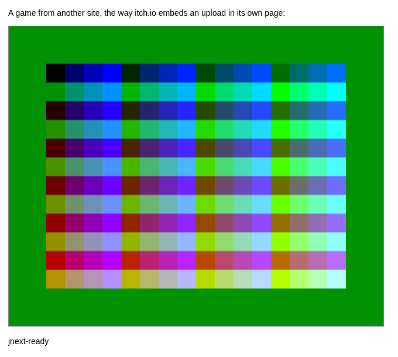

# 8.3 On itch.io, and what the browser build does not do

## An itch.io upload

1. Take a page like `itch-game.html` (it is in `jnext-VERSION-web.zip`).
2. Zip it with `jnext-VERSION.js` and `jnext-VERSION.wasm`.
3. Upload it as an HTML game.
4. Set the frame size on the itch.io page.

itch.io embeds your page in an `iframe` of its own site. `itch-host.html` shows the same
arrangement, a game inside a frame of another page:

Because of the `iframe`:

- Game controllers need `allow="gamepad"` on that `iframe`; `itch-host.html` shows the
  markup.
- Browsers keep storage per origin and may give an embedded page storage of its own, so
  the SD card may be made again on the embedding site (see
  [8.4](04-the-image-and-what-the-browser-keeps.md#what-the-browser-keeps-and-where)).
- `itch-game.html` tells the page that embeds it when the game is running
  (`jnext-ready`) or has failed (`jnext-error: <message>`), as `postMessage` text.

## Several players on a page

- Each `mount()` makes its own emulator, with its own canvas and keyboard focus.
- Game controllers are page-wide: give the other players `args: ['--joy1-source', 'none']`.

## What the browser build does not do

- **Host process features.** Flags and `--set` keys that need a process, a socket or a
  terminal are refused with a message. The list is in the man page ("Not available in the
  browser").
- **Debugger servers are not TCP listeners.** A page cannot listen on a port, so `--dzrp-port`,
  `--zrcp-port`, `--gdb-port` and `--debug-listen-address` are refused. The `debug` option serves the
  same protocols to the page's own code or through a WebSocket bridge ([8.6](06-debugging-from-the-page.md)).
- **Program formats.** Programs load as `.nex`, `.tap`, `.tzx` or `.wav` (a tape, in real
  time), recordings as `.rzx`, snapshots as `.jns`, `.sna`, `.szx` or `.z80`.
- **Headless and command-line recording.** `--headless` and `--rzx-record` are refused. A
  page records with `startRzxRecording()` and `stopRzxRecording()`.
- **WAV files.** A WAV is large and stays in the page's memory for the session. Give the
  `.tap` or `.tzx` of a game when there is one.
- **Saves.** What the guest writes to the SD card is kept across reloads only when the
  page asks with `keepWrites` ([8.4](04-the-image-and-what-the-browser-keeps.md)). Without
  it the card lives in memory for the session.
- **Files JNEXT writes** (screenshots, snapshots) live in memory in either case.
  `saveSnapshot()` hands a snapshot to the page.
- **Browser shortcuts.** Ctrl+W, Ctrl+T, Ctrl+N, Ctrl+Q and the operating system's own
  keys never reach the page.
- **Touch devices.** The on-screen keyboard ([8.2](02-options-and-the-player.md)) is
  tested under a browser's touch-device emulation, not on real phones or tablets, and the
  emulation speed on a phone has not been measured.

## Advanced configuration

### What `keepWrites` keeps

`keepWrites` keeps two kinds of save:

- what reaches the card: a program started from the NextZXOS menu, or one that drives the
  card itself, writes there;
- the file a NEX loaded with `file` saves through esxDOS.

How the esxDOS file behaves:

- Such a NEX is not started by NextZXOS, so JNEXT's own stand-in answers its esxDOS file
  calls (`RST $08`); the man page describes it ("esxDOS calls from a directly loaded NEX").
- It keeps ONE file. The file is stored when the program closes it and is there at the
  next visit.
- A program that saves two files keeps only the last one written.
- The file belongs to the page's card and the file name, not to the program: a changed
  NEX on the same page reads the old save, as on a real Next.
- Files such a page writes to a host directory it names with `--esxdos-stub-root` live in
  memory only.

Sharing and warm start:

- One card on one page has one set of saves: two `keepWrites` players of the same card on
  the same page share it, and the last one to store wins.
- A save made by the esxDOS stand-in does not make the next visit record the machine
  again.
- After a program has saved to the card, the next visit starts NextZXOS again and records
  the machine once more (the card is no longer the one the recording was made on). That
  takes as long as a first visit's `warm-start` step. A visit that follows one that saved
  nothing is restored as usual.

### How fast it runs

Measured on one 2026 laptop (a Ryzen AI 5 340), with the 39 programs of the project's
test set (the NEX programs of its regression suite and a 3.5 MHz one), each started on its
own and left to run for 600 frames:

- In Chrome 156, in Firefox 159 and in Chrome with its CPU throttled to half speed (a
  rough stand-in for a slow machine) every program kept full emulation speed, with no
  audio underrun.
- On an otherwise idle machine every program also showed nearly every picture. The
  lowest, one program that runs at 58 Hz, in Firefox, showed 98% to 99% of them. Every
  other program showed 99.7% or more.
- With some other load on the machine the three heaviest programs at half speed
  (`shift`, `blue` and `menu`) showed 95% to 98% of the pictures.

The CRT effect ([8.2](02-options-and-the-player.md)) is extra drawing work on the graphics
chip of every frame, which is why it is off by default. The figures above are without it.
With the TV look on, on the same machine with the same programs:

- the time a frame took grew by about 0.1 ms in Chrome, 0.2 ms in Chrome at half speed
  and 0.15 ms in Firefox on average (the largest single program, 1.1 ms);
- the emulation and display rates stayed what they were without it;
- the soft scanlines and the PC monitor looks cost about the same as TV on the three
  heaviest programs.

This is what one machine did, not a promise for another: a slower computer, a busy one or
another browser will differ.
