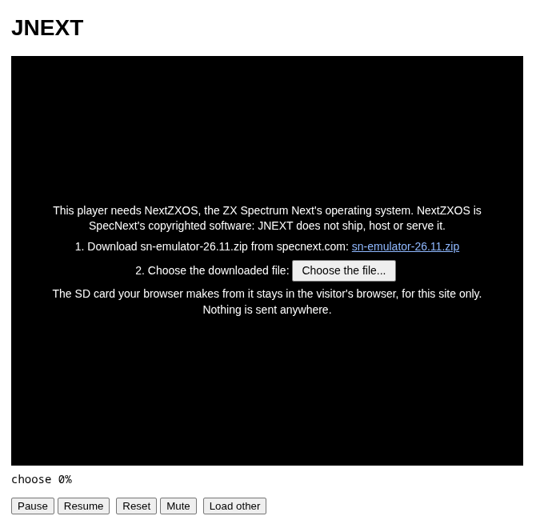

# 8.4 NextZXOS, the SD card, and what the browser keeps

## NextZXOS

JNEXT runs NextZXOS, the ZX Spectrum Next's operating system, from an SD card. In the
browser the page needs that card too, and this is how it gets it.

- NextZXOS is SpecNext's copyrighted software. JNEXT does not ship, host or serve it,
  and neither does a page that embeds JNEXT: the only place that offers it is
  specnext.com.
- The player makes its SD card in the visitor's browser, from the official NextZXOS
  file from specnext.com (`sn-emulator-26.11a.zip`, 69 MB (65.8 MiB), for this release), unchanged.
  Another file, or a changed copy, is refused.
- The card the browser makes stays in the visitor's browser (Cache Storage, for that
  site only). Nothing is sent anywhere, and the page's author never receives it.

The card is a small boot card (40 MiB) with only what NextZXOS needs to reach its menu,
to run its dot commands (its file browser uses them to open files and programs)
and to warm-start a program, not the 1 GB distribution image. The browser build is made
and tested for that card.

The page author does nothing for any of this: the player's default does it all. A page
that wants more of NextZXOS on the card, such as its `/GAMES` and `/APPS` directories, can
ask for it with `card.dirs` ([below](#carddirs-more-of-nextzxos-on-the-card)).

## The first visit, two ways

The first visit to a site starts when the visitor clicks the player (nothing is
downloaded or built before the click). It then goes one of two ways.

1. **specnext.com allows the page to read the file.**
    - The page downloads the official file (`onProgress('download', fraction)`).
    - It makes the card in the browser (`onProgress('build', 1)`) and keeps the card.
    - The downloaded file itself is not kept.
2. **specnext.com does not allow it.** This is the case with this release: a browser lets
   a page read a file from another site only when that site says so.
    - The player shows what to do: a link to download the official file from specnext.com,
      and a button to choose the downloaded file (`onProgress('choose', 0)`).
    - When the visitor chooses the file, the browser makes the card from it
      (`onProgress('build', fraction)`) and keeps the card.
    - A file that is not the official one is refused, with the reason on the screen, and
      the visitor can choose again.



Either way the visitor sees these steps, in this order:

1. the click;
2. `download` or `choose`, then `build`;
3. for a `.nex` program only, `warm-start` (NextZXOS boots once and the machine is
   recorded);
4. `onReady`.

## Later visits

A later visit to the same site needs no download and no file.

- The card the browser kept is stored compressed and checked every time by the compressed
  copy's own checksum. A card that fails it is deleted and made again, as on a first visit.
- A card kept by an earlier JNEXT release is converted on the first visit, with no
  download.
- For a `.nex` program the recorded machine is brought back (`restore`) instead of booting
  NextZXOS again. A corrupted recording is made again.
- A `.tap`, a `.tzx` or a `.wav` starts directly in 48K BASIC, and an `.rzx` on the
  machine it was recorded on, without NextZXOS, so there is nothing to record.
- A Next page with no program boots NextZXOS on every visit and records nothing.

## What the browser keeps, and where

| what | where |
|---|---|
| the SD card | Cache Storage: one entry of about 1.5 MB (the 40 MiB card, compressed), named by the card's SHA-256 (so a JNEXT release with a newer NextZXOS replaces it). A card with more of NextZXOS on it (`card.dirs`) is a further entry, much larger (about 15.7 MB for `/GAMES` and `/APPS`) |
| the warm-start recording | IndexedDB |
| the saves, with `keepWrites` | IndexedDB, in a database of its own |

- Nothing else is kept: no settings, nor screenshots or snapshots
  ([8.3](03-itch-and-limits.md)).
- The official file the card was made from is not kept.
- A browser too old to compress and decompress data in the page keeps the card
  uncompressed, about 40 MiB, and checks it by its SHA-256 on every visit instead.
- Several players on one page share the recording.
- If the browser's storage is full, the session still runs and the next visit makes the
  card again.
- Clearing the site's data in the browser makes the next visit a first visit: the card is
  made again.

## Keeping the saves

```js
jnext.mount(el, { file: 'game.nex', keepWrites: true });
```

- Whatever the program writes to the card is there at the next visit, and so is the one
  file a NEX loaded with `file` saves through esxDOS ([8.3](03-itch-and-limits.md)).
- `player.resetCard()` clears both ([8.2](02-options-and-the-player.md)).
- A save is stored a moment after the program makes it: a reload within moments of a save
  can lose it (the store on leaving the page is best effort).

## If it does not start

The page reports these messages through `onError`, and the example pages show them in
their status line. The exception is a file the visitor chose that is not the official one:
it is refused on the player's panel only (no `onError`), because the visitor can choose again.

| message | what it means |
|---|---|
| `unknown option '<name>'` or `option '<name>' must be ...` | A `mount()` option is misspelt or of the wrong type. Nothing has been downloaded yet. |
| `option 'card' must be an object {source, dirs}`, `option 'card': unknown key '<key>'` or `option 'card': source must be 'auto', 'fetch' or 'pick'` | The `card` option is not what [8.2](02-options-and-the-player.md) and this page describe. |
| `option 'card': dirs must be an array of strings` or `option 'card': dirs: '<path>' ...` | `card.dirs` is not a list of absolute paths, or the named path is refused (no leading `/`, `/` alone, an empty, `.` or `..` part, a backslash, a part of the boot card, a path given twice, or one inside another). Nothing has been downloaded yet. |
| `the requested path <path> is not in the distribution` | `card.dirs` names a path NextZXOS does not have (the message gives it in lower case). Correct the list: it is the page's, not the visitor's file. |
| `the boot set and the requested paths are larger than the card: <N> bytes, the limit is 33554432 (32 MiB)` | `card.dirs` asks for more than the 40 MiB card takes. The message gives what was asked for and the limit. Ask for less. |
| `this file is not sn-emulator-26.11a.zip from specnext.com ...` | The visitor chose a different file: the message gives its size, or says its SHA-256 differs. The visitor has to download the official file from specnext.com (the link is on the panel) and choose that one. |
| `the chosen file could not be read: ...` or `the card could not be made in this browser: ...` | On the panel. The browser could not read the file the visitor chose (it changed or moved after it was chosen), or could not make or store the card (memory or storage). The file is not at fault: choose it again, or free some space. |
| `cannot read the NextZXOS distribution from specnext.com: ...` | `card.source` is `'fetch'` and the file could not be read: specnext.com does not allow the page to read it, the visitor is offline, or the download failed. Use `'auto'` or `'pick'`. |
| `the card built from the distribution is not the expected one ...` | The card the browser made does not have the SHA-256 this JNEXT release expects. The message gives both digests. It is a fault of the build or of the browser: report it. With `card.source: 'fetch'` it reaches `onError` after `cannot read the NextZXOS distribution from specnext.com: <address>: `; with `'auto'` the player falls back to the panel and shows it there; with `'pick'` it is shown on the panel. |
| `cannot fetch <url>: a network error, or the server does not allow cross-origin reads (no Access-Control-Allow-Origin header)` | A program file on another site: its server is unreachable, or it does not send `Access-Control-Allow-Origin`. Make it send the header. |
| `cannot fetch <url>: HTTP <status>` | The server answered with an error for the program file: check the URL. |
| `Failed to fetch` | The browser's own text (Chromium's is shown; Firefox words it differently) for a program file it could not read: the program is on another site whose server does not send `Access-Control-Allow-Origin` (make it send the header, or give `{data, name}` to avoid the network), or its server cannot be reached. |
| `the SD card needs a secure context (https, or http://localhost): ...` | The page is not served over `https://`, `http://localhost` or `http://127.0.0.1`. |
| `--load <file>: a browser page loads only .nex, .tap, .tzx, .jns, .sna, .szx, .z80, .wav, .rzx programs` | The program has another extension. |
| `failed to load '<file>'`, and in the console `the mounted SD card is not the one the snapshot was taken on` | A `.jns` was taken on another SD card. Mount the card it was taken on, or pass `args: ['--snapshot-mode', 'force']`. |
| `--rzx-record: not available in a browser page (record from JavaScript: ...)` | A page cannot start a recording from the command line: record with `startRzxRecording()` and `stopRzxRecording()`. |
| `the RZX recording did not start (the log says why)` | `startRzxRecording()` was refused: the machine is a ZX Spectrum Next, an RZX is playing, or `--tape-save` is on. The console line before it says which. |
| `<flag>: not available in the browser build (...)` or `<flag>: not available in a browser page (...)` | An option that needs a process, a socket or a terminal was given. The reason is in the brackets, and the list is in the man page ("Not available in the browser"). |
| `<file> is not a jnext SD-writes file; not touching it` | The stored record's header is damaged, or in a format this version does not read; `--sdcard-writes-reset` does not remove it. Clear the site's data, or delete the record from the `jnext-card-writes` database. (A record with a valid header whose saved-file entry is inconsistent is refused the same way, but `--sdcard-writes-reset` does discard it.) |
| `<file> was made for another image ...; run with --sdcard-writes-reset to discard them` | The record under this key is for another image. Mount once with `args: ['--sdcard-writes-reset']`. |
| `jnext: resetCard() needs the keepWrites option` | `resetCard()` was called on a player mounted without `keepWrites`. |
| `option 'keepWrites' must be a boolean` | `keepWrites` is not `true` or `false`. Nothing has been downloaded yet. |
| `jnext exited with code N` | The machine stopped with an error after it had started. |
| the lines the machine printed, or `jnext: the machine did not start` | The machine stopped before its first frame. The lines say why. |

## Advanced configuration

### `card.source`: how the first visit goes

The page does not name the file, its address or a digest, and has nothing to host. It can choose
how the first visit goes with the `card` option (`data-card-source` on the widget,
[8.5](05-two-ways-to-embed.md)):

| `card.source` | the first visit |
|---|---|
| `'auto'` (default) | The page checks whether specnext.com allows it to read the official file. If so, it downloads it (way 1); if not, or if the download fails, the player asks the visitor (way 2) and shows the reason. |
| `'fetch'` | Only way 1. Use it once specnext.com allows pages to read the file; if it cannot be read, the page reports an error (`onError`) and does not ask the visitor. |
| `'pick'` | Only way 2: the page always shows the download link and the file button, and makes no request to specnext.com. |
| `'none'` | Neither: no SD card at all, as with `--no-sdcard`. The `file` NEX runs with no NextZXOS and no ROMs; nothing is downloaded, asked or kept. For a NEX that needs nothing but the esxDOS file calls, which the stand-in answers (give it a directory with `args: ['--esxdos-stub-root', DIR]`). An emulator convenience: a program that runs ROM code (an IM 1 interrupt, `RST $10`) does not work, and the first time it does `onError` says where, e.g. `executed ROM code at $0038 (IM 1); --no-sdcard has no ROM`. Needs `file`; `keepWrites` and `dirs` are refused (there is no card to keep writes on or to add directories to). |

- The widget and the example pages show the same player panel.
- A page that shows its own status text can use `onProgress` ([8.2](02-options-and-the-player.md)):
  `'choose'` is the moment to say "choose the NextZXOS file".
- The download's progress is measured against the `Content-Length` specnext.com sends when
  it does not compress the file, and otherwise against the known size of the official file,
  so it is reported either way.

### `card.dirs`: more of NextZXOS on the card

The boot card has only what NextZXOS needs to start and to run its commands. A page whose visitors want more of
what the distribution holds, its games or its programs, can ask for those directories
(`data-card-dirs` on the widget, [8.5](05-two-ways-to-embed.md)):

```js
jnext.mount(el, { card: { dirs: ['/GAMES', '/APPS'] } });
```

- Each entry is an absolute path in the distribution, from its root. The whole directory is
  copied with everything below it, and the directories above it are made too, with the names,
  dates and attributes they have in the distribution. A path such as `/GAMES/Next/Nextoid`
  copies that one directory and makes `/GAMES` and `/GAMES/Next` empty of anything else.
- Capital letters do not matter, and neither do a trailing `/` or the order of the list.
- The default is no list: the boot card only.
- The boot card's own directories are always there and are refused in the list, as is `/`
  alone (the whole distribution does not fit).
- The card is 40 MiB whatever the list. What the list asks for has to fit in 32 MiB together
  with the boot card. In this release `/GAMES` is 23.2 MB, `/APPS` 3.7 MB and `/DEMOS` 2.1 MB
  as files, so `/GAMES` and `/APPS` fit together and adding `/DEMOS` does not. The count is
  of the files plus the distribution's directories, and the boot card itself counts about 3.7 MB.
- Every list makes its own card. It is made the first time, kept as a further entry in the
  browser (about 15.7 MB for `/GAMES` and `/APPS`), and used by later visits without
  a download. It has its own warm-start recording and its own saves.
- While it builds the card for `/GAMES` and `/APPS` the page's memory grows by about 21 MB.
- A page that changes its list leaves the card of the old list in the visitor's browser
  until the next JNEXT release.

### A program from the card

A page can run a NEX that the card holds, with the files next to it. Ask for its directory
in `card.dirs` and name the NEX in `file`:

```js
jnext.mount(el, { card: { dirs: ['/GAMES'] }, file: { card: '/GAMES/Next/Game/game.nex' } });
```

- The path is absolute, ends `.nex`, and lies inside one entry of `card.dirs`; capital letters
  do not matter. Anything else is refused when the page starts, before any download.
- The directory that holds the NEX is copied, with everything below it, into the page's memory,
  and the NEX is loaded from the copy. The program is served that directory, as a program on
  a real Next reads its data files from its own folder. The directory is limited to 48 MiB.
- The files are read-only: a game that saves a score is told the write failed and carries on.
  A page that wants the writes (kept in memory only) adds `args: ['--esxdos-stub-writable']`.
- NextZXOS is started first and the program loaded over it, so the program finds its ROMs.
  `card.source` `'none'` cannot do this: it has no card.
- One card serves every page of a site that uses the same `card.dirs`, so a site with several
  such programs downloads the distribution once.
- A NEX that is not on the card stops the player with `the card has no <path>`.

### The stored saves in detail

- With `keepWrites`, the sectors the program writes to the card are kept in IndexedDB, in
  a database of their own (`jnext-card-writes`) that exists only for a page that uses it.
- There is one record per card and page. Its name is the card's SHA-256 and a short
  digest of the page's path, so another card, or another page of the same site, has its
  own saves, and a changed card never reuses the old ones.
- Only the written sectors are stored (516 bytes each; the card itself is never written),
  and they stay in the visitor's browser: nothing is sent anywhere.
- The saves belong to the card: a visit whose card differs, even in one byte (a JNEXT
  release that moves to a newer NextZXOS makes a different card), starts with none.
- A record made for another card is refused with a message naming
  `--sdcard-writes-reset`. Mount once with `args: ['--sdcard-writes-reset']` to discard it.
- A record whose header is not a valid one (damaged, or in a format this version does not
  read) is refused as "not a jnext SD-writes file", and the reset does not remove it.
  Clear the site's data in the browser, or delete the record from the `jnext-card-writes`
  database (store `journals`) with the browser's developer tools.
- A `.jns` snapshot ([8.2](02-options-and-the-player.md)) restored over a card that has
  newer saves leaves NextZXOS's in-memory picture of the card out of step with the card,
  as on the desktop ([5.9](../05-running-programs/09-snapshots.md)).

### Storage per origin

- Browsers keep the storage of each origin (scheme, host and port) apart.
- Two pages of one origin share the card and the recording.
- A game inside an `iframe` of another site may or may not see the storage its own origin
  has: that depends on the browser, its version and its privacy settings (in the Chromium
  used to test JNEXT it did), so do not rely on either.
