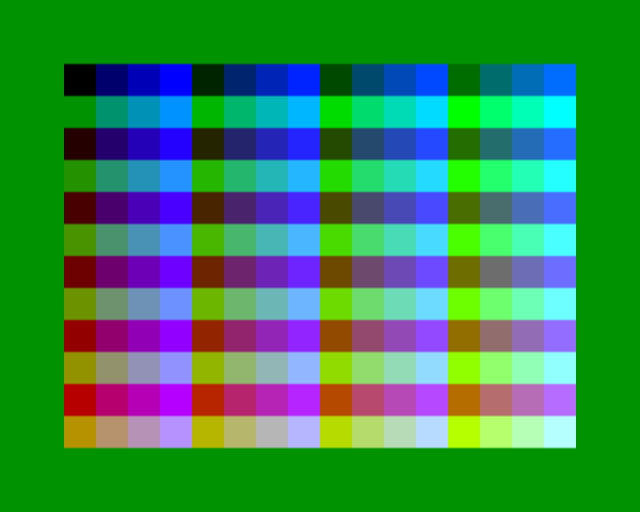
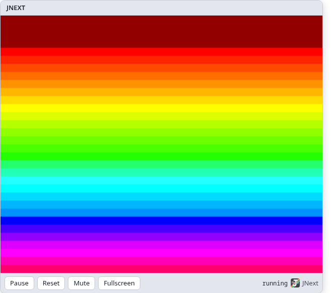
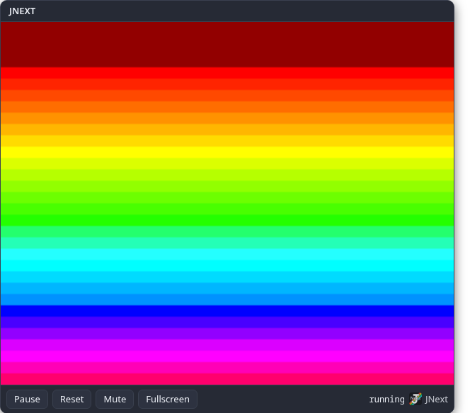

# 8.5 Two ways to embed JNEXT, your own page or the ready-made widget

There are two ways to put a player on a page. Both are in the release's
`jnext-VERSION-web.zip`, both get NextZXOS the same way
([8.4](04-the-image-and-what-the-browser-keeps.md)), and both need a page served over
`https://` or `http://localhost` ([8.1](01-a-page-with-a-game.md)).

| | your own page | the ready-made widget |
|---|---|---|
| how | `jnext.mount()` | one `div` and one script tag |
| choose it when | you want full control of the layout, the controls and the messages | you want a good-looking player with a title bar, a progress bar and a toolbar |
| options | [8.1](01-a-page-with-a-game.md), [8.2](02-options-and-the-player.md) | `data-*` attributes |

## Your own page: `jnext.mount()`

The shortest working page. `jnext-VERSION.js` and `jnext-VERSION.wasm` sit beside it:

```html
<!doctype html>
<div id="player"></div>
<script src="jnext-VERSION.js"></script>
<script>
  jnext.mount(document.getElementById('player'), {
    file: 'game.nex',
    width: 640, height: 512,
    card: { source: 'auto' }   // optional: 'auto' (default), 'fetch', 'pick' or 'none'; dirs: ['/GAMES'] adds more of NextZXOS (8.4)
  });
</script>
```

The visitor clicks the player to start it, and sees just the emulator screen:



Everything else (events, `pause()`, `reset()`, `setVolume()`, loading another program)
is yours to add: see [8.2](02-options-and-the-player.md).

## The ready-made widget

The same player, framed, from one `div` and one script tag. `jnext-widget.js` and
`jnext-VERSION.js` (with its `.wasm`) sit beside the page. The widget loads
`jnext-VERSION.js` itself unless the page has loaded it already:

```html
<!doctype html>
<div class="jnext-widget"
     data-file="game.nex"></div>
<script src="jnext-widget.js"></script>
```



What the widget gives you:

- a rounded frame with a title bar;
- a progress bar while NextZXOS's card is made and the machine starts;
- the usual "click to start" overlay (over the `data-poster` picture when there is one);
- a toolbar: Pause or Resume, Reset, NMI (when the element has `data-nmi`), Mute or Unmute, Fullscreen; on a narrow widget it wraps onto a second line;
- a status line;
- the small "JNext" link at the right end of the toolbar, linked to www.jnext.es; `jnext.mount()` adds it to every player, so your own page gets it too: under the player, or at the end of your own controls with the `creditIn` option.

Every element with the class `jnext-widget` gets a player, so a page can hold several.

## Advanced configuration

### Widget attributes

| attribute | meaning | default |
|---|---|---|
| `data-card-source` | how the page gets NextZXOS's SD card (`card.source`, [8.4](04-the-image-and-what-the-browser-keeps.md)): `auto`, `fetch`, `pick` or `none` | `auto` |
| `data-card-dirs` | more of NextZXOS on the card (`card.dirs`, [8.4](04-the-image-and-what-the-browser-keeps.md)): comma-separated absolute paths, such as `/GAMES,/APPS` | none |
| `data-poster` | a picture shown in the player before the click (`poster`, [8.2](02-options-and-the-player.md)) | none |
| `data-file` | the program to run (`file`) | none: NextZXOS menu |
| `data-width`, `data-height` | the screen size in CSS pixels | 640 and 512 |
| `data-keep-writes` | keep the program's saves across reloads (`keepWrites`); any value but `false`. `el.jnextPlayer.resetCard()` clears them | off |
| `data-touch-keyboard` | the on-screen keyboard (`touchKeyboard`): `auto`, `on` or `off` | `auto`: shown on a phone or tablet |
| `data-card-file` | a NEX on the SD card to run with its directory (`file: {card: ...}`, [8.4](04-the-image-and-what-the-browser-keeps.md#a-program-from-the-card)); `data-card-dirs` must cover its directory. Not together with `data-file`: that is an error in the status line | none |
| `data-nmi` | add an NMI button after Reset (the Multiface NMI, F9: it opens NextZXOS's NMI Menu); it stays disabled with `data-card-source="none"`, which has no Multiface ROM. Any value | off |
| `data-title` | the title bar text | `JNEXT` |
| `data-theme` | `light` or `dark` | the visitor's browser setting |

### The widget in detail

- The player behind it is the element's `jnextPlayer` property, with the members of
  [8.2](02-options-and-the-player.md).
- The labels and the status line follow the player, so they stay right when the page itself
  calls `pause()` or `setVolume()`.
- Fullscreen enlarges the screen to fill the display, between the title bar and the
  toolbar.
- `widget.html` in the zip is the snippet with the program also readable from the query
  string, like `plain.html`.

**The status line** also shows errors:

- a refused option;
- a `data-card-source` of `fetch` that cannot read the file;
- a program that does not load;
- a `jnext-VERSION.js` that cannot be loaded.

While the visitor is asked to choose the NextZXOS file, the status line says so; that is
not an error. A NextZXOS file the visitor chose that is not the official one is refused on
the player's panel ([8.4](04-the-image-and-what-the-browser-keeps.md)), not in the status
line.

### Themes and page styles

The widget has a light and a dark theme:



- Without `data-theme` it follows the visitor's `prefers-color-scheme`.
- `data-theme="light"` or `"dark"` fixes it.
- All of its styles start with `.jnext-widget` and are added to the page once.
- Each part resets its own properties, so the page's own rules for `div`, `button` or
  `canvas` do not change the widget, and the widget changes nothing else on the page.
- The limit: a page rule that is more specific than a class (one with an `id` selector,
  such as `#content div`) or marked `!important` still reaches the widget's parts, and the
  widget does not try to beat it.
